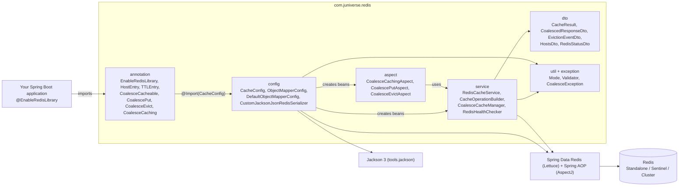
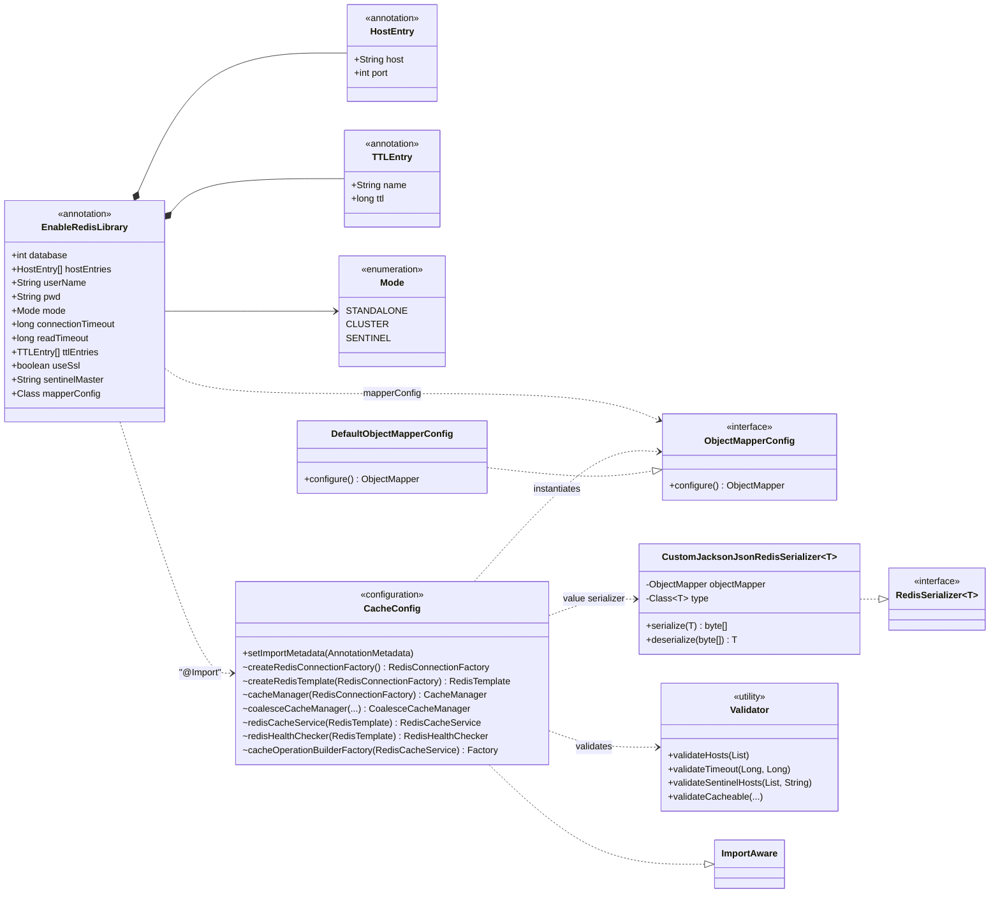
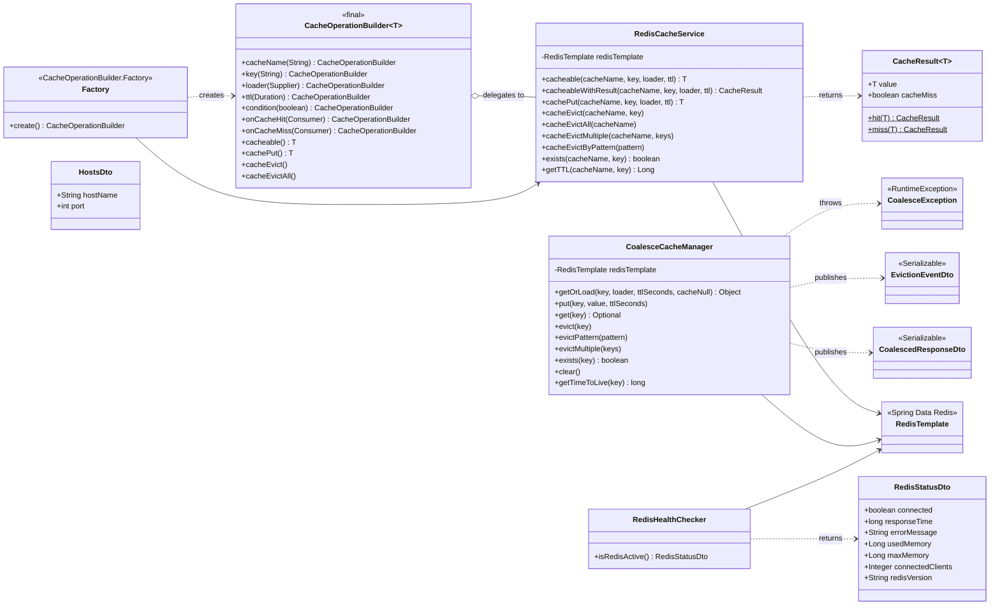
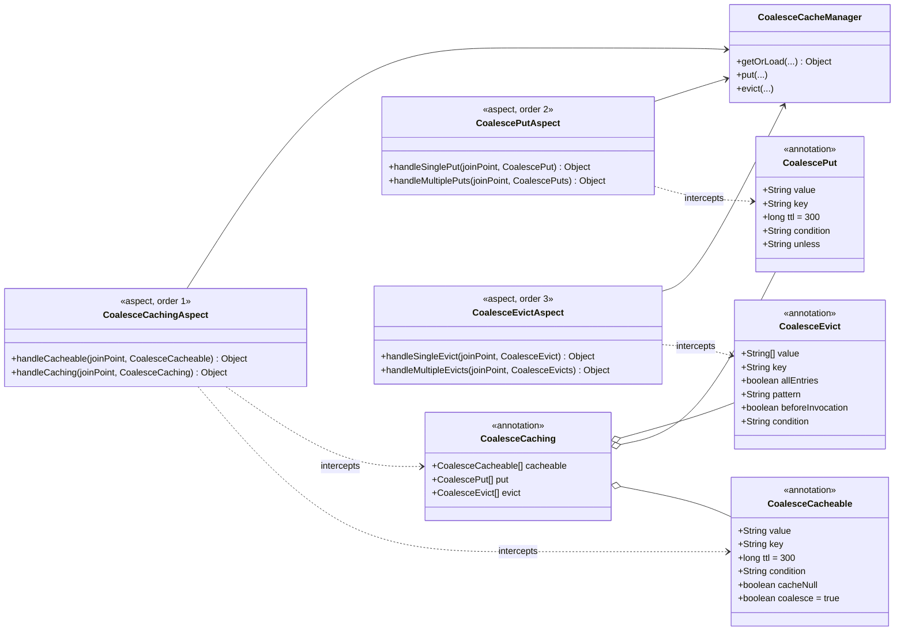
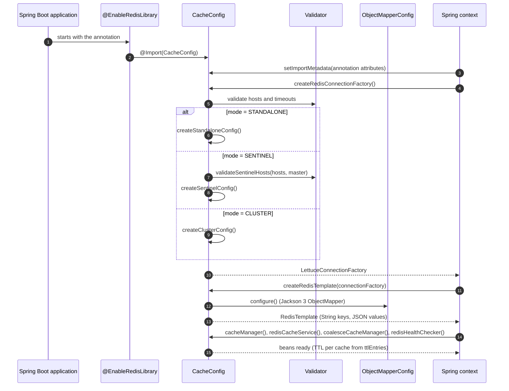
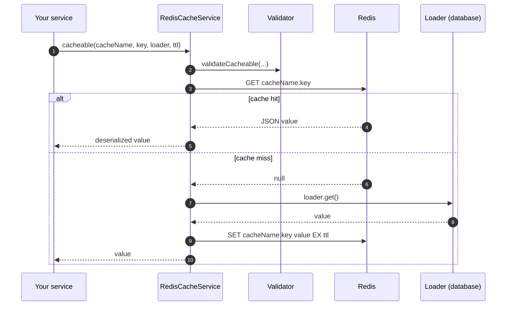
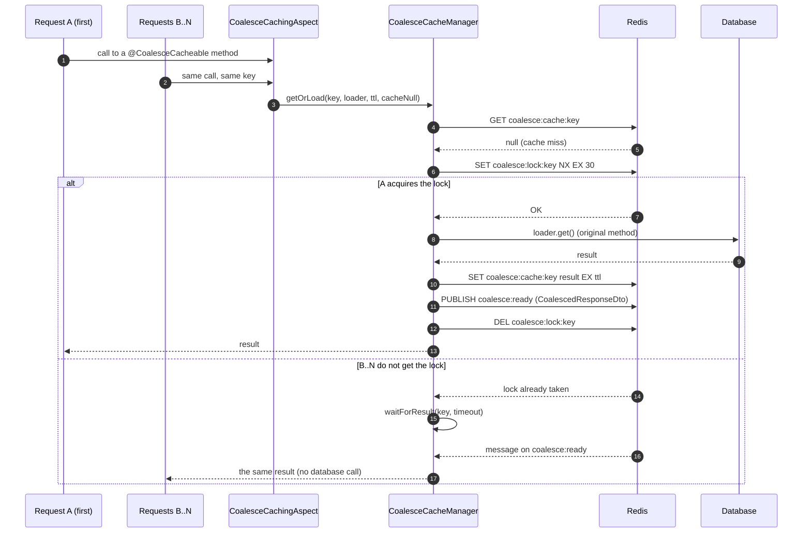
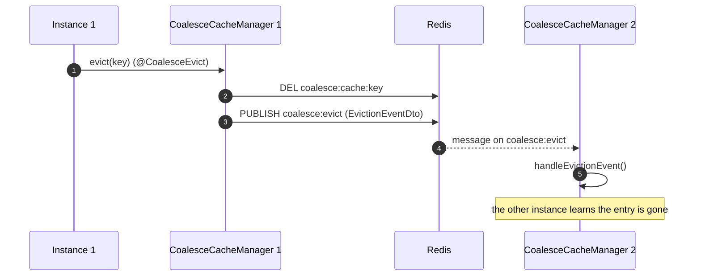
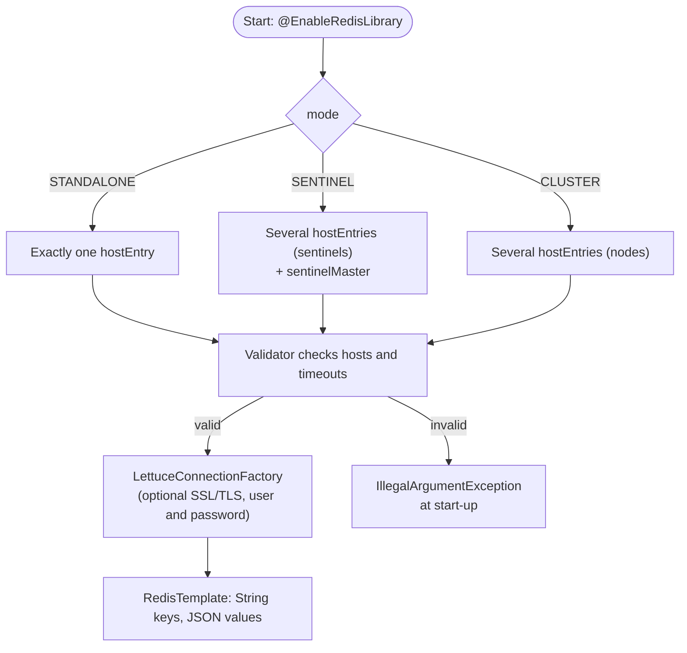

# SBJ-Util-Redis

A powerful and flexible Spring Boot utility library for Redis integration, providing simplified cache operations, health checking, and advanced configuration options.

## Table of Contents

- [Features](#-features)
- [Requirements](#-requirements)
- [Installation](#-installation)
- [Quick Start](#-quick-start)
- [Configuration](#-configuration)
- [Usage](#-usage)
  - [Basic Cache Operations](#basic-cache-operations)
  - [Advanced Cache Operations](#advanced-cache-operations)
  - [Health Checking](#health-checking)
  - [Request Coalescing](#request-coalescing-high-concurrency-caching)
- [Caching Approaches Comparison](#caching-approaches-comparison)
- [Security](#-security)
- [Thread Safety](#-thread-safety)
- [API Reference](#-api-reference)
- [Examples](#-examples)
- [UML Diagrams](#uml-diagrams)
- [Migrating from 1.x to 2.0 (Jackson 3)](#migrating-from-1x-to-20-jackson-3)
- [Troubleshooting](#-troubleshooting)
- [License](#-license)

## Features

- **Simple Integration**: Enable Redis with a single annotation
- **Flexible Configuration**: Support for Standalone, Cluster, and Sentinel modes
- **High Availability**: Redis Sentinel support for automatic failover
- **SSL/TLS Support**: Secure connections with built-in SSL/TLS support
- **Cache Operations**: Programmatic cache operations similar to Spring Cache annotations
- **Builder Pattern**: Fluent API for complex cache operations
- **Health Monitoring**: Built-in Redis health checker with detailed metrics (memory, clients, version)
- **Custom Serialization**: Configurable Jackson 3 `ObjectMapper` for JSON serialization
- **TTL Management**: Per-cache TTL configuration support
- **Robust Validation**: Comprehensive parameter validation with descriptive error messages
- **Error Handling**: Graceful error handling with fallback mechanisms
- **High Test Coverage**: 85%+ code coverage with comprehensive unit tests
- **Request Coalescing**: AOP-based annotations for high-concurrency scenarios with automatic request deduplication

## Requirements

- Java 21 or higher
- Spring Boot 4.0.1 or higher
- Redis Server (Standalone, Sentinel or Cluster)

## Installation

This copy of the library uses the group `com.juniverse.redis`, which is not published on Maven Central, so install it in your local Maven repository first:

```bash
cd sbj-util-redis-lib
mvn install
```

Then add the dependency to your `pom.xml`:

```xml
<dependency>
    <groupId>com.juniverse.redis</groupId>
    <artifactId>sbj-util-redis</artifactId>
    <version>2.0.0</version>
</dependency>
```

## Quick Start

### 1. Enable Redis Library

Add the `@EnableRedisLibrary` annotation to your Spring Boot application:

```java
import com.juniverse.redis.annotation.EnableRedisLibrary;
import com.juniverse.redis.util.Mode;
import org.springframework.boot.SpringApplication;
import org.springframework.boot.autoconfigure.SpringBootApplication;

@SpringBootApplication
@EnableRedisLibrary(
    hostEntries = {
        @HostEntry(host = "localhost", port = 6379)
    },
    mode = Mode.STANDALONE,
    connectionTimeout = 5000,
    readTimeout = 3000
)
public class Application {
    public static void main(String[] args) {
        SpringApplication.run(Application.class, args);
    }
}
```

### 2. Inject and Use

```java
import com.juniverse.redis.service.RedisCacheService;
import org.springframework.beans.factory.annotation.Autowired;
import org.springframework.stereotype.Service;

@Service
public class UserService {
    
    @Autowired
    private RedisCacheService cacheService;
    
    public User getUser(String userId) {
        return cacheService.cacheable(
            "users",
            userId,
            () -> fetchUserFromDatabase(userId),
            Duration.ofMinutes(30)
        );
    }
}
```

## Configuration

### Annotation Parameters

The `@EnableRedisLibrary` annotation supports the following parameters:

| Parameter | Type | Default | Description |
|-----------|------|---------|-------------|
| `hostEntries` | HostEntry[] | `{}` | Redis host(s) configuration using `@HostEntry(host, port)` |
| `userName` | String | `""` | Redis username (optional) |
| `pwd` | String | `""` | Redis password (optional) |
| `mode` | Mode | `STANDALONE` | Connection mode: `STANDALONE`, `CLUSTER`, or `SENTINEL` |
| `sentinelMaster` | String | `""` | Sentinel master name (required when mode is `SENTINEL`) |
| `useSsl` | boolean | `false` | Enable SSL/TLS for secure connections |
| `connectionTimeout` | long | `5000` | Connection timeout in milliseconds (must be > 0) |
| `readTimeout` | long | `3000` | Read timeout in milliseconds (must be > 0) |
| `errorHandler` | Class | `DefaultObjectMapperConfig.class` | Custom ObjectMapper configuration |
| `ttlEntries` | TTLEntry[] | `{}` | Per-cache TTL configurations |

### Standalone Configuration Example

```java
@EnableRedisLibrary(
    hostEntries = {
        @HostEntry(host = "localhost", port = 6379)
    },
    mode = Mode.STANDALONE,
    userName = "myuser",
    pwd = "mypassword"
)
```

### Standalone with SSL/TLS

```java
@EnableRedisLibrary(
    hostEntries = {
        @HostEntry(host = "redis.example.com", port = 6380)
    },
    mode = Mode.STANDALONE,
    userName = "myuser",
    pwd = "mypassword",
    useSsl = true  // Enable SSL/TLS
)
```

### Cluster Configuration Example

```java
@EnableRedisLibrary(
    hostEntries = {
        @HostEntry(host = "redis-node1", port = 6379),
        @HostEntry(host = "redis-node2", port = 6379),
        @HostEntry(host = "redis-node3", port = 6379)
    },
    mode = Mode.CLUSTER,
    userName = "myuser",
    pwd = "mypassword"
)
```

### Sentinel Configuration Example

```java
@EnableRedisLibrary(
    hostEntries = {
        @HostEntry(host = "sentinel1", port = 26379),
        @HostEntry(host = "sentinel2", port = 26379),
        @HostEntry(host = "sentinel3", port = 26379)
    },
    mode = Mode.SENTINEL,
    sentinelMaster = "mymaster",  // Required: name of the master instance
    userName = "myuser",
    pwd = "mypassword"
)
```

**Notes:**
- Redis Sentinel provides high availability through automatic failover
- Sentinel nodes monitor the master and replica instances
- The `sentinelMaster` parameter is **required** when using SENTINEL mode
- Common master names: "mymaster", "redis-master" (configured in sentinel.conf)

### Choosing the Right Mode

| Mode | Use Case | Pros | Cons |
|------|----------|------|------|
| **STANDALONE** | Development, testing, small apps | Simple setup, low overhead | No HA, single point of failure |
| **CLUSTER** | Large-scale applications, big datasets | Horizontal scaling, data partitioning | Complex setup, overhead |
| **SENTINEL** | Production apps needing HA | Automatic failover, monitoring | Requires sentinel nodes |

**Recommendations:**
- **Development/Testing**: Use STANDALONE
- **Production (Small/Medium)**: Use SENTINEL for high availability
- **Production (Large Scale)**: Use CLUSTER for horizontal scaling
- **Production (Critical)**: Consider CLUSTER + SENTINEL for both scaling and HA

### Custom TTL Configuration

```java
@EnableRedisLibrary(
    hostEntries = {
        @HostEntry(host = "localhost", port = 6379)
    },
    ttlEntries = {
        @TTLEntry(name = "users", ttl = 30),      // 30 minutes
        @TTLEntry(name = "products", ttl = 60),   // 1 hour
        @TTLEntry(name = "sessions", ttl = 120)    // 2 hours
    }
)
```

**Note:** `@TTLEntry` configurations only apply to Spring's **`@Cacheable` annotation**. For programmatic cache operations using `RedisCacheService` (such as `cacheable()`, `cachePut()`, etc.), you must explicitly specify the TTL as a parameter in the method call.

### Custom ObjectMapper Configuration

Create a custom configuration class:

```java
import com.juniverse.redis.config.ObjectMapperConfig;
import tools.jackson.databind.ObjectMapper;
import tools.jackson.databind.json.JsonMapper;
import tools.jackson.databind.cfg.DateTimeFeature;

public class CustomObjectMapperConfig implements ObjectMapperConfig {

    @Override
    public ObjectMapper configure() {
        // Jackson 3 mappers are immutable: everything is set on the builder.
        // java.time and Optional are supported out of the box (no modules to register).
        return JsonMapper.builder()
                .disable(DateTimeFeature.WRITE_DATES_AS_TIMESTAMPS)
                // Add your custom configuration
                .build();
    }
}
```

> The mapper must write and read the type information (`@class`) the library relies on to rebuild your objects; start from `DefaultObjectMapperConfig` if you are unsure.

Then reference it in the annotation:

```java
@EnableRedisLibrary(
    hostEntries = {
        @HostEntry(host = "localhost", port = 6379)
    },
    mapperConfig = CustomObjectMapperConfig.class
)
```

## Usage

### Basic Cache Operations

#### RedisCacheService

The `RedisCacheService` provides programmatic equivalents to Spring Cache annotations:

##### Cacheable (Similar to @Cacheable)

```java
@Autowired
private RedisCacheService cacheService;

// With custom TTL
public Product getProduct(String productId) {
    return cacheService.cacheable(
        "products",
        productId,
        () -> productRepository.findById(productId),
        Duration.ofHours(1)
    );
}

// With default TTL (10 minutes)
public Product getProduct(String productId) {
    return cacheService.cacheable(
        "products",
        productId,
        () -> productRepository.findById(productId)
    );
}
```

##### Cache Put (Similar to @CachePut)

```java
public Product updateProduct(String productId, Product product) {
    return cacheService.cachePut(
        "products",
        productId,
        () -> productRepository.save(product),
        Duration.ofHours(1)
    );
}
```

##### Cache Evict (Similar to @CacheEvict)

```java
// Evict single entry
public void deleteProduct(String productId) {
    productRepository.deleteById(productId);
    cacheService.cacheEvict("products", productId);
}

// Evict all entries in a cache
public void clearProductCache() {
    cacheService.cacheEvictAll("products");
}

// Evict multiple specific keys
public void deleteProducts(String... productIds) {
    cacheService.cacheEvictMultiple("products", productIds);
}

// Evict by pattern
public void evictUserSessions() {
    cacheService.cacheEvictByPattern("sessions:user:*");
}
```

##### Utility Methods

```java
// Check if key exists
boolean exists = cacheService.exists("products", "product-123");

// Get remaining TTL (in seconds)
Long ttl = cacheService.getTTL("products", "product-123");
```

### Advanced Cache Operations

#### CacheOperationBuilder

For more complex scenarios, use the fluent builder API:

```java
@Autowired
private CacheOperationBuilder<User> cacheBuilder;

public User getUser(String userId, boolean forceRefresh) {
    return cacheBuilder
        .cacheName("users")
        .key(userId)
        .loader(() -> userRepository.findById(userId))
        .ttl(Duration.ofMinutes(30))
        .condition(!forceRefresh)  // Skip cache if forceRefresh is true
        .onCacheHit(user -> log.info("Cache hit for user: {}", userId))
        .onCacheMiss(user -> log.info("Cache miss for user: {}", userId))
        .cacheable();
}
```

Builder Methods:

- `cacheName(String)`: Set the cache name
- `key(String)`: Set the cache key
- `loader(Supplier<T>)`: Set the data loader function
- `ttl(Duration)`: Set the TTL duration
- `condition(boolean)`: Conditional caching
- `onCacheHit(Consumer<T>)`: Callback on cache hit
- `onCacheMiss(Consumer<T>)`: Callback on cache miss
- `cacheable()`: Execute as cacheable operation
- `cachePut()`: Execute as cache put operation
- `cacheEvict()`: Execute as cache evict operation
- `cacheEvictAll()`: Execute as cache evict all operation (removes all entries for the cache name)

### Health Checking

Monitor Redis connection health with detailed metrics:

```java
@Autowired
private RedisHealthChecker healthChecker;

@GetMapping("/health/redis")
public RedisStatusDto checkRedisHealth() {
    return healthChecker.isRedisActive();
}
```

Response structure:

```json
{
  "connected": true,
  "responseTime": 15,
  "errorMessage": "Redis is up and running and responding correctly",
  "usedMemory": 1048576,
  "maxMemory": 2097152,
  "connectedClients": 5,
  "redisVersion": "7.0.0"
}
```

The health checker provides comprehensive metrics including:
- **connected**: Connection status (true/false)
- **responseTime**: Response time in milliseconds
- **errorMessage**: Status or error message
- **usedMemory**: Current memory usage in bytes
- **maxMemory**: Maximum memory limit in bytes
- **connectedClients**: Number of connected clients
- **redisVersion**: Redis server version

### Request Coalescing (High-Concurrency Caching)

For high-concurrency scenarios where multiple threads may request the same data simultaneously, use the coalesce annotations:

#### @CoalesceCacheable

```java
@Service
public class UserService {

    @CoalesceCacheable(
        value = "users",           // Cache name/prefix
        key = "#userId",           // SpEL expression for dynamic key
        ttl = 300,                 // TTL in seconds (5 minutes)
        condition = "#userId != null",  // SpEL condition for caching
        cacheNull = false,         // Whether to cache null results
        coalesce = true            // Enable request coalescing
    )
    public User getUserById(String userId) {
        return userRepository.findById(userId);
    }
}
```

#### @CoalescePut

```java
@CoalescePut(value = "users", key = "#user.id", ttl = 300)
public User updateUser(User user) {
    return userRepository.save(user);
}
```

#### @CoalesceEvict

```java
@CoalesceEvict(value = "users", key = "#userId")
public void deleteUser(String userId) {
    userRepository.deleteById(userId);
}

// Evict all entries in the cache
@CoalesceEvict(value = "users", allEntries = true)
public void clearAllUsers() {
    // This will evict all entries with the "users" prefix
}
```

#### @CoalesceCaching (Multiple Operations)

```java
@CoalesceCaching(
    cacheable = @CoalesceCacheable(value = "users", key = "#userId"),
    evict = @CoalesceEvict(value = "userSessions", key = "#userId")
)
public User refreshUser(String userId) {
    return userRepository.findById(userId);
}
```

**Key Features:**
- **Request Coalescing**: Multiple concurrent requests for the same key are coalesced, executing the underlying method only once
- **SpEL Support**: Dynamic key generation using Spring Expression Language
- **Distributed Eviction**: Cache eviction events are published via Redis pub/sub to notify all application instances
- **Separate Cache Namespace**: Uses `coalesce:cache:` prefix to avoid conflicts with standard caching

**When to Use Coalesce Annotations:**
- Methods with expensive operations (database queries, external API calls)
- High-concurrency scenarios where multiple threads may request the same data simultaneously
- Need for SpEL-based dynamic key generation
- Distributed applications requiring cache eviction synchronization across instances

## Caching Approaches Comparison

The library provides **three different caching approaches** - choose based on your use case:

| Approach | Use Case | Features | Thread Safety |
|----------|----------|----------|---------------|
| **RedisCacheService** | Programmatic caching with full control | Direct API calls, custom TTL, eviction patterns, callback support via builder | Thread-safe singleton |
| **Spring @Cacheable** | Standard Spring declarative caching | Standard Spring Cache abstraction, TTL via `@TTLEntry`, works with any cache provider | Thread-safe |
| **@CoalesceCacheable** | High-concurrency scenarios with request coalescing | SpEL-based keys, request coalescing, distributed eviction via pub/sub, conditional caching | Thread-safe |

**Decision Matrix:**
- **Need programmatic control or callbacks?** Use `RedisCacheService` or `CacheOperationBuilder`
- **Standard Spring caching with minimal configuration?** Use `@Cacheable` with `@TTLEntry`
- **High concurrency + expensive operations + need SpEL?** Use `@CoalesceCacheable`
- **Distributed eviction across instances?** Use `@CoalesceEvict` (publishes to Redis pub/sub)
- **Dynamic conditional caching at runtime?** Use `CacheOperationBuilder.condition()` or `@CoalesceCacheable(condition=...)`

**Cache Key Namespaces:**
- `RedisCacheService`: `{cacheName}:{key}`
- Spring `@Cacheable`: Configured via `RedisCacheManager` (default: `{cacheName}::{key}`)
- `@CoalesceCacheable`: `coalesce:cache:{value}:{key}`

## Security

### SSL/TLS Encryption

Enable secure connections to Redis using SSL/TLS:

```java
@EnableRedisLibrary(
    hostEntries = {
        @HostEntry(host = "secure-redis.example.com", port = 6380)
    },
    useSsl = true,
    userName = "${redis.username}",  // Use environment variables
    pwd = "${redis.password}"
)
```

**Best Practices:**
- Always use SSL/TLS for production environments
- Store credentials in environment variables or secure vaults
- Never hardcode passwords in source code
- Use strong authentication credentials
- Configure appropriate timeout values to prevent blocking

### Parameter Validation

The library includes comprehensive validation for all inputs:

**Connection Parameters:**
- Host names cannot be empty
- Ports must be between 1 and 65535
- Connection timeout must be > 0
- Read timeout must be > 0

**Cache Parameters:**
- Cache names cannot contain `:` or `*` characters
- Keys cannot contain `*` character
- TTL must be positive (> 0)
- All required parameters are validated for null values

**Example Validation Errors:**
```java
// Invalid - will throw IllegalArgumentException
cacheService.cacheable("test:cache", "key", loader, ttl);
// Error: cacheName cannot contain ':' or '*' characters

// Invalid - will throw IllegalArgumentException
cacheService.cacheable("cache", "key*", loader, ttl);
// Error: key cannot contain '*' character

// Invalid - will throw IllegalArgumentException
cacheService.cacheable("cache", "key", loader, Duration.ZERO);
// Error: ttl must be positive

// Valid
cacheService.cacheable("cache", "key", loader, Duration.ofMinutes(10));
```

### Error Handling

The library implements graceful error handling:

- **Cache Fallback**: On Redis errors, `cacheable()` returns the loader result
- **Non-Blocking Errors**: Evict operations don't throw exceptions on failure
- **Detailed Logging**: All errors are logged with context information
- **Health Checks**: Use `RedisHealthChecker` to monitor connectivity

## Thread Safety

### Fully Thread-Safe Design

All components are designed for **safe concurrent access** in multi-threaded environments:

| Component | Thread Safety | Scope | Notes |
|-----------|-------------|-------|-------|
| `RedisCacheService` | Thread-Safe | Singleton | Immutable state, safe for concurrent use |
| `RedisHealthChecker` | Thread-Safe | Singleton | Immutable state, safe for concurrent use |
| `CacheOperationBuilder.Factory` | Thread-Safe | Singleton | Factory creates new builders safely |
| `CacheOperationBuilder` | Not Thread-Safe | Per-operation | Use factory.create() each time |
| `RedisTemplate` | Thread-Safe | Singleton | Spring managed, connection pooled |

### CacheOperationBuilder - Factory Pattern

**Important:** The `CacheOperationBuilder` itself is NOT thread-safe and should not be shared across threads. Always create a new instance for each operation using the factory.

**Correct Usage:**
```java
@Service
public class UserService {
    @Autowired
    private CacheOperationBuilder.Factory builderFactory;

    public User getUser(String userId) {
        // Create a NEW builder for each operation
        return builderFactory.create()
            .cacheName("users")
            .key(userId)
            .loader(() -> userRepository.findById(userId))
            .ttl(Duration.ofMinutes(30))
            .cacheable();
    }
}
```

**Incorrect Usage:**
```java
@Service
public class UserService {
    @Autowired
    private CacheOperationBuilder.Factory builderFactory;

    // DON'T DO THIS - Reusing builders causes race conditions!
    private CacheOperationBuilder<User> reusedBuilder;

    @PostConstruct
    public void init() {
        this.reusedBuilder = builderFactory.create();
    }

    public User getUser(String userId) {
        // UNSAFE - Multiple threads will share the same builder
        return reusedBuilder
            .cacheName("users")
            .key(userId)
            .loader(() -> userRepository.findById(userId))
            .cacheable();
    }
}
```

**Key Points:**
- Factory is thread-safe and can be injected as singleton
- Call `factory.create()` for each cache operation
- Each builder instance is isolated and independent
- Never store and reuse builder instances across requests

### Why This Design Is Thread-Safe

1. **Factory Pattern**: Creates new builder instances on demand
2. **Immutable Services**: All singleton services use `final` fields
3. **Constructor Injection**: Ensures safe publication (Java Memory Model)
4. **Connection Pooling**: RedisTemplate manages thread-safe connections
5. **No Shared State**: Each builder operates independently

## API Reference

### RedisCacheService

| Method | Parameters | Return Type | Description |
|--------|-----------|-------------|-------------|
| `cacheable` | `cacheName, key, loader, ttl` | `T` | Get from cache or execute loader |
| `cacheable` | `cacheName, key, loader` | `T` | Get from cache with default TTL |
| `cachePut` | `cacheName, key, loader, ttl` | `T` | Update cache entry |
| `cachePut` | `cacheName, key, loader` | `T` | Update cache with default TTL |
| `cacheEvict` | `cacheName, key` | `void` | Remove single cache entry |
| `cacheEvictAll` | `cacheName` | `void` | Remove all entries in cache |
| `cacheEvictMultiple` | `cacheName, keys...` | `void` | Remove multiple entries |
| `cacheEvictByPattern` | `pattern` | `void` | Remove entries matching pattern |
| `exists` | `cacheName, key` | `boolean` | Check if key exists |
| `getTTL` | `cacheName, key` | `Long` | Get remaining TTL in seconds |

### RedisHealthChecker

| Method | Parameters | Return Type | Description |
|--------|-----------|-------------|-------------|
| `isRedisActive` | - | `RedisStatusDto` | Check Redis connection status |

### RedisStatusDto

| Field | Type | Description |
|-------|------|-------------|
| `connected` | boolean | Connection status |
| `responseTime` | long | Response time in milliseconds |
| `errorMessage` | String | Status or error message |
| `usedMemory` | long | Current memory usage in bytes |
| `maxMemory` | long | Maximum memory limit in bytes |
| `connectedClients` | int | Number of connected clients |
| `redisVersion` | String | Redis server version |

## Examples

### Example 1: E-commerce Product Cache

```java
@Service
public class ProductService {
    
    @Autowired
    private RedisCacheService cacheService;
    
    @Autowired
    private ProductRepository productRepository;
    
    public Product getProduct(String productId) {
        return cacheService.cacheable(
            "products",
            productId,
            () -> productRepository.findById(productId)
                .orElseThrow(() -> new ProductNotFoundException(productId)),
            Duration.ofHours(2)
        );
    }
    
    public Product updateProduct(String productId, Product product) {
        Product updated = productRepository.save(product);
        return cacheService.cachePut(
            "products",
            productId,
            () -> updated,
            Duration.ofHours(2)
        );
    }
    
    public void deleteProduct(String productId) {
        productRepository.deleteById(productId);
        cacheService.cacheEvict("products", productId);
    }
    
    public void refreshAllProducts() {
        cacheService.cacheEvictAll("products");
    }
}
```

### Example 2: User Session Management

```java
@Service
public class SessionService {
    
    @Autowired
    private CacheOperationBuilder<UserSession> sessionBuilder;
    
    public UserSession getSession(String sessionId) {
        return sessionBuilder
            .cacheName("sessions")
            .key(sessionId)
            .loader(() -> createNewSession(sessionId))
            .ttl(Duration.ofMinutes(30))
            .onCacheHit(session -> updateLastAccess(session))
            .cacheable();
    }
    
    public void invalidateSession(String sessionId) {
        sessionBuilder
            .cacheName("sessions")
            .key(sessionId)
            .cacheEvict();
    }
}
```

### Example 3: Conditional Caching

```java
@Service
public class ReportService {
    
    @Autowired
    private CacheOperationBuilder<Report> reportBuilder;
    
    public Report getReport(String reportId, boolean realtime) {
        return reportBuilder
            .cacheName("reports")
            .key(reportId)
            .loader(() -> generateReport(reportId))
            .ttl(Duration.ofMinutes(15))
            .condition(!realtime)  // Only cache if not realtime
            .onCacheMiss(report -> log.info("Generated new report: {}", reportId))
            .cacheable();
    }
}
```

### Example 4: Health Check Endpoint

```java
@RestController
@RequestMapping("/api/health")
public class HealthController {
    
    @Autowired
    private RedisHealthChecker healthChecker;
    
    @GetMapping("/redis")
    public ResponseEntity<RedisStatusDto> checkRedis() {
        RedisStatusDto status = healthChecker.isRedisActive();
        
        if (status.isConnected()) {
            return ResponseEntity.ok(status);
        } else {
            return ResponseEntity.status(HttpStatus.SERVICE_UNAVAILABLE)
                .body(status);
        }
    }
}
```

## Architecture

### Key Components

- **@EnableRedisLibrary**: Main annotation to enable the library
- **CacheConfig**: Auto-configuration class for Redis setup
- **RedisCacheService**: Core service for cache operations
- **CacheOperationBuilder**: Fluent API for advanced operations
- **RedisHealthChecker**: Health monitoring service
- **ObjectMapperConfig**: Interface for custom JSON serialization
- **CoalesceCacheManager**: Dedicated cache manager for request coalescing with pub/sub support
- **@CoalesceCacheable/@CoalescePut/@CoalesceEvict**: AOP annotations for high-concurrency caching

### Connection Modes

- **STANDALONE**: Single Redis instance (for development and small-scale deployments)
- **CLUSTER**: Redis Cluster with multiple nodes (for horizontal scaling and partitioning)
- **SENTINEL**: Redis Sentinel with automatic failover (for high availability)

### Serialization

The library uses **Jackson 3** (`tools.jackson`, the version that ships with Spring Boot 4) for JSON serialization, through `CustomJacksonJsonRedisSerializer`, with the following default configuration (`DefaultObjectMapperConfig`):

- Java 8 date/time and `Optional` support (built into Jackson 3, no modules to register)
- Dates written as ISO-8601 text, not as timestamps
- Field-based visibility
- Polymorphic type information (`@class`) so objects are rebuilt with their original class
- Ignores unknown properties
- Handles empty beans gracefully

Jackson annotations (`@JsonFormat`, `@JsonIgnore`, ...) are still the `com.fasterxml.jackson.annotation` ones: Jackson 3 keeps using the 2.x annotations package.

## UML Diagrams

The diagrams are written in [Mermaid](https://mermaid.js.org/), which GitHub renders directly in the browser.

### 1. Packages and dependencies



### 2. Class diagram: configuration and annotations



### 3. Class diagram: services and data



### 4. Class diagram: AOP annotations and aspects



### 5. Sequence: application start-up



### 6. Sequence: `RedisCacheService.cacheable`



### 7. Sequence: request coalescing (`@CoalesceCacheable`)

Ten concurrent requests for the same key produce **one** call to the database: the first request takes a lock, the rest wait for its result through Redis pub/sub.



### 8. Sequence: eviction across instances



### 9. Choosing the connection mode




## Migrating from 1.x to 2.0 (Jackson 3)

Version 2.0.0 moves the library from Jackson 2 to **Jackson 3**, the default in Spring Boot 4. It is a breaking release:

| 1.x (Jackson 2) | 2.0 (Jackson 3) |
|---|---|
| `com.fasterxml.jackson.databind.ObjectMapper` | `tools.jackson.databind.ObjectMapper` (build it with `JsonMapper.builder()`; it is immutable) |
| `ObjectMapperConfig.configure()` returned a Jackson 2 `ObjectMapper` | it returns a Jackson 3 `ObjectMapper` |
| `JavaTimeModule` and `Jdk8Module` (`jackson-datatype-jsr310` / `-jdk8`) | built into Jackson 3: remove those two dependencies |
| `SerializationFeature.WRITE_DATES_AS_TIMESTAMPS` | `DateTimeFeature.WRITE_DATES_AS_TIMESTAMPS` |
| `DeserializationFeature.READ_ENUMS_USING_TO_STRING`, `SerializationFeature.WRITE_ENUMS_USING_TO_STRING` | `EnumFeature.READ_ENUMS_USING_TO_STRING`, `EnumFeature.WRITE_ENUMS_USING_TO_STRING` |
| `CustomJackson2JsonRedisSerializer` | `CustomJacksonJsonRedisSerializer` |
| `JsonProcessingException` / `IOException` (checked) | `tools.jackson.core.JacksonException` (unchecked) |
| `spring-boot-starter-aop` (Spring Boot 3 artifact) | `spring-boot-starter-aspectj` |

The JSON stored in Redis keeps the same shape (`@class` plus the fields). Cached values are temporary by nature, so if you have doubts when upgrading, flush the library's caches once.

## Troubleshooting

### Common Issues

**Connection Timeout**
```
Increase connectionTimeout and readTimeout values in @EnableRedisLibrary
```

**Serialization Errors**
```
Implement a custom ObjectMapperConfig (Jackson 3, tools.jackson) to handle specific types
```

**Cache Not Working**
```
Verify Redis is running and accessible
Check health endpoint: /api/health/redis
Review logs for connection errors
```

## License

This project is licensed under the Apache License, Version 2.0.

```
Copyright 2025 AJuarez

Licensed under the Apache License, Version 2.0 (the "License");
you may not use this file except in compliance with the License.
You may obtain a copy of the License at

    http://www.apache.org/licenses/LICENSE-2.0

Unless required by applicable law or agreed to in writing, software
distributed under the License is distributed on an "AS IS" BASIS,
WITHOUT WARRANTIES OR CONDITIONS OF ANY KIND, either express or implied.
See the License for the specific language governing permissions and
limitations under the License.
```

## Author

**AJuarez** (ajuarez0021)
- Email: programacion0025@gmail.com
- GitHub: [@ajuarez0021](https://github.com/ajuarez0021)

## Contributing

Contributions, issues, and feature requests are welcome!

## Project Stats

- **Test Coverage**: 85%+ code coverage
- **Total Tests**: 260+ unit tests
- **Build Status**: All tests passing
- **Thread Safety**: Fully verified
- **Supported Modes**: Standalone, Cluster, Sentinel
- **Java Version**: 21
- **Spring Boot**: 4.0.1

---

For more information, issues, or contributions, please visit the project repository.
