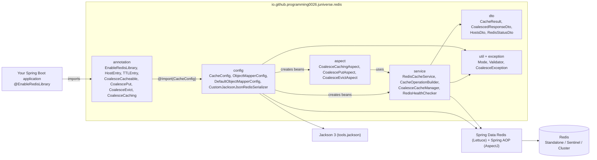
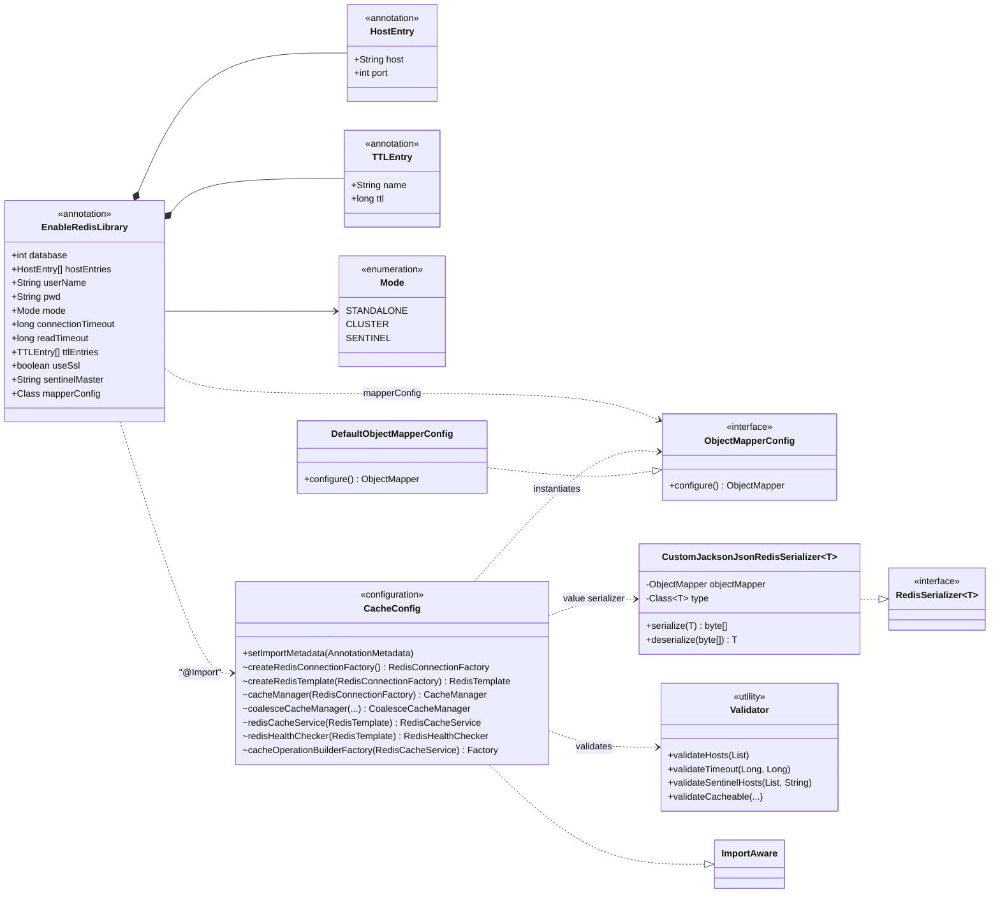
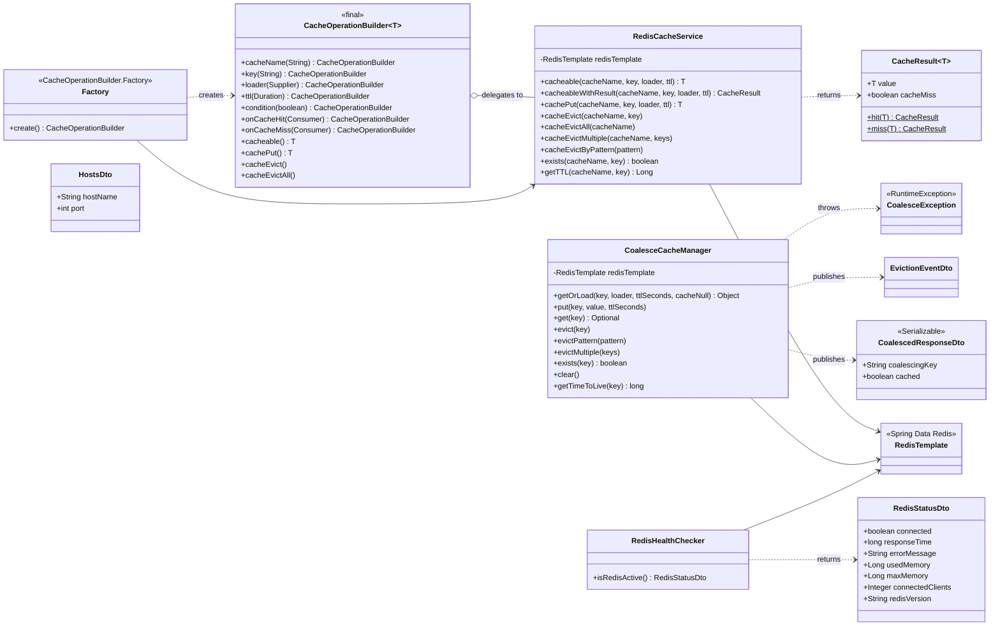
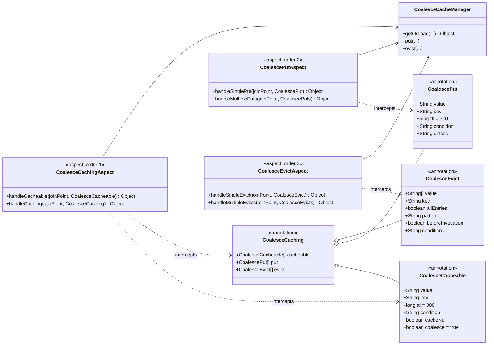
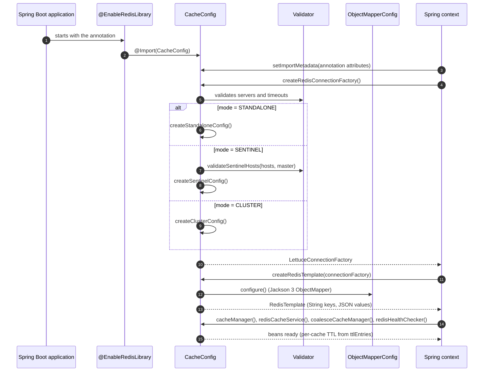
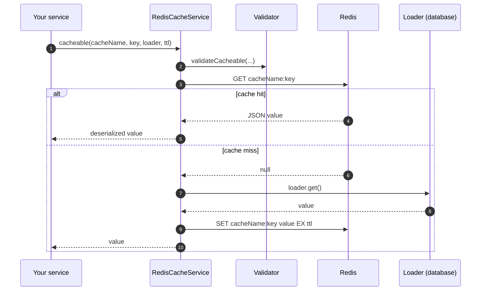
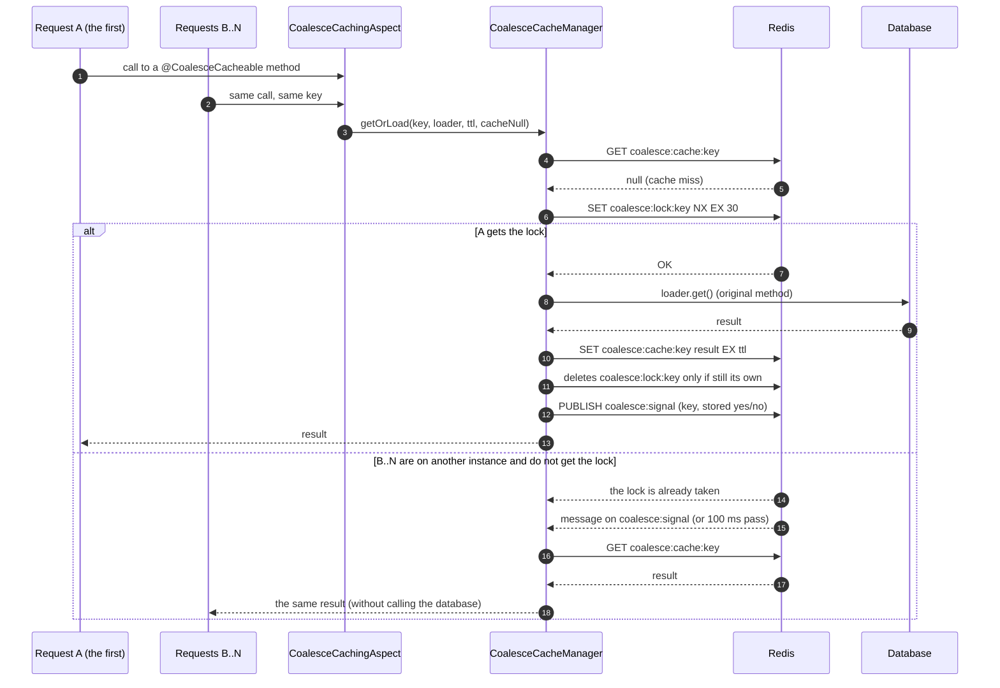
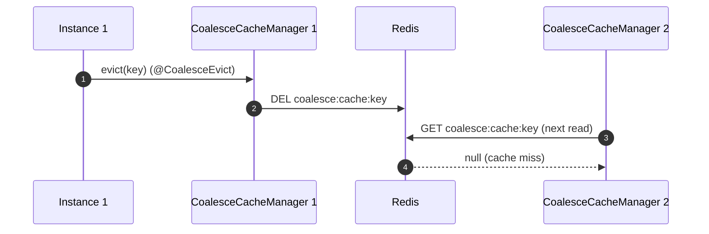
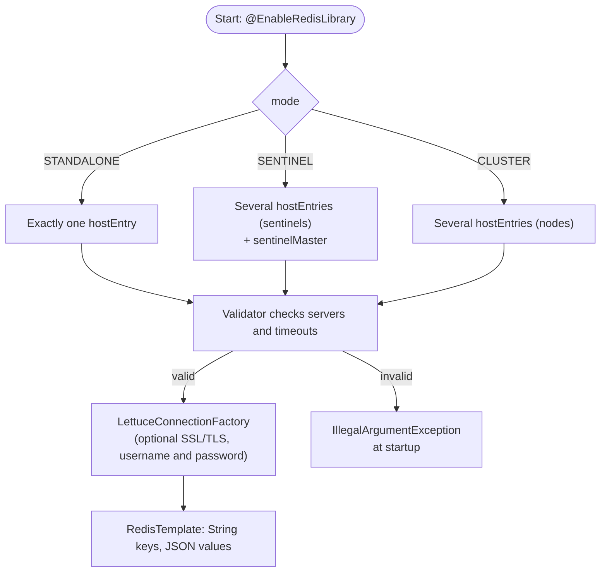

# SBJ-Util-Redis

A powerful and flexible utility library for Spring Boot that simplifies Redis integration: cache operations, health checks and advanced configuration options.

> Versión en español: [README.md](README.md)

## Table of contents

- [Features](#features)
- [Requirements](#requirements)
- [Installation](#installation)
- [Quick start](#quick-start)
- [Configuration](#configuration)
- [Usage](#usage)
  - [Basic cache operations](#basic-cache-operations)
  - [Advanced cache operations](#advanced-cache-operations)
  - [Health check](#health-check)
  - [Request coalescing](#request-coalescing-high-concurrency-caching)
- [Comparison of caching approaches](#comparison-of-caching-approaches)
- [Security](#security)
- [Observability](#observability)
- [Thread safety](#thread-safety)
- [API reference](#api-reference)
- [Examples](#examples)
- [UML diagrams](#uml-diagrams)
- [Migrating from 1.x to 2.0 (Jackson 3)](#migrating-from-1x-to-20-jackson-3)
- [Migrating from 2.x to 3.0](#migrating-from-2x-to-30)
- [Troubleshooting](#troubleshooting)
- [Testing](#testing)
- [License](#license)

## Features

- **Simple integration**: enable Redis with a single annotation
- **Flexible configuration**: supports Standalone, Cluster and Sentinel modes
- **High availability**: Redis Sentinel support for automatic failover
- **SSL/TLS support**: secure connections with built-in SSL/TLS
- **Cache operations**: programmatic operations equivalent to the Spring Cache annotations
- **Builder pattern**: fluent API for complex cache operations
- **Health monitoring**: Redis checker with detailed metrics (memory, clients, version)
- **Custom serialization**: configurable Jackson 3 `ObjectMapper` for JSON serialization
- **TTL management**: per-cache TTL configuration
- **Robust validation**: thorough parameter validation with descriptive error messages
- **Error handling**: graceful error handling with fallback mechanisms
- **High test coverage**: over 85% coverage with comprehensive unit tests
- **Request coalescing**: AOP-based annotations for high-concurrency scenarios with automatic request deduplication

## Requirements

- Java 21 or later
- Spring Boot 4.1.2 or later
- Redis 4 or later (deletes use `UNLINK`)
- A Redis server (Standalone, Sentinel or Cluster)

## Installation

This copy of the library is published with the coordinates `io.github.programming0026:sbj-util-redis-annotation`. To use the version in this repository, first install it into your local Maven repository:

```bash
cd sbj-util-redis
mvn install
```

Then add the dependency to your `pom.xml`:

```xml
<dependency>
    <groupId>io.github.programming0026</groupId>
    <artifactId>sbj-util-redis-annotation</artifactId>
    <version>3.0.0</version>
</dependency>
```

## Quick start

### 1. Enable the Redis library

Add the `@EnableRedisLibrary` annotation to your Spring Boot application:

```java
import io.github.programming0026.juniverse.redis.annotation.EnableRedisLibrary;
import io.github.programming0026.juniverse.redis.enums.Mode;
import org.springframework.boot.SpringApplication;
import org.springframework.boot.autoconfigure.SpringBootApplication;

@SpringBootApplication
@EnableRedisLibrary(
		hostEntries = {
				@HostEntry(host = "localhost", port = 6379)
		},
		mode = Mode.STANDALONE,
		connectionTimeout = 5000,
		readTimeout = 1000
)
public class Application {
	public static void main(String[] args) {
		SpringApplication.run(Application.class, args);
	}
}
```

### 2. Inject and use

```java
import io.github.programming0026.juniverse.redis.service.RedisCacheService;
import org.springframework.beans.factory.annotation.Autowired;
import org.springframework.stereotype.Service;

@Service
public class UserService {

	@Autowired
	private RedisCacheService cacheService;

	public User getUser(String userId) {
		return cacheService.cacheable(
				"users",
				userId,
				() -> fetchUserFromDatabase(userId),
				Duration.ofMinutes(30)
		);
	}
}
```

## Configuration

### Annotation parameters

The `@EnableRedisLibrary` annotation supports the following parameters:

| Parameter | Type | Default | Description |
|-----------|------|---------|-------------|
| `hostEntries` | HostEntry[] | `{}` | Redis servers, with `@HostEntry(host, port)`. `host` accepts placeholders and can also carry the port: `@HostEntry(host = "${redis.host}:${redis.port}")` |
| `userName` | String | `""` | Username for the data nodes (optional). In `SENTINEL` mode it is the one for the master and replicas |
| `pwd` | String | `""` | Password for the data nodes (optional). In `SENTINEL` mode it is the one for the master and replicas |
| `sentinelUserName` | String | `""` | Username for the sentinels (optional, `SENTINEL` mode only) |
| `sentinelPwd` | String | `""` | Password for the sentinels (optional, `SENTINEL` mode only) |
| `mode` | Mode | `STANDALONE` | Connection mode: `STANDALONE`, `CLUSTER` or `SENTINEL` |
| `sentinelMaster` | String | `""` | Sentinel master name (required with `SENTINEL` mode) |
| `useSsl` | boolean | `false` | Enables SSL/TLS for secure connections |
| `failOpen` | boolean | `true` | If Redis fails, all three caching styles (`@Coalesce*`, `RedisCacheService` and `@Cacheable`) run the method as if there were no cache, and the application starts even when Redis is unavailable. With `false`, the failure is propagated |
| `failurePause` | long | `5000` | Milliseconds during which Redis is no longer used after a connection failure. When it ends, a single request tries it again. `0` disables it |
| `coalesceLockTimeout` | long | `30000` | Duration of the lock of a coalesced load. The loader renews it while it works; it is how long it takes to detect that the loading instance died |
| `coalesceWaitTimeout` | long | `30000` | Maximum milliseconds a request waits for the result another one is loading before failing with `CoalesceException`. It must exceed the maximum duration of the `@CoalesceCacheable` methods |
| `connectionTimeout` | long | `5000` | Maximum time to establish the connection, in milliseconds (must be > 0) |
| `readTimeout` | long | `1000` | Maximum time to wait for the response of each command, in milliseconds (must be > 0). It is how long it takes to detect that Redis is not answering (see "What happens if Redis fails") |
| `mapperConfig` | Class | `DefaultObjectMapperConfig.class` | Class that builds the `ObjectMapper`. It must have a public no-arg constructor; if it cannot be instantiated, the application does not start |
| `ttlEntries` | TTLEntry[] | `{}` | TTL per cache name, with `@TTLEntry(name, ttl, unit)`; the default unit is minutes |
| `keyPrefix` | String | `""` | Prefix for all of the application's keys, locks and channels. Empty: `spring.application.name` is used; if that is not set either, there is no prefix |
| `readFrom` | String | `""` | Which nodes to read from when there are replicas (`replicaPreferred`, `replica`, `any`, `nearest`...). Empty: always from the master |
| `trustedPackages` | String[] | `{}` | Additional packages whose classes may be rebuilt from the class name stored in Redis (see "Serialization") |

### Standalone configuration example

```java
@EnableRedisLibrary(
    hostEntries = {
        @HostEntry(host = "localhost", port = 6379)
    },
    mode = Mode.STANDALONE,
    userName = "myuser",
    pwd = "mypassword"
)
```

### Standalone with SSL/TLS

```java
@EnableRedisLibrary(
    hostEntries = {
        @HostEntry(host = "redis.example.com", port = 6380)
    },
    mode = Mode.STANDALONE,
    userName = "myuser",
    pwd = "mypassword",
    useSsl = true  // Enables SSL/TLS
)
```

### Cluster configuration example

```java
@EnableRedisLibrary(
    hostEntries = {
        @HostEntry(host = "redis-node1", port = 6379),
        @HostEntry(host = "redis-node2", port = 6379),
        @HostEntry(host = "redis-node3", port = 6379)
    },
    mode = Mode.CLUSTER,
    userName = "myuser",
    pwd = "mypassword"
)
```

### Sentinel configuration example

```java
@EnableRedisLibrary(
    hostEntries = {
        @HostEntry(host = "sentinel1", port = 26379),
        @HostEntry(host = "sentinel2", port = 26379),
        @HostEntry(host = "sentinel3", port = 26379)
    },
    mode = Mode.SENTINEL,
    sentinelMaster = "mymaster",  // Required: name of the master instance
    userName = "myuser",           // Credentials for the master and replicas
    pwd = "${redis.password}",
    sentinelPwd = "${redis.sentinel.password:}"  // Only if the sentinels require a password
)
```

**Notes:**
- Redis Sentinel provides high availability through automatic failover
- Sentinel nodes monitor the master and replica instances
- The `sentinelMaster` parameter is **required** with SENTINEL mode
- `userName` and `pwd` authenticate against the master and replicas; `sentinelUserName` and `sentinelPwd`, against the sentinels. Up to version 2.0.1, `userName` and `pwd` were sent only to the sentinels: if yours require a password, now pass it in `sentinelPwd`
- In `SENTINEL` and `CLUSTER` modes a single `hostEntry` is enough (for example, the single entry point of a managed service); with several, the initial connection has alternatives if one does not respond
- Common master names: "mymaster", "redis-master" (configured in sentinel.conf)

### Choosing the mode

| Mode | Use case | Pros | Cons |
|------|----------|------|------|
| **STANDALONE** | Development, testing, small applications | Simple setup, low overhead | No high availability, single point of failure |
| **CLUSTER** | Large applications, large data volumes | Horizontal scaling, data sharding | Complex setup, overhead |
| **SENTINEL** | Production applications that need high availability | Automatic failover, monitoring | Requires Sentinel nodes |

**Recommendations:**
- **Development and testing**: use STANDALONE
- **Production (small or medium)**: use SENTINEL for high availability
- **Production (large scale)**: use CLUSTER to scale horizontally
- **Production (critical)**: consider CLUSTER + SENTINEL for scaling and high availability

### Custom TTL

```java
@EnableRedisLibrary(
    hostEntries = {
        @HostEntry(host = "localhost", port = 6379)
    },
    ttlEntries = {
        @TTLEntry(name = "users", ttl = 30),      // 30 minutes
        @TTLEntry(name = "products", ttl = 60),   // 1 hour
        @TTLEntry(name = "sessions", ttl = 120)    // 2 hours
    }
)
```

A `@TTLEntry` is the default TTL for that cache in all three ways of using it:

| Usage | When the `@TTLEntry` applies | If the cache has no `@TTLEntry` |
|---|---|---|
| Spring `@Cacheable` | Always | No expiration |
| `@CoalesceCacheable`, `@CoalescePut` | When the annotation does not specify `ttl` | 300 seconds |
| `RedisCacheService`, `CacheOperationBuilder` | When the call does not specify a TTL | 10 minutes |

The unit is set with `unit`; without it, minutes are used: `@TTLEntry(name = "tokens", ttl = 90, unit = TimeUnit.SECONDS)`. The `ttl` attribute of the `@Coalesce*` annotations is always in seconds.

### Redis client behavior

The library configures Lettuce as follows, with no attributes to tune:

- **TCP keep-alive** with probes after 30 s of inactivity, every 10 s, 3 attempts: a connection silently dropped by a firewall or load balancer is detected in just over a minute and Lettuce reconnects. Where the operating system does not support these timings, basic keep-alive is used.
- **CLUSTER mode**: topology refresh every 60 seconds and on redirection errors, to follow the nodes after a failover or a slot migration.
- **With `failOpen = true`**: while there is no connection, commands fail immediately instead of waiting for `readTimeout`.

**What happens if Redis fails (`failOpen = true`, the default)**

| Situation | Behavior |
|---|---|
| Redis is down or refuses the connection | Requests are served without cache, without waiting |
| Redis does not answer (network outage, firewall dropping packets) | Requests arriving during the first `readTimeout` wait that long, because the failure has not been detected yet. The first one to time out opens a pause of `failurePause`. During the pause, no operation of any of the three caching styles waits for Redis. When it ends, a single request tries again: if Redis answers, caching resumes for everyone |
| Redis is unavailable at startup | The application starts anyway; the subscription to notifications is retried every 5 s |
| Redis comes back | The client reconnects on its own and caching resumes, without restarting the application |
| Sentinel promotes another replica, or a cluster master goes down | Requests keep being served during the failover and caching resumes against the new master |

While Redis is unavailable, invalidations are not applied: after it recovers there may be stale data until it expires. Always use a TTL.

Reading from replicas (`readFrom`) spreads the load, but a replica may lag a few milliseconds behind: a read right after a write or invalidation may see the previous state.

### Replacing the library's beans

Every library bean backs off if the application defines its own:

| Library bean | Backs off if the application defines |
|---|---|
| `redisConnectionFactory` | Any `RedisConnectionFactory` |
| `redisTemplate` | A bean named `redisTemplate` |
| `cacheManager` | Any `CacheManager` |
| `redisMessageListenerContainer` | Any `RedisMessageListenerContainer` |
| `CoalesceCacheManager`, `RedisCacheService`, `RedisHealthChecker`, the three aspects, `CacheOperationBuilder.Factory` | A bean of the same type |

If you define your own `RedisConnectionFactory`, the connection attributes of `@EnableRedisLibrary` (`hostEntries`, `mode`, timeouts, SSL) are not used. This is the way to configure what the annotation does not allow, for example a custom TLS trust store:

```java
@Bean
RedisConnectionFactory redisConnectionFactory(@Value("${redis.host}") String host) {
    LettuceClientConfiguration client = LettuceClientConfiguration.builder()
            .useSsl().and()
            .clientOptions(ClientOptions.builder()
                    .sslOptions(SslOptions.builder().truststore(new File("/etc/redis/truststore.p12"), "clave").build())
                    .build())
            .build();
    return new LettuceConnectionFactory(new RedisStandaloneConfiguration(host, 6380), client);
}
```

Taking the port from a property does not require this: `@HostEntry(host = "${redis.host}:${redis.port}")` is enough.

The template and the connection factory use Spring Boot's names (`redisTemplate`, `redisConnectionFactory`), so its Redis auto-configuration does not create others. Up to version 2.0.1 they were called `createRedisTemplate` and `createRedisConnectionFactory`.

The annotation can be placed on the configuration class, on one of its superclasses, or inside a custom annotation of the application.

The library's cache manager writes to Redis immediately. Spring Data Redis 4 does it asynchronously by default, in which case a read right after a `@Cacheable` or `@CacheEvict` may not see the change.

### Custom ObjectMapper configuration

Create your own configuration class:

```java
import io.github.programming0026.juniverse.redis.config.ObjectMapperConfig;
import tools.jackson.databind.ObjectMapper;
import tools.jackson.databind.json.JsonMapper;
import tools.jackson.databind.cfg.DateTimeFeature;

public class CustomObjectMapperConfig implements ObjectMapperConfig {

	@Override
	public ObjectMapper configure() {
		// Jackson 3 mappers are immutable: everything is configured in the builder.
		// java.time and Optional are supported out of the box (no modules to register).
		return JsonMapper.builder()
				.disable(DateTimeFeature.WRITE_DATES_AS_TIMESTAMPS)
				// Add your custom configuration
				.build();
	}
}
```

> The mapper must write and read the type information (`@class`) that `RedisTemplate`, `RedisCacheService` and `@Cacheable` need to rebuild their objects; start from `DefaultObjectMapperConfig` if in doubt. The `@Coalesce*` annotations use a copy of that same mapper without type information, because they already know the method's return type. With a custom `mapperConfig`, `trustedPackages` does not apply: class validation is up to your mapper.

Then reference it in the annotation:

```java
@EnableRedisLibrary(
    hostEntries = {
        @HostEntry(host = "localhost", port = 6379)
    },
    mapperConfig = CustomObjectMapperConfig.class
)
```

## Usage

### Basic cache operations

#### RedisCacheService

`RedisCacheService` provides the programmatic equivalent of the Spring Cache annotations:

##### Cacheable (equivalent to @Cacheable)

```java
@Autowired
private RedisCacheService cacheService;

// With a custom TTL
public Product getProduct(String productId) {
    return cacheService.cacheable(
        "products",
        productId,
        () -> productRepository.findById(productId),
        Duration.ofHours(1)
    );
}

// With the default TTL (10 minutes)
public Product getProduct(String productId) {
    return cacheService.cacheable(
        "products",
        productId,
        () -> productRepository.findById(productId)
    );
}
```

##### Cache Put (equivalent to @CachePut)

```java
public Product updateProduct(String productId, Product product) {
    return cacheService.cachePut(
        "products",
        productId,
        () -> productRepository.save(product),
        Duration.ofHours(1)
    );
}
```

##### Cache Evict (equivalent to @CacheEvict)

```java
// Evict a single entry
public void deleteProduct(String productId) {
    productRepository.deleteById(productId);
    cacheService.cacheEvict("products", productId);
}

// Evict all entries of a cache
public void clearProductCache() {
    cacheService.cacheEvictAll("products");
}

// Evict several specific keys
public void deleteProducts(String... productIds) {
    cacheService.cacheEvictMultiple("products", productIds);
}

// Evict by pattern
public void evictUserSessions() {
    cacheService.cacheEvictByPattern("sessions:user:*");
}
```

##### Utility methods

```java
// Check whether a key exists
boolean exists = cacheService.exists("products", "product-123");

// Get the remaining TTL (in seconds)
Long ttl = cacheService.getTTL("products", "product-123");
```

### Advanced cache operations

#### CacheOperationBuilder

For more complex scenarios, use the fluent builder API:

```java
@Autowired
private CacheOperationBuilder<User> cacheBuilder;

public User getUser(String userId, boolean forceRefresh) {
    return cacheBuilder
        .cacheName("users")
        .key(userId)
        .loader(() -> userRepository.findById(userId))
        .ttl(Duration.ofMinutes(30))
        .condition(!forceRefresh)  // Skips the cache if forceRefresh is true
        .onCacheHit(user -> log.info("Cache hit for user: {}", userId))
        .onCacheMiss(user -> log.info("Cache miss for user: {}", userId))
        .cacheable();
}
```

Builder methods:

- `cacheName(String)`: sets the cache name
- `key(String)`: sets the cache key
- `loader(Supplier<T>)`: sets the function that loads the data
- `ttl(Duration)`: sets the time to live
- `condition(boolean)`: conditional caching
- `onCacheHit(Consumer<T>)`: callback on a cache hit
- `onCacheMiss(Consumer<T>)`: callback on a cache miss
- `cacheable()`: runs the operation as cacheable
- `cachePut()`: runs the operation as a cache put
- `cacheEvict()`: runs the operation as an eviction
- `cacheEvictAll()`: runs a full eviction (removes every entry of that cache name)

### Health check

Monitor the health of the Redis connection with detailed metrics:

```java
@Autowired
private RedisHealthChecker healthChecker;

@GetMapping("/health/redis")
public RedisStatusDto checkRedisHealth() {
    return healthChecker.isRedisActive();
}
```

Response structure:

```json
{
  "connected": true,
  "responseTime": 15,
  "errorMessage": "Redis is up and running and responding correctly",
  "usedMemory": 1048576,
  "maxMemory": 2097152,
  "connectedClients": 5,
  "redisVersion": "7.0.0"
}
```

The health checker provides comprehensive metrics:
- **connected**: connection status (true/false)
- **responseTime**: response time in milliseconds
- **errorMessage**: status or error message
- **usedMemory**: current memory usage in bytes
- **maxMemory**: memory limit configured in Redis (`maxmemory`), in bytes; 0 if there is no limit
- **connectedClients**: number of connected clients
- **redisVersion**: Redis server version

### Request coalescing (high-concurrency caching)

In high-concurrency scenarios, where several threads may request the same data at once, use the coalescing annotations:

#### @CoalesceCacheable

```java
@Service
public class UserService {

    @CoalesceCacheable(
        value = "users",           // Cache name or prefix
        key = "#userId",           // SpEL expression for the dynamic key
        ttl = 300,                 // TTL in seconds (5 minutes)
        condition = "#userId != null",  // SpEL condition for caching
        cacheNull = false,         // Whether null results are cached
        coalesce = true            // Enables request coalescing
    )
    public User getUserById(String userId) {
        return userRepository.findById(userId);
    }
}
```

#### @CoalescePut

```java
@CoalescePut(value = "users", key = "#user.id", ttl = 300)
public User updateUser(User user) {
    return userRepository.save(user);
}
```

#### @CoalesceEvict

```java
@CoalesceEvict(value = "users", key = "#userId")
public void deleteUser(String userId) {
    userRepository.deleteById(userId);
}

// Evict all entries of the cache
@CoalesceEvict(value = "users", allEntries = true)
public void clearAllUsers() {
    // This evicts every entry of the "users" cache ("users:..." keys).
    // Other caches whose name starts the same way, such as "usersByEmail", are not touched.
}
```

If you use `:` inside cache names (`order`, `order:status`, `order:customer`), `allEntries` on `order` also deletes the other two, because their keys start with `order:`. To be able to clear them separately, use names without `:`.

#### @CoalesceCaching (multiple operations)

```java
@CoalesceCaching(
    cacheable = @CoalesceCacheable(value = "users", key = "#userId"),
    evict = @CoalesceEvict(value = "userSessions", key = "#userId")
)
public User refreshUser(String userId) {
    return userRepository.findById(userId);
}
```

**Key features:**
- **Request coalescing**: several concurrent requests for the same key are merged and the underlying method runs only once
- **SpEL support**: dynamic key generation with the Spring Expression Language. Arguments are available by name (`#id`) and by position (`#a0`, `#p0`); names require compiling with `-parameters`, positions always work. Also `#target`, `#method` and, after the method runs, `#result`
- **Several caches in one eviction**: `@CoalesceEvict(value = {"users", "usersByEmail"}, key = "#id")` deletes the key in all of them
- **Distributed invalidation**: values live only in Redis, so an invalidation applies to every instance
- **Dedicated namespace**: uses the `coalesce:cache:` prefix to avoid clashes with the standard cache
- **Exact types**: the value is rebuilt with the method's return type, including records, `Long`, dates, enums and immutable lists
- **Cached nulls**: with `cacheNull = true` a null result is stored and the method is not run again

**Keys when the annotation does not specify them:**

- Without `value`, the cache name is the class, the method and its parameter types: `com.acme.UserService.find(Long)`. Two overloads do not share entries.
- Without `key`, the key is built from the content of the arguments, not from their `hashCode()`. A single numeric, boolean, enum or UUID argument yields its text (`users:42`); in every other case it is the argument list as JSON (`users:["ana",2]`), or its SHA-256 if it exceeds 200 characters.
- If an argument cannot be converted to JSON, the call fails with a message asking you to specify `key`.

A `@CoalescePut` whose method returns `null` deletes the entry instead of storing a null.

**When to use the coalescing annotations:**
- Methods with expensive operations (database queries, calls to external APIs)
- High-concurrency scenarios where several threads may request the same data at once
- Need for dynamic key generation with SpEL
- Distributed applications that require synchronized cache invalidation across instances

## Comparison of caching approaches

The library offers **three different caching approaches**; choose according to your use case:

| Approach | Use case | Features | Thread safety |
|----------|----------|----------|---------------|
| **RedisCacheService** | Programmatic caching with full control | Direct API calls, custom TTL, eviction patterns, callbacks through the builder | Thread-safe singleton |
| **Spring @Cacheable** | Standard declarative Spring caching | Standard Spring Cache abstraction, TTL via `@TTLEntry`, works with any cache provider | Thread-safe |
| **@CoalesceCacheable** | High concurrency with request coalescing | SpEL keys, request coalescing, distributed invalidation via pub/sub, conditional caching | Thread-safe |

**Decision matrix:**
- **Need programmatic control or callbacks?** Use `RedisCacheService` or `CacheOperationBuilder`
- **Standard Spring caching with little configuration?** Use `@Cacheable` with `@TTLEntry`
- **High concurrency + expensive operations + need for SpEL?** Use `@CoalesceCacheable`
- **Distributed invalidation across instances?** Use `@CoalesceEvict` (publishes on Redis pub/sub)
- **Dynamic conditional caching at runtime?** Use `CacheOperationBuilder.condition()` or `@CoalesceCacheable(condition=...)`

**Key namespaces** (`{prefix}` is `keyPrefix` or `spring.application.name`; without either, there is no prefix nor its `:`):
- `RedisCacheService`: `{prefix}:{cacheName}:{key}`
- Spring `@Cacheable`: `{prefix}:{cacheName}::{key}`
- `@CoalesceCacheable`: `{prefix}:coalesce:cache:{value}:{key}`

The three styles use different key spaces on purpose: they store values in different formats and must not read each other's entries. Two applications sharing a Redis must have different prefixes; all instances of the same application, the same one. `cacheEvictByPattern` and pattern deletes act only within the application's own prefix.

## Security

### SSL/TLS encryption

Enable secure connections to Redis with SSL/TLS:

```java
@EnableRedisLibrary(
    hostEntries = {
        @HostEntry(host = "secure-redis.example.com", port = 6380)
    },
    useSsl = true,
    userName = "${redis.username}",  // Use environment variables
    pwd = "${redis.password}"
)
```

**Best practices:**
- Always use SSL/TLS in production
- Store credentials in environment variables or secure vaults
- Never hard-code passwords in source code
- Use strong authentication credentials
- Configure suitable timeouts to avoid hangs
- Give each application its own Redis user (ACL) and its own `keyPrefix`

**What `useSsl` validates.** The server certificate is checked against the JVM trust store (`javax.net.ssl.trustStore`). To use a different store, a client certificate, or to disable host name verification, define your own `RedisConnectionFactory` (see "Replacing the library's beans").

**What the contents of Redis can instantiate.** Whoever can write to your Redis must not be able to choose which classes your application builds. The `@Coalesce*` annotations do not store class names; the rest only accept the trusted packages (see "Serialization").

### Parameter validation

The library thoroughly validates every input:

**Connection parameters:**
- Host names cannot be empty
- Ports must be between 1 and 65535
- The connection timeout must be > 0
- The read timeout must be > 0

**Cache parameters:**
- Cache names cannot contain the `:` or `*` characters
- Keys cannot contain the `*` character
- The TTL must be positive (> 0)
- Every required parameter is checked against null values

**Validation error examples:**
```java
// Invalid: throws IllegalArgumentException
cacheService.cacheable("test:cache", "key", loader, ttl);
// Error: cacheName cannot contain ':' or '*' characters

// Invalid: throws IllegalArgumentException
cacheService.cacheable("cache", "key*", loader, ttl);
// Error: key cannot contain '*' character

// Invalid: throws IllegalArgumentException
cacheService.cacheable("cache", "key", loader, Duration.ZERO);
// Error: ttl must be positive

// Valid
cacheService.cacheable("cache", "key", loader, Duration.ofMinutes(10));
```

### Error handling

The library handles errors gracefully:

- **Cache fallback**: on Redis errors, `cacheable()` and the `@Coalesce*` methods return the result of the business method (`failOpen = true`)
- **The business method runs only once**: if it throws an exception, it reaches the caller as is
- **Non-blocking errors**: eviction operations do not throw if they fail. The entry stays in Redis until it expires, so always use a TTL
- **Spring's `@Cacheable`, `@CachePut` and `@CacheEvict`** have the same fallback: a Redis failure is treated as an empty cache. With `failOpen = false` it is propagated
- **Detailed logging**: every error is logged with context information
- **Health checks**: use `RedisHealthChecker` to monitor connectivity

## Observability

### Metrics

If the application has a Micrometer `MeterRegistry` (for example, with Spring Boot Actuator), the library publishes these counters for the `@Coalesce*` annotations, with no configuration:

| Metric | Tag | What it counts |
|---|---|---|
| `sbj.redis.cache.requests` | `result`: `hit`, `miss`, `coalesced` | Requests served from the cache, that found no value, or that received the value loaded by another request |
| `sbj.redis.cache.loads` | | Executions of the business method |
| `sbj.redis.cache.wait.timeouts` | | Requests that exhausted `coalesceWaitTimeout` |
| `sbj.redis.cache.errors` | `operation`: `read`, `write`, `lock`... | Operations against Redis that failed |

How to read them:

- **Hit rate**: `hit / (hit + miss)`.
- **Savings from coalescing**: `coalesced` are calls to the business method that were not made.
- **Growing `errors`** with `failOpen = true` means the application keeps answering, but without cache: that is the signal to alert on.

Micrometer is an optional dependency. To send the counters to another system, define a bean of type `CacheMetrics`. `RedisCacheService` and Spring's `@Cacheable` do not publish these metrics.

### Logs

| Level | What is logged |
|---|---|
| `WARN` | Redis failures in the annotations (at most one every 10 seconds; the rest go to `DEBUG`), unreadable entries that are discarded, CLUSTER or SENTINEL mode with a single host |
| `ERROR` | Redis failures in `RedisCacheService` and in the health checker |
| `DEBUG` | Every hit, miss, put and eviction, with its key |

Keys may contain caller data (identifiers, emails). Keep that in mind before enabling `DEBUG` in production.

## Thread safety

### Fully thread-safe design

All components are designed for **safe concurrent access** in multithreaded environments:

| Component | Thread safety | Scope | Notes |
|-----------|-------------|-------|-------|
| `RedisCacheService` | Safe | Singleton | Immutable state, safe for concurrent use |
| `RedisHealthChecker` | Safe | Singleton | Immutable state, safe for concurrent use |
| `CacheOperationBuilder.Factory` | Safe | Singleton | The factory creates new builders safely |
| `CacheOperationBuilder` | Not safe | Per operation | Use factory.create() each time |
| `RedisTemplate` | Safe | Singleton | Managed by Spring, with pooled connections |

### CacheOperationBuilder: factory pattern

**Important:** `CacheOperationBuilder` itself is NOT thread-safe and must not be shared between threads. Always create a new instance per operation with the factory.

**Correct usage:**
```java
@Service
public class UserService {
    @Autowired
    private CacheOperationBuilder.Factory builderFactory;

    public User getUser(String userId) {
        // Create a NEW builder for each operation
        return builderFactory.create()
            .cacheName("users")
            .key(userId)
            .loader(() -> userRepository.findById(userId))
            .ttl(Duration.ofMinutes(30))
            .cacheable();
    }
}
```

**Incorrect usage:**
```java
@Service
public class UserService {
    @Autowired
    private CacheOperationBuilder.Factory builderFactory;

    // DO NOT DO THIS: reusing builders causes race conditions
    private CacheOperationBuilder<User> reusedBuilder;

    @PostConstruct
    public void init() {
        this.reusedBuilder = builderFactory.create();
    }

    public User getUser(String userId) {
        // UNSAFE: several threads will share the same builder
        return reusedBuilder
            .cacheName("users")
            .key(userId)
            .loader(() -> userRepository.findById(userId))
            .cacheable();
    }
}
```

**Key points:**
- The factory is thread-safe and can be injected as a singleton
- Call `factory.create()` for each cache operation
- Each builder instance is isolated and independent
- Never store or reuse builder instances across requests

### Why this design is thread-safe

1. **Factory pattern**: creates new builder instances when needed
2. **Immutable services**: every singleton service uses `final` fields
3. **Constructor injection**: guarantees safe publication (Java memory model)
4. **Connection pool**: RedisTemplate manages thread-safe connections
5. **No shared state**: each builder operates independently

## API reference

### RedisCacheService

| Method | Parameters | Return type | Description |
|--------|-----------|-------------|-------------|
| `cacheable` | `cacheName, key, loader, ttl` | `T` | Gets from the cache or runs the loader |
| `cacheable` | `cacheName, key, loader` | `T` | Gets from the cache with the default TTL |
| `cachePut` | `cacheName, key, loader, ttl` | `T` | Updates a cache entry |
| `cachePut` | `cacheName, key, loader` | `T` | Updates the cache with the default TTL |
| `cacheEvict` | `cacheName, key` | `void` | Removes a cache entry |
| `cacheEvictAll` | `cacheName` | `void` | Removes every entry of the cache |
| `cacheEvictMultiple` | `cacheName, keys...` | `void` | Removes several entries |
| `cacheEvictByPattern` | `pattern` | `void` | Removes the entries matching the pattern |
| `exists` | `cacheName, key` | `boolean` | Checks whether the key exists |
| `getTTL` | `cacheName, key` | `Long` | Gets the remaining TTL in seconds |

### RedisHealthChecker

| Method | Parameters | Return type | Description |
|--------|-----------|-------------|-------------|
| `isRedisActive` | - | `RedisStatusDto` | Checks the status of the Redis connection |

### RedisStatusDto

| Field | Type | Description |
|-------|------|-------------|
| `connected` | boolean | Connection status |
| `responseTime` | long | Response time in milliseconds |
| `errorMessage` | String | Status or error message |
| `usedMemory` | long | Current memory usage in bytes |
| `maxMemory` | long | Memory limit configured in Redis (`maxmemory`), in bytes; 0 if there is no limit |
| `connectedClients` | int | Number of connected clients |
| `redisVersion` | String | Redis server version |

## Examples

### Example 1: product cache for an online store

```java
@Service
public class ProductService {
    
    @Autowired
    private RedisCacheService cacheService;
    
    @Autowired
    private ProductRepository productRepository;
    
    public Product getProduct(String productId) {
        return cacheService.cacheable(
            "products",
            productId,
            () -> productRepository.findById(productId)
                .orElseThrow(() -> new ProductNotFoundException(productId)),
            Duration.ofHours(2)
        );
    }
    
    public Product updateProduct(String productId, Product product) {
        Product updated = productRepository.save(product);
        return cacheService.cachePut(
            "products",
            productId,
            () -> updated,
            Duration.ofHours(2)
        );
    }
    
    public void deleteProduct(String productId) {
        productRepository.deleteById(productId);
        cacheService.cacheEvict("products", productId);
    }
    
    public void refreshAllProducts() {
        cacheService.cacheEvictAll("products");
    }
}
```

### Example 2: user session management

```java
@Service
public class SessionService {
    
    @Autowired
    private CacheOperationBuilder<UserSession> sessionBuilder;
    
    public UserSession getSession(String sessionId) {
        return sessionBuilder
            .cacheName("sessions")
            .key(sessionId)
            .loader(() -> createNewSession(sessionId))
            .ttl(Duration.ofMinutes(30))
            .onCacheHit(session -> updateLastAccess(session))
            .cacheable();
    }
    
    public void invalidateSession(String sessionId) {
        sessionBuilder
            .cacheName("sessions")
            .key(sessionId)
            .cacheEvict();
    }
}
```

### Example 3: conditional caching

```java
@Service
public class ReportService {
    
    @Autowired
    private CacheOperationBuilder<Report> reportBuilder;
    
    public Report getReport(String reportId, boolean realtime) {
        return reportBuilder
            .cacheName("reports")
            .key(reportId)
            .loader(() -> generateReport(reportId))
            .ttl(Duration.ofMinutes(15))
            .condition(!realtime)  // Cached only when not real time
            .onCacheMiss(report -> log.info("Generated new report: {}", reportId))
            .cacheable();
    }
}
```

### Example 4: health check endpoint

```java
@RestController
@RequestMapping("/api/health")
public class HealthController {
    
    @Autowired
    private RedisHealthChecker healthChecker;
    
    @GetMapping("/redis")
    public ResponseEntity<RedisStatusDto> checkRedis() {
        RedisStatusDto status = healthChecker.isRedisActive();
        
        if (status.isConnected()) {
            return ResponseEntity.ok(status);
        } else {
            return ResponseEntity.status(HttpStatus.SERVICE_UNAVAILABLE)
                .body(status);
        }
    }
}
```

## Architecture

### Main components

- **@EnableRedisLibrary**: main annotation that enables the library
- **CacheConfig**: Redis auto-configuration class
- **RedisCacheService**: core service for cache operations
- **CacheOperationBuilder**: fluent API for advanced operations
- **RedisHealthChecker**: health monitoring service
- **ObjectMapperConfig**: interface for custom JSON serialization
- **CoalesceCacheManager**: cache manager dedicated to request coalescing, with pub/sub support
- **@CoalesceCacheable/@CoalescePut/@CoalesceEvict**: AOP annotations for high-concurrency caching

### Connection modes

- **STANDALONE**: a single Redis instance (for development and small deployments)
- **CLUSTER**: Redis Cluster with several nodes (for horizontal scaling and sharding)
- **SENTINEL**: Redis Sentinel with automatic failover (for high availability)

### Serialization

The library uses **Jackson 3** (`tools.jackson`, the version shipped with Spring Boot 4) for JSON serialization, through `CustomJacksonJsonRedisSerializer`, with this default configuration (`DefaultObjectMapperConfig`):

- Java 8 date/time and `Optional` support (built into Jackson 3, no modules to register)
- Dates written as ISO-8601 text, not as timestamps
- Field-based visibility
- Ignores unknown properties
- Gracefully handles empty beans

**Two formats depending on who stores the value:**

| | `@Coalesce*` annotations | `RedisTemplate`, `RedisCacheService`, `@Cacheable` |
|---|---|---|
| How the type is known when reading | From the method's return type | From the class name stored with each value in the JSON |
| Records, `Long`, `BigDecimal`, dates and enums | Preserved | Preserved |
| `List.of(...)`, `stream.toList()`, `Map.of(...)` | Preserved | Read back with the same content, as `ArrayList` / modifiable map |
| Fields of type `Object`, interface or abstract class | Need `@JsonTypeInfo` on the type | Work |
| Which classes the contents of Redis can instantiate | Only those of the return type | Those of the trusted packages |
| Size | More compact | Somewhat larger, because of the class names |

With the annotations, a method returning `Object` or an unresolved generic uses the second format. In the second format, an `Optional` as the root value is stored as its content; Spring's `@Cacheable` already unwraps it on its own.

**Trusted packages.** In the `@class` format, only classes from the application's base packages (those of `@SpringBootApplication`; if there are none, the package of the class carrying `@EnableRedisLibrary`), those added in `trustedPackages`, and the basic types of `java.lang`, `java.util`, `java.time` and `java.math` are instantiated. An entry with a class from another package cannot be read: the error is logged and the loader runs. If your DTOs come from a shared library, add its package:

```java
@EnableRedisLibrary(
    hostEntries = @HostEntry(host = "${redis.host}"),
    trustedPackages = {"com.acme.shared.dto"}
)
```

**Compatibility of stored values.** An entry that does not match the method's current type (for example, after changing the DTO in an incompatible way) is deleted and reloaded, with no error for the caller.

The Jackson annotations (`@JsonFormat`, `@JsonIgnore`, ...) are still those of `com.fasterxml.jackson.annotation`: Jackson 3 keeps using the 2.x annotations package.

## UML diagrams

The diagrams are written in [Mermaid](https://mermaid.js.org/), which GitHub renders directly in the browser.

### 1. Packages and dependencies



### 2. Class diagram: configuration and annotations



### 3. Class diagram: services and data



### 4. Class diagram: AOP annotations and aspects



### 5. Sequence: application startup



### 6. Sequence: `RedisCacheService.cacheable`



### 7. Sequence: request coalescing (`@CoalesceCacheable`)

Ten concurrent requests for the same key produce **a single** database call.

- **Within an instance**, the first request for a key takes charge of it and the others wait for its result in memory. If the method throws an exception, all of them receive that same exception.
- **Across instances**, the request in charge on each instance competes for a lock in Redis. The one that gets it loads the value, stores it and notifies through pub/sub; the others wait for the notification and, in case it is lost, check the cache and the lock again every 100 ms.

Cases worth knowing:

| Situation | What happens |
|---|---|
| The method throws an exception | The caller receives that exception, unwrapped. Waiting instances run their own call |
| The method returns `null` | There is no value to share: each waiting instance runs its own call |
| The method takes longer than `coalesceLockTimeout` | The loader renews the lock every third of its duration, so the method does not run concurrently on another instance. If that instance dies, the lock expires and another request loads the value |
| Another instance's lock is still held when `coalesceWaitTimeout` runs out | The request fails with `CoalesceException` |
| Redis does not respond (`failOpen = true`) | The method runs without cache and the failure is logged. After a connection failure the library stops using Redis for `failurePause` (5 s), so requests do not pay the timeout one by one |

While Redis does not respond, invalidations (`@CoalesceEvict`) are not applied. After it recovers there may be stale data until it expires, so it is advisable to always use a TTL.



In the diagram, B..N are requests from another instance. Those arriving at the same instance as A do not even query Redis: they wait in memory for A's result.

### 8. Sequence: cross-instance invalidation

Values live only in Redis, not in each instance's memory. That is why deleting the key is enough: the next read from any instance no longer finds it.



### 9. Choosing the connection mode




## Migrating from 1.x to 2.0 (Jackson 3)

Version 2.0.0 moves the library from Jackson 2 to **Jackson 3**, the default in Spring Boot 4. It is a release with breaking changes:

| 1.x (Jackson 2) | 2.0 (Jackson 3) |
|---|---|
| `com.fasterxml.jackson.databind.ObjectMapper` | `tools.jackson.databind.ObjectMapper` (built with `JsonMapper.builder()`; it is immutable) |
| `ObjectMapperConfig.configure()` returned a Jackson 2 `ObjectMapper` | returns a Jackson 3 `ObjectMapper` |
| `JavaTimeModule` and `Jdk8Module` (`jackson-datatype-jsr310` / `-jdk8`) | built into Jackson 3: remove those two dependencies |
| `SerializationFeature.WRITE_DATES_AS_TIMESTAMPS` | `DateTimeFeature.WRITE_DATES_AS_TIMESTAMPS` |
| `DeserializationFeature.READ_ENUMS_USING_TO_STRING`, `SerializationFeature.WRITE_ENUMS_USING_TO_STRING` | `EnumFeature.READ_ENUMS_USING_TO_STRING`, `EnumFeature.WRITE_ENUMS_USING_TO_STRING` |
| `CustomJackson2JsonRedisSerializer` | `CustomJacksonJsonRedisSerializer` |
| `JsonProcessingException` / `IOException` (checked) | `tools.jackson.core.JacksonException` (unchecked) |
| `spring-boot-starter-aop` (Spring Boot 3 artifact) | `spring-boot-starter-aspectj` |

The JSON stored in Redis keeps the same shape (`@class` plus the fields). Cached values are temporary by nature, so if in doubt when upgrading, clear the library's caches once.

**2.0.1.** No changes to the code or the API: the library is no longer premium content and is published for free on GitHub as open source under the [MIT License](../LICENSE).

## Migrating from 2.x to 3.0

Version 3.0 fixes bugs that affected data and availability, and to do so it changes the format of what is stored in Redis and several behaviors. Review this list before upgrading.

**Before deploying**

1. **The cache starts empty.** Keys change (new default format and application prefix), so the first request for each key runs the method. Plan for that initial load.
2. **Delete old entries without expiration.** Those with a TTL expire on their own. Those stored with `ttl = 0` are left orphaned: `coalesce:cache:*`, `coalesce:lock:*` and the `{cacheName}:*` keys of `RedisCacheService`.
3. **Do not keep 2.x and 3.0 instances mixed** longer than necessary: they share neither entries nor coalescing notifications.

**Configuration that may need changes**

| If your application... | Do this |
|---|---|
| Uses Sentinel with a password on the sentinels | Pass it in `sentinelPwd`; `pwd` is now the one for the master and replicas |
| Stores, with `RedisCacheService`, `RedisTemplate` or `@Cacheable`, classes from a package other than the application's | Add that package to `trustedPackages` |
| Has fields of type `Object`, interface or abstract class in what the `@Coalesce*` methods return | Annotate the type with `@JsonTypeInfo`, or return concrete types |
| Injects `createRedisTemplate` or `createRedisConnectionFactory` by name | Use `redisTemplate` and `redisConnectionFactory` |
| Catches `CoalesceException` to detect failures of the cached method | Catch the method's original exception; `CoalesceException` is now reserved for an exhausted or interrupted wait |
| Relied on `allEntries` with `value = "user"` also deleting `users:...` | Declare both caches |
| Relied on the library bringing in Spring MVC | Declare `spring-boot-starter-webmvc` in your application |
| Prefers a Redis failure to fail the request | Set `failOpen = false` |
| Does not want a prefix on the keys | Do not define `keyPrefix` nor `spring.application.name` |

**Behaviors that change without touching anything**

- **Redis down**: all three caching styles serve requests without cache instead of failing, and the application starts even when Redis is unavailable. Invalidations that happen in the meantime are not applied.
- **Format with class names** (`RedisTemplate`, `RedisCacheService`, `@Cacheable`): now preserves `Long`, records, dates and enums. Entries written by 2.x are still read, with the limitations of back then, until they expire.
- **`@Cacheable`**: the cache manager is a `FailOpenCacheManager` wrapping the `RedisCacheManager`. If you need the latter's API, use `getDelegate()`.
- **Timeouts**: `readTimeout` (1 s by default; previously 3 s) limits each command and `connectionTimeout` (5 s) the connection; previously they were swapped. Without a connection, commands fail immediately.
- **Exceptions**: with coalescing, the caller receives its method's exception, unwrapped.
- **`cacheNull = true`** works: the null is stored.
- **`@CoalescePut` with a null result** deletes the entry.
- **`@CoalesceEvict` with several `value`s** deletes the key in all of them.
- **`@TTLEntry`** is also the default TTL for `@Coalesce*` (if the annotation does not specify `ttl`) and for `RedisCacheService` (if the call does not specify one).
- **`cacheable` / `cachePut` of `RedisCacheService`**: an exception from the loader no longer runs it twice.
- **A `mapperConfig` that cannot be instantiated**: the application does not start.
- **The health checker's `maxMemory`** is Redis's `maxmemory` (0 if there is no limit), not the system memory.
- **Spring's `@Cacheable`** writes to Redis immediately.
- **Logs**: per-operation messages move to `debug`.

**API**

- `CoalesceCacheManager` changes its constructor and gains typed `lookup`, `put` and `getOrLoad`. If you only inject it, you are not affected.
- `CoalescedResponseDto` changes its fields and `EvictionEventDto` is removed (they were internal messages).
- New `@EnableRedisLibrary` attributes: `failOpen`, `failurePause`, `coalesceLockTimeout`, `coalesceWaitTimeout`, `keyPrefix`, `trustedPackages`, `readFrom`, `sentinelUserName`, `sentinelPwd`. `@TTLEntry` gains `unit`.

## Troubleshooting

### Common problems

**Connection timeout**
```
Increase the connectionTimeout and readTimeout values in @EnableRedisLibrary
```

**Serialization errors**
```
Implement your own ObjectMapperConfig (Jackson 3, tools.jackson) to handle specific types
```

**The cache does not work**
```
Check that Redis is running and reachable
Check the health endpoint: /api/health/redis
Check the logs for connection errors
```

## Testing

`mvn verify` runs the unit tests and, if Docker is available, the integration tests against a real Redis (without Docker they are skipped). The integration tests cover:

| Scenario | Test |
|---|---|
| Type round trips in all three caching styles | `SerializationRoundTripIT`, `UntypedRoundTripIT` |
| Coalescing with 20 threads and 2 instances, loads longer than the lock, dead instance | `CoalesceConcurrencyIT` (standalone and cluster) |
| Redis that does not answer, that goes down and comes back, that is absent at startup; pause with simultaneous requests | `NetworkFailureIT` |
| Sentinel with different passwords on data nodes and sentinels; master failure | `SentinelFailoverIT` |
| Cluster of 3 masters and 3 replicas from a single seed node; deletion on every node; master failure | `ClusterFailoverIT` |
| TLS with a trusted certificate and with a rejected certificate | `TlsIT` |
| Real Spring context: beans, replacement, metrics | `SpringContextIT` |

The Sentinel and cluster tests publish the Redis ports on the host machine itself, so they need a local Docker. The certificates in `src/test/resources/tls` are for testing only.

## License

This project is **open source** and is released under the [MIT License](../LICENSE). You may use, copy, modify, merge, publish, distribute, sublicense and even sell it, as long as you keep the copyright notice and the license text. The full terms are in [LICENSE](../LICENSE).

## Author

**Java Universe**
- GitHub: [@programming0026](https://github.com/programming0026)

## Contributing

Contributions, bug reports and feature requests are welcome!

## Project statistics

- **Test coverage**: over 85%
- **Total tests**: 297 unit tests
- **Build status**: all tests pass
- **Thread safety**: fully verified
- **Supported modes**: Standalone, Cluster, Sentinel
- **Java version**: 21
- **Spring Boot**: 4.1.2

---

For more information, bug reports or contributions, visit the project repository.
