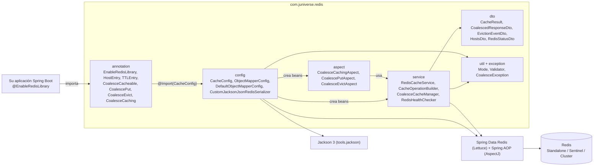
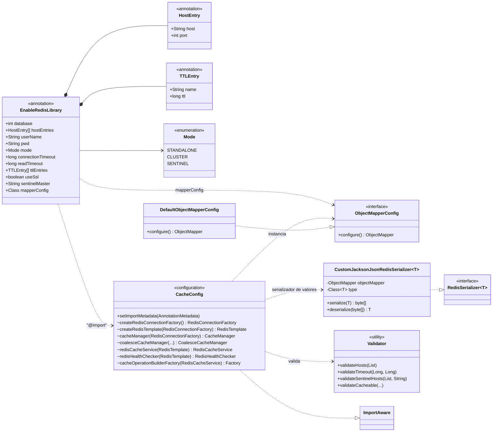
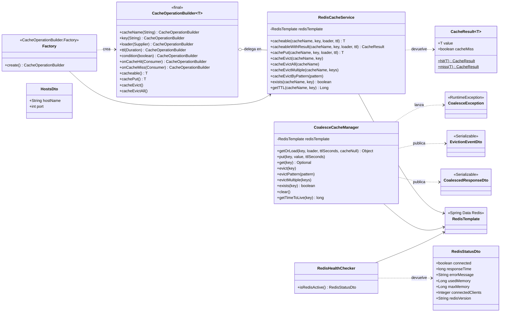
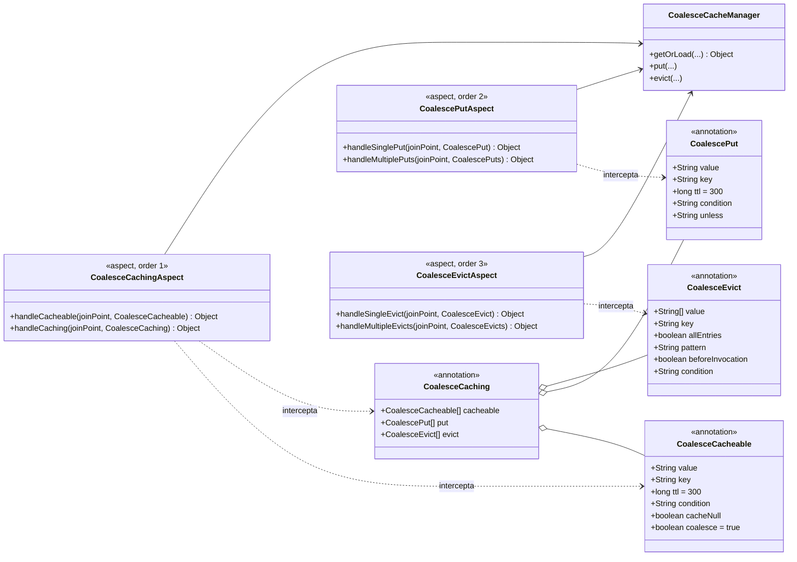
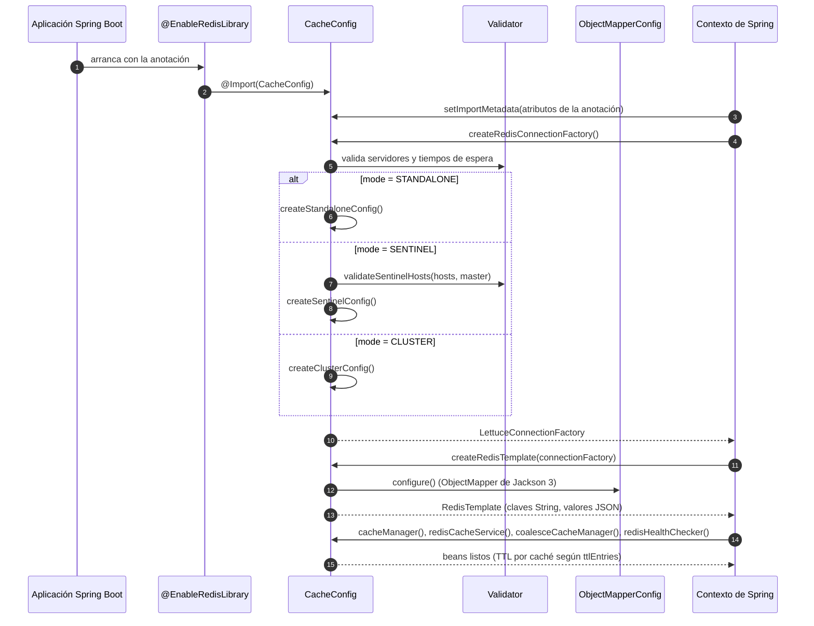
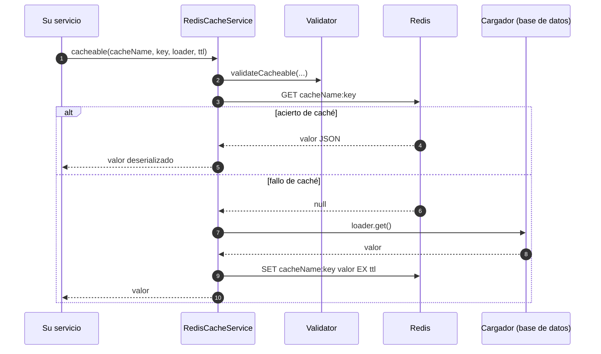
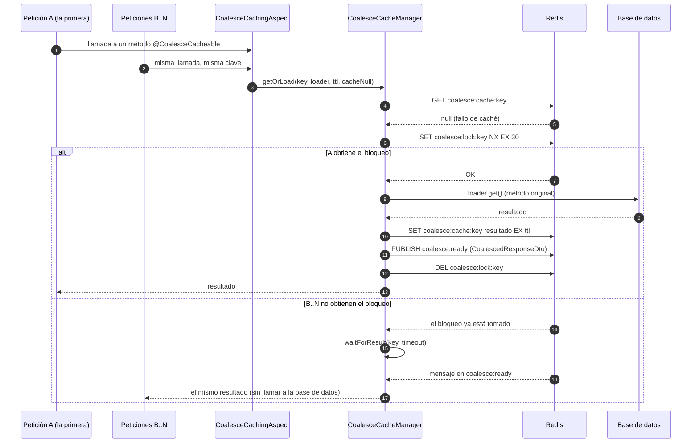
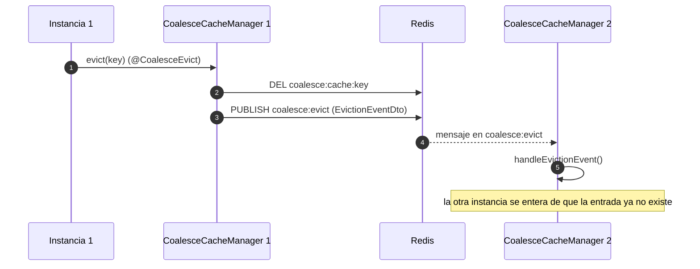
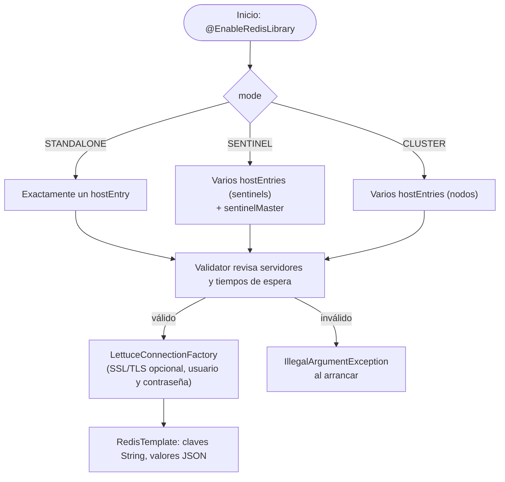

# SBJ-Util-Redis

Librería de utilidades para Spring Boot, potente y flexible, que simplifica la integración con Redis: operaciones de caché, verificación de salud y opciones avanzadas de configuración.

## Tabla de contenido

- [Características](#características)
- [Requisitos](#requisitos)
- [Instalación](#instalación)
- [Inicio rápido](#inicio-rápido)
- [Configuración](#configuración)
- [Uso](#uso)
  - [Operaciones básicas de caché](#operaciones-básicas-de-caché)
  - [Operaciones avanzadas de caché](#operaciones-avanzadas-de-caché)
  - [Verificación de salud](#verificación-de-salud)
  - [Coalescencia de peticiones](#coalescencia-de-peticiones-caché-con-alta-concurrencia)
- [Comparación de enfoques de caché](#comparación-de-enfoques-de-caché)
- [Seguridad](#seguridad)
- [Seguridad en hilos](#seguridad-en-hilos)
- [Referencia de la API](#referencia-de-la-api)
- [Ejemplos](#ejemplos)
- [Diagramas UML](#diagramas-uml)
- [Migración de 1.x a 2.0 (Jackson 3)](#migración-de-1x-a-20-jackson-3)
- [Solución de problemas](#solución-de-problemas)
- [Licencia](#licencia)

## Características

- **Integración sencilla**: habilita Redis con una sola anotación
- **Configuración flexible**: admite los modos Standalone, Cluster y Sentinel
- **Alta disponibilidad**: soporte de Redis Sentinel para la conmutación automática por fallo
- **Soporte SSL/TLS**: conexiones seguras con SSL/TLS integrado
- **Operaciones de caché**: operaciones programáticas equivalentes a las anotaciones de Spring Cache
- **Patrón constructor**: API fluida para operaciones de caché complejas
- **Monitoreo de salud**: verificador de Redis con métricas detalladas (memoria, clientes, versión)
- **Serialización personalizada**: `ObjectMapper` de Jackson 3 configurable para la serialización JSON
- **Gestión de TTL**: configuración del TTL por caché
- **Validación robusta**: validación completa de parámetros con mensajes de error descriptivos
- **Manejo de errores**: manejo elegante de errores con mecanismos de respaldo
- **Alta cobertura de pruebas**: más del 85 % de cobertura con pruebas unitarias completas
- **Coalescencia de peticiones**: anotaciones basadas en AOP para escenarios de alta concurrencia con deduplicación automática de peticiones

## Requisitos

- Java 21 o superior
- Spring Boot 4.0.1 o superior
- Servidor Redis (Standalone, Sentinel o Cluster)

## Instalación

Esta copia de la librería usa el grupo `com.juniverse.redis`, que no está publicado en Maven Central, así que primero instálela en su repositorio local de Maven:

```bash
cd sbj-util-redis
mvn install
```

Después agregue la dependencia a su `pom.xml`:

```xml
<dependency>
    <groupId>io.github.programming0026</groupId>
    <artifactId>sbj-util-redis-annotation</artifactId>
    <version>2.0.1</version>
</dependency>
```

## Inicio rápido

### 1. Habilitar la librería de Redis

Agregue la anotación `@EnableRedisLibrary` a su aplicación Spring Boot:

```java
import io.github.programming0026.juniverse.redis.EnableRedisLibrary;
import util.io.github.programming0026.juniverse.redis.Mode;
import org.springframework.boot.SpringApplication;
import org.springframework.boot.autoconfigure.SpringBootApplication;

@SpringBootApplication
@EnableRedisLibrary(
		hostEntries = {
				@HostEntry(host = "localhost", port = 6379)
		},
		mode = Mode.STANDALONE,
		connectionTimeout = 5000,
		readTimeout = 3000
)
public class Application {
	public static void main(String[] args) {
		SpringApplication.run(Application.class, args);
	}
}
```

### 2. Inyectar y usar

```java
import io.github.programming0026.juniverse.redis.RedisCacheService;
import org.springframework.beans.factory.annotation.Autowired;
import org.springframework.stereotype.Service;

@Service
public class UserService {

	@Autowired
	private RedisCacheService cacheService;

	public User getUser(String userId) {
		return cacheService.cacheable(
				"users",
				userId,
				() -> fetchUserFromDatabase(userId),
				Duration.ofMinutes(30)
		);
	}
}
```

## Configuración

### Parámetros de la anotación

La anotación `@EnableRedisLibrary` admite los siguientes parámetros:

| Parámetro | Tipo | Valor por defecto | Descripción |
|-----------|------|---------|-------------|
| `hostEntries` | HostEntry[] | `{}` | Configuración de los servidores Redis con `@HostEntry(host, port)` |
| `userName` | String | `""` | Usuario de Redis (opcional) |
| `pwd` | String | `""` | Contraseña de Redis (opcional) |
| `mode` | Mode | `STANDALONE` | Modo de conexión: `STANDALONE`, `CLUSTER` o `SENTINEL` |
| `sentinelMaster` | String | `""` | Nombre del maestro de Sentinel (obligatorio con el modo `SENTINEL`) |
| `useSsl` | boolean | `false` | Habilita SSL/TLS para conexiones seguras |
| `connectionTimeout` | long | `5000` | Tiempo de espera de conexión en milisegundos (debe ser > 0) |
| `readTimeout` | long | `3000` | Tiempo de espera de lectura en milisegundos (debe ser > 0) |
| `errorHandler` | Class | `DefaultObjectMapperConfig.class` | Configuración personalizada del ObjectMapper |
| `ttlEntries` | TTLEntry[] | `{}` | Configuración del TTL por caché |

### Ejemplo de configuración Standalone

```java
@EnableRedisLibrary(
    hostEntries = {
        @HostEntry(host = "localhost", port = 6379)
    },
    mode = Mode.STANDALONE,
    userName = "myuser",
    pwd = "mypassword"
)
```

### Standalone con SSL/TLS

```java
@EnableRedisLibrary(
    hostEntries = {
        @HostEntry(host = "redis.example.com", port = 6380)
    },
    mode = Mode.STANDALONE,
    userName = "myuser",
    pwd = "mypassword",
    useSsl = true  // Habilita SSL/TLS
)
```

### Ejemplo de configuración Cluster

```java
@EnableRedisLibrary(
    hostEntries = {
        @HostEntry(host = "redis-node1", port = 6379),
        @HostEntry(host = "redis-node2", port = 6379),
        @HostEntry(host = "redis-node3", port = 6379)
    },
    mode = Mode.CLUSTER,
    userName = "myuser",
    pwd = "mypassword"
)
```

### Ejemplo de configuración Sentinel

```java
@EnableRedisLibrary(
    hostEntries = {
        @HostEntry(host = "sentinel1", port = 26379),
        @HostEntry(host = "sentinel2", port = 26379),
        @HostEntry(host = "sentinel3", port = 26379)
    },
    mode = Mode.SENTINEL,
    sentinelMaster = "mymaster",  // Obligatorio: nombre de la instancia maestra
    userName = "myuser",
    pwd = "mypassword"
)
```

**Notas:**
- Redis Sentinel ofrece alta disponibilidad mediante la conmutación automática por fallo
- Los nodos Sentinel vigilan las instancias maestra y réplica
- El parámetro `sentinelMaster` es **obligatorio** con el modo SENTINEL
- Nombres comunes del maestro: «mymaster», «redis-master» (se configuran en sentinel.conf)

### Cómo elegir el modo

| Modo | Caso de uso | Ventajas | Desventajas |
|------|----------|------|------|
| **STANDALONE** | Desarrollo, pruebas, aplicaciones pequeñas | Configuración sencilla, poca sobrecarga | Sin alta disponibilidad, punto único de fallo |
| **CLUSTER** | Aplicaciones grandes, grandes volúmenes de datos | Escalado horizontal, particionado de datos | Configuración compleja, sobrecarga |
| **SENTINEL** | Aplicaciones de producción que necesitan alta disponibilidad | Conmutación automática, monitoreo | Requiere nodos Sentinel |

**Recomendaciones:**
- **Desarrollo y pruebas**: use STANDALONE
- **Producción (pequeña o mediana)**: use SENTINEL para alta disponibilidad
- **Producción (gran escala)**: use CLUSTER para escalar horizontalmente
- **Producción (crítica)**: considere CLUSTER + SENTINEL para escalar y tener alta disponibilidad

### TTL personalizado

```java
@EnableRedisLibrary(
    hostEntries = {
        @HostEntry(host = "localhost", port = 6379)
    },
    ttlEntries = {
        @TTLEntry(name = "users", ttl = 30),      // 30 minutos
        @TTLEntry(name = "products", ttl = 60),   // 1 hora
        @TTLEntry(name = "sessions", ttl = 120)    // 2 horas
    }
)
```

**Nota:** las configuraciones de `@TTLEntry` solo se aplican a la **anotación `@Cacheable` de Spring**. En las operaciones programáticas con `RedisCacheService` (como `cacheable()`, `cachePut()`, etc.) debe indicar el TTL de forma explícita como parámetro de la llamada.

### Configuración personalizada del ObjectMapper

Cree una clase de configuración propia:

```java
import config.io.github.programming0026.juniverse.redis.ObjectMapperConfig;
import tools.jackson.databind.ObjectMapper;
import tools.jackson.databind.json.JsonMapper;
import tools.jackson.databind.cfg.DateTimeFeature;

public class CustomObjectMapperConfig implements ObjectMapperConfig {

	@Override
	public ObjectMapper configure() {
		// Los mappers de Jackson 3 son inmutables: todo se configura en el constructor.
		// java.time y Optional se admiten de fábrica (no hay módulos que registrar).
		return JsonMapper.builder()
				.disable(DateTimeFeature.WRITE_DATES_AS_TIMESTAMPS)
				// Agregue su configuración personalizada
				.build();
	}
}
```

> El mapper debe escribir y leer la información de tipo (`@class`) que la librería necesita para reconstruir sus objetos; parta de `DefaultObjectMapperConfig` si tiene dudas.

Después, haga referencia a ella en la anotación:

```java
@EnableRedisLibrary(
    hostEntries = {
        @HostEntry(host = "localhost", port = 6379)
    },
    mapperConfig = CustomObjectMapperConfig.class
)
```

## Uso

### Operaciones básicas de caché

#### RedisCacheService

`RedisCacheService` ofrece el equivalente programático de las anotaciones de Spring Cache:

##### Cacheable (equivale a @Cacheable)

```java
@Autowired
private RedisCacheService cacheService;

// Con TTL personalizado
public Product getProduct(String productId) {
    return cacheService.cacheable(
        "products",
        productId,
        () -> productRepository.findById(productId),
        Duration.ofHours(1)
    );
}

// Con el TTL predeterminado (10 minutos)
public Product getProduct(String productId) {
    return cacheService.cacheable(
        "products",
        productId,
        () -> productRepository.findById(productId)
    );
}
```

##### Cache Put (equivale a @CachePut)

```java
public Product updateProduct(String productId, Product product) {
    return cacheService.cachePut(
        "products",
        productId,
        () -> productRepository.save(product),
        Duration.ofHours(1)
    );
}
```

##### Cache Evict (equivale a @CacheEvict)

```java
// Invalidar una sola entrada
public void deleteProduct(String productId) {
    productRepository.deleteById(productId);
    cacheService.cacheEvict("products", productId);
}

// Invalidar todas las entradas de una caché
public void clearProductCache() {
    cacheService.cacheEvictAll("products");
}

// Invalidar varias claves concretas
public void deleteProducts(String... productIds) {
    cacheService.cacheEvictMultiple("products", productIds);
}

// Invalidar por patrón
public void evictUserSessions() {
    cacheService.cacheEvictByPattern("sessions:user:*");
}
```

##### Métodos de utilidad

```java
// Comprobar si existe una clave
boolean exists = cacheService.exists("products", "product-123");

// Obtener el TTL restante (en segundos)
Long ttl = cacheService.getTTL("products", "product-123");
```

### Operaciones avanzadas de caché

#### CacheOperationBuilder

Para escenarios más complejos, use la API fluida del constructor:

```java
@Autowired
private CacheOperationBuilder<User> cacheBuilder;

public User getUser(String userId, boolean forceRefresh) {
    return cacheBuilder
        .cacheName("users")
        .key(userId)
        .loader(() -> userRepository.findById(userId))
        .ttl(Duration.ofMinutes(30))
        .condition(!forceRefresh)  // Omite la caché si forceRefresh es true
        .onCacheHit(user -> log.info("Cache hit for user: {}", userId))
        .onCacheMiss(user -> log.info("Cache miss for user: {}", userId))
        .cacheable();
}
```

Métodos del constructor:

- `cacheName(String)`: establece el nombre de la caché
- `key(String)`: establece la clave de la caché
- `loader(Supplier<T>)`: establece la función que carga los datos
- `ttl(Duration)`: establece el tiempo de vida
- `condition(boolean)`: caché condicional
- `onCacheHit(Consumer<T>)`: retrollamada ante un acierto de caché
- `onCacheMiss(Consumer<T>)`: retrollamada ante un fallo de caché
- `cacheable()`: ejecuta la operación como cacheable
- `cachePut()`: ejecuta la operación como guardado en caché
- `cacheEvict()`: ejecuta la operación como invalidación
- `cacheEvictAll()`: ejecuta la invalidación de todo (elimina todas las entradas de ese nombre de caché)

### Verificación de salud

Monitoree la salud de la conexión con Redis con métricas detalladas:

```java
@Autowired
private RedisHealthChecker healthChecker;

@GetMapping("/health/redis")
public RedisStatusDto checkRedisHealth() {
    return healthChecker.isRedisActive();
}
```

Estructura de la respuesta:

```json
{
  "connected": true,
  "responseTime": 15,
  "errorMessage": "Redis is up and running and responding correctly",
  "usedMemory": 1048576,
  "maxMemory": 2097152,
  "connectedClients": 5,
  "redisVersion": "7.0.0"
}
```

El verificador de salud ofrece métricas completas:
- **connected**: estado de la conexión (true/false)
- **responseTime**: tiempo de respuesta en milisegundos
- **errorMessage**: mensaje de estado o de error
- **usedMemory**: uso actual de memoria en bytes
- **maxMemory**: límite máximo de memoria en bytes
- **connectedClients**: cantidad de clientes conectados
- **redisVersion**: versión del servidor Redis

### Coalescencia de peticiones (caché con alta concurrencia)

En escenarios de alta concurrencia, donde varios hilos pueden pedir los mismos datos a la vez, use las anotaciones de coalescencia:

#### @CoalesceCacheable

```java
@Service
public class UserService {

    @CoalesceCacheable(
        value = "users",           // Nombre o prefijo de la caché
        key = "#userId",           // Expresión SpEL para la clave dinámica
        ttl = 300,                 // TTL en segundos (5 minutos)
        condition = "#userId != null",  // Condición SpEL para guardar en caché
        cacheNull = false,         // Si se guardan los resultados nulos
        coalesce = true            // Activa la coalescencia de peticiones
    )
    public User getUserById(String userId) {
        return userRepository.findById(userId);
    }
}
```

#### @CoalescePut

```java
@CoalescePut(value = "users", key = "#user.id", ttl = 300)
public User updateUser(User user) {
    return userRepository.save(user);
}
```

#### @CoalesceEvict

```java
@CoalesceEvict(value = "users", key = "#userId")
public void deleteUser(String userId) {
    userRepository.deleteById(userId);
}

// Invalidar todas las entradas de la caché
@CoalesceEvict(value = "users", allEntries = true)
public void clearAllUsers() {
    // Esto invalidará todas las entradas con el prefijo "users"
}
```

#### @CoalesceCaching (varias operaciones)

```java
@CoalesceCaching(
    cacheable = @CoalesceCacheable(value = "users", key = "#userId"),
    evict = @CoalesceEvict(value = "userSessions", key = "#userId")
)
public User refreshUser(String userId) {
    return userRepository.findById(userId);
}
```

**Características principales:**
- **Coalescencia de peticiones**: varias peticiones concurrentes por la misma clave se unifican y el método subyacente se ejecuta una sola vez
- **Soporte de SpEL**: generación dinámica de claves con Spring Expression Language
- **Invalidación distribuida**: los eventos de invalidación se publican por pub/sub de Redis para avisar a todas las instancias de la aplicación
- **Espacio de nombres propio**: usa el prefijo `coalesce:cache:` para evitar conflictos con la caché estándar

**Cuándo usar las anotaciones de coalescencia:**
- Métodos con operaciones costosas (consultas a la base de datos, llamadas a APIs externas)
- Escenarios de alta concurrencia donde varios hilos pueden pedir los mismos datos a la vez
- Necesidad de generar claves dinámicas con SpEL
- Aplicaciones distribuidas que requieren sincronizar la invalidación de la caché entre instancias

## Comparación de enfoques de caché

La librería ofrece **tres enfoques de caché distintos**; elija según su caso de uso:

| Enfoque | Caso de uso | Características | Seguridad en hilos |
|----------|----------|----------|---------------|
| **RedisCacheService** | Caché programática con control total | Llamadas directas a la API, TTL propio, patrones de invalidación, retrollamadas mediante el constructor | Singleton seguro para hilos |
| **Spring @Cacheable** | Caché declarativa estándar de Spring | Abstracción estándar de Spring Cache, TTL mediante `@TTLEntry`, funciona con cualquier proveedor de caché | Seguro para hilos |
| **@CoalesceCacheable** | Alta concurrencia con coalescencia de peticiones | Claves con SpEL, coalescencia de peticiones, invalidación distribuida por pub/sub, caché condicional | Seguro para hilos |

**Matriz de decisión:**
- **¿Necesita control programático o retrollamadas?** Use `RedisCacheService` o `CacheOperationBuilder`
- **¿Caché estándar de Spring con poca configuración?** Use `@Cacheable` con `@TTLEntry`
- **¿Alta concurrencia + operaciones costosas + necesidad de SpEL?** Use `@CoalesceCacheable`
- **¿Invalidación distribuida entre instancias?** Use `@CoalesceEvict` (publica en pub/sub de Redis)
- **¿Caché condicional dinámica en tiempo de ejecución?** Use `CacheOperationBuilder.condition()` o `@CoalesceCacheable(condition=...)`

**Espacios de nombres de las claves:**
- `RedisCacheService`: `{cacheName}:{key}`
- Spring `@Cacheable`: se configura con `RedisCacheManager` (por defecto: `{cacheName}::{key}`)
- `@CoalesceCacheable`: `coalesce:cache:{value}:{key}`

## Seguridad

### Cifrado SSL/TLS

Habilite conexiones seguras con Redis mediante SSL/TLS:

```java
@EnableRedisLibrary(
    hostEntries = {
        @HostEntry(host = "secure-redis.example.com", port = 6380)
    },
    useSsl = true,
    userName = "${redis.username}",  // Use variables de entorno
    pwd = "${redis.password}"
)
```

**Buenas prácticas:**
- Use siempre SSL/TLS en producción
- Guarde las credenciales en variables de entorno o en almacenes seguros
- Nunca escriba contraseñas directamente en el código fuente
- Use credenciales de autenticación robustas
- Configure tiempos de espera adecuados para evitar bloqueos

### Validación de parámetros

La librería valida de forma completa todas las entradas:

**Parámetros de conexión:**
- Los nombres de host no pueden estar vacíos
- Los puertos deben estar entre 1 y 65535
- El tiempo de espera de conexión debe ser > 0
- El tiempo de espera de lectura debe ser > 0

**Parámetros de caché:**
- Los nombres de caché no pueden contener los caracteres `:` ni `*`
- Las claves no pueden contener el carácter `*`
- El TTL debe ser positivo (> 0)
- Todos los parámetros obligatorios se validan contra valores nulos

**Ejemplos de errores de validación:**
```java
// Inválido: lanza IllegalArgumentException
cacheService.cacheable("test:cache", "key", loader, ttl);
// Error: cacheName cannot contain ':' or '*' characters

// Inválido: lanza IllegalArgumentException
cacheService.cacheable("cache", "key*", loader, ttl);
// Error: key cannot contain '*' character

// Inválido: lanza IllegalArgumentException
cacheService.cacheable("cache", "key", loader, Duration.ZERO);
// Error: ttl must be positive

// Válido
cacheService.cacheable("cache", "key", loader, Duration.ofMinutes(10));
```

### Manejo de errores

La librería maneja los errores con elegancia:

- **Respaldo de la caché**: ante errores de Redis, `cacheable()` devuelve el resultado del cargador
- **Errores que no bloquean**: las operaciones de invalidación no lanzan excepciones si fallan
- **Registro detallado**: todos los errores se registran con información de contexto
- **Verificaciones de salud**: use `RedisHealthChecker` para monitorear la conectividad

## Seguridad en hilos

### Diseño totalmente seguro para hilos

Todos los componentes están diseñados para un **acceso concurrente seguro** en entornos multihilo:

| Componente | Seguridad en hilos | Alcance | Notas |
|-----------|-------------|-------|-------|
| `RedisCacheService` | Segura | Singleton | Estado inmutable, segura para uso concurrente |
| `RedisHealthChecker` | Segura | Singleton | Estado inmutable, segura para uso concurrente |
| `CacheOperationBuilder.Factory` | Segura | Singleton | La fábrica crea constructores nuevos de forma segura |
| `CacheOperationBuilder` | No segura | Por operación | Use factory.create() cada vez |
| `RedisTemplate` | Segura | Singleton | Administrado por Spring, con conexiones en grupo |

### CacheOperationBuilder: patrón fábrica

**Importante:** el propio `CacheOperationBuilder` NO es seguro para hilos y no debe compartirse entre hilos. Cree siempre una instancia nueva por operación con la fábrica.

**Uso correcto:**
```java
@Service
public class UserService {
    @Autowired
    private CacheOperationBuilder.Factory builderFactory;

    public User getUser(String userId) {
        // Cree un constructor NUEVO por cada operación
        return builderFactory.create()
            .cacheName("users")
            .key(userId)
            .loader(() -> userRepository.findById(userId))
            .ttl(Duration.ofMinutes(30))
            .cacheable();
    }
}
```

**Uso incorrecto:**
```java
@Service
public class UserService {
    @Autowired
    private CacheOperationBuilder.Factory builderFactory;

    // NO HAGA ESTO: reutilizar constructores provoca condiciones de carrera
    private CacheOperationBuilder<User> reusedBuilder;

    @PostConstruct
    public void init() {
        this.reusedBuilder = builderFactory.create();
    }

    public User getUser(String userId) {
        // INSEGURO: varios hilos compartirán el mismo constructor
        return reusedBuilder
            .cacheName("users")
            .key(userId)
            .loader(() -> userRepository.findById(userId))
            .cacheable();
    }
}
```

**Puntos clave:**
- La fábrica es segura para hilos y se puede inyectar como singleton
- Llame a `factory.create()` en cada operación de caché
- Cada instancia del constructor es aislada e independiente
- Nunca guarde ni reutilice instancias del constructor entre peticiones

### Por qué este diseño es seguro para hilos

1. **Patrón fábrica**: crea instancias nuevas del constructor cuando se necesitan
2. **Servicios inmutables**: todos los servicios singleton usan campos `final`
3. **Inyección por constructor**: garantiza una publicación segura (modelo de memoria de Java)
4. **Grupo de conexiones**: RedisTemplate administra conexiones seguras para hilos
5. **Sin estado compartido**: cada constructor opera de forma independiente

## Referencia de la API

### RedisCacheService

| Método | Parámetros | Tipo de retorno | Descripción |
|--------|-----------|-------------|-------------|
| `cacheable` | `cacheName, key, loader, ttl` | `T` | Obtiene de la caché o ejecuta el cargador |
| `cacheable` | `cacheName, key, loader` | `T` | Obtiene de la caché con el TTL predeterminado |
| `cachePut` | `cacheName, key, loader, ttl` | `T` | Actualiza una entrada de la caché |
| `cachePut` | `cacheName, key, loader` | `T` | Actualiza la caché con el TTL predeterminado |
| `cacheEvict` | `cacheName, key` | `void` | Elimina una entrada de la caché |
| `cacheEvictAll` | `cacheName` | `void` | Elimina todas las entradas de la caché |
| `cacheEvictMultiple` | `cacheName, keys...` | `void` | Elimina varias entradas |
| `cacheEvictByPattern` | `pattern` | `void` | Elimina las entradas que coinciden con el patrón |
| `exists` | `cacheName, key` | `boolean` | Comprueba si existe la clave |
| `getTTL` | `cacheName, key` | `Long` | Obtiene el TTL restante en segundos |

### RedisHealthChecker

| Método | Parámetros | Tipo de retorno | Descripción |
|--------|-----------|-------------|-------------|
| `isRedisActive` | - | `RedisStatusDto` | Comprueba el estado de la conexión con Redis |

### RedisStatusDto

| Campo | Tipo | Descripción |
|-------|------|-------------|
| `connected` | boolean | Estado de la conexión |
| `responseTime` | long | Tiempo de respuesta en milisegundos |
| `errorMessage` | String | Mensaje de estado o de error |
| `usedMemory` | long | Uso actual de memoria en bytes |
| `maxMemory` | long | Límite máximo de memoria en bytes |
| `connectedClients` | int | Cantidad de clientes conectados |
| `redisVersion` | String | Versión del servidor Redis |

## Ejemplos

### Ejemplo 1: caché de productos de una tienda en línea

```java
@Service
public class ProductService {
    
    @Autowired
    private RedisCacheService cacheService;
    
    @Autowired
    private ProductRepository productRepository;
    
    public Product getProduct(String productId) {
        return cacheService.cacheable(
            "products",
            productId,
            () -> productRepository.findById(productId)
                .orElseThrow(() -> new ProductNotFoundException(productId)),
            Duration.ofHours(2)
        );
    }
    
    public Product updateProduct(String productId, Product product) {
        Product updated = productRepository.save(product);
        return cacheService.cachePut(
            "products",
            productId,
            () -> updated,
            Duration.ofHours(2)
        );
    }
    
    public void deleteProduct(String productId) {
        productRepository.deleteById(productId);
        cacheService.cacheEvict("products", productId);
    }
    
    public void refreshAllProducts() {
        cacheService.cacheEvictAll("products");
    }
}
```

### Ejemplo 2: administración de sesiones de usuario

```java
@Service
public class SessionService {
    
    @Autowired
    private CacheOperationBuilder<UserSession> sessionBuilder;
    
    public UserSession getSession(String sessionId) {
        return sessionBuilder
            .cacheName("sessions")
            .key(sessionId)
            .loader(() -> createNewSession(sessionId))
            .ttl(Duration.ofMinutes(30))
            .onCacheHit(session -> updateLastAccess(session))
            .cacheable();
    }
    
    public void invalidateSession(String sessionId) {
        sessionBuilder
            .cacheName("sessions")
            .key(sessionId)
            .cacheEvict();
    }
}
```

### Ejemplo 3: caché condicional

```java
@Service
public class ReportService {
    
    @Autowired
    private CacheOperationBuilder<Report> reportBuilder;
    
    public Report getReport(String reportId, boolean realtime) {
        return reportBuilder
            .cacheName("reports")
            .key(reportId)
            .loader(() -> generateReport(reportId))
            .ttl(Duration.ofMinutes(15))
            .condition(!realtime)  // Solo se guarda en caché si no es en tiempo real
            .onCacheMiss(report -> log.info("Generated new report: {}", reportId))
            .cacheable();
    }
}
```

### Ejemplo 4: endpoint de verificación de salud

```java
@RestController
@RequestMapping("/api/health")
public class HealthController {
    
    @Autowired
    private RedisHealthChecker healthChecker;
    
    @GetMapping("/redis")
    public ResponseEntity<RedisStatusDto> checkRedis() {
        RedisStatusDto status = healthChecker.isRedisActive();
        
        if (status.isConnected()) {
            return ResponseEntity.ok(status);
        } else {
            return ResponseEntity.status(HttpStatus.SERVICE_UNAVAILABLE)
                .body(status);
        }
    }
}
```

## Arquitectura

### Componentes principales

- **@EnableRedisLibrary**: anotación principal que habilita la librería
- **CacheConfig**: clase de autoconfiguración de Redis
- **RedisCacheService**: servicio central de las operaciones de caché
- **CacheOperationBuilder**: API fluida para operaciones avanzadas
- **RedisHealthChecker**: servicio de monitoreo de salud
- **ObjectMapperConfig**: interfaz para la serialización JSON personalizada
- **CoalesceCacheManager**: administrador de caché dedicado a la coalescencia de peticiones, con soporte de pub/sub
- **@CoalesceCacheable/@CoalescePut/@CoalesceEvict**: anotaciones AOP para caché con alta concurrencia

### Modos de conexión

- **STANDALONE**: una sola instancia de Redis (para desarrollo e instalaciones pequeñas)
- **CLUSTER**: Redis Cluster con varios nodos (para escalado horizontal y particionado)
- **SENTINEL**: Redis Sentinel con conmutación automática por fallo (para alta disponibilidad)

### Serialización

La librería usa **Jackson 3** (`tools.jackson`, la versión que trae Spring Boot 4) para la serialización JSON, mediante `CustomJacksonJsonRedisSerializer`, con esta configuración por defecto (`DefaultObjectMapperConfig`):

- Soporte de fecha y hora de Java 8 y de `Optional` (integrado en Jackson 3, sin módulos que registrar)
- Fechas escritas como texto ISO-8601, no como marcas de tiempo
- Visibilidad basada en campos
- Información de tipo polimórfico (`@class`) para reconstruir los objetos con su clase original
- Ignora las propiedades desconocidas
- Maneja con elegancia los beans vacíos

Las anotaciones de Jackson (`@JsonFormat`, `@JsonIgnore`, ...) siguen siendo las de `com.fasterxml.jackson.annotation`: Jackson 3 sigue usando el paquete de anotaciones de la versión 2.x.

## Diagramas UML

Los diagramas están escritos en [Mermaid](https://mermaid.js.org/), que GitHub muestra directamente en el navegador.

### 1. Paquetes y dependencias



### 2. Diagrama de clases: configuración y anotaciones



### 3. Diagrama de clases: servicios y datos



### 4. Diagrama de clases: anotaciones AOP y aspectos



### 5. Secuencia: arranque de la aplicación



### 6. Secuencia: `RedisCacheService.cacheable`



### 7. Secuencia: coalescencia de peticiones (`@CoalesceCacheable`)

Diez peticiones concurrentes por la misma clave producen **una sola** llamada a la base de datos: la primera petición toma un bloqueo y las demás esperan su resultado mediante pub/sub de Redis.



### 8. Secuencia: invalidación entre instancias



### 9. Elección del modo de conexión




## Migración de 1.x a 2.0 (Jackson 3)

La versión 2.0.0 pasa la librería de Jackson 2 a **Jackson 3**, el valor por defecto en Spring Boot 4. Es una versión con cambios incompatibles:

| 1.x (Jackson 2) | 2.0 (Jackson 3) |
|---|---|
| `com.fasterxml.jackson.databind.ObjectMapper` | `tools.jackson.databind.ObjectMapper` (se construye con `JsonMapper.builder()`; es inmutable) |
| `ObjectMapperConfig.configure()` devolvía un `ObjectMapper` de Jackson 2 | devuelve un `ObjectMapper` de Jackson 3 |
| `JavaTimeModule` y `Jdk8Module` (`jackson-datatype-jsr310` / `-jdk8`) | integrados en Jackson 3: elimine esas dos dependencias |
| `SerializationFeature.WRITE_DATES_AS_TIMESTAMPS` | `DateTimeFeature.WRITE_DATES_AS_TIMESTAMPS` |
| `DeserializationFeature.READ_ENUMS_USING_TO_STRING`, `SerializationFeature.WRITE_ENUMS_USING_TO_STRING` | `EnumFeature.READ_ENUMS_USING_TO_STRING`, `EnumFeature.WRITE_ENUMS_USING_TO_STRING` |
| `CustomJackson2JsonRedisSerializer` | `CustomJacksonJsonRedisSerializer` |
| `JsonProcessingException` / `IOException` (comprobadas) | `tools.jackson.core.JacksonException` (no comprobada) |
| `spring-boot-starter-aop` (artefacto de Spring Boot 3) | `spring-boot-starter-aspectj` |

El JSON guardado en Redis conserva la misma forma (`@class` más los campos). Los valores en caché son temporales por naturaleza, así que, si tiene dudas al actualizar, vacíe una vez las cachés de la librería.

**2.0.1.** Sin cambios en el código ni en la API: la librería deja de ser contenido premium, se publica gratis en GitHub y pasa a la Licencia de uso personal de Java Universe 1.1.

## Solución de problemas

### Problemas comunes

**Tiempo de espera de conexión agotado**
```
Aumente los valores de connectionTimeout y readTimeout en @EnableRedisLibrary
```

**Errores de serialización**
```
Implemente un ObjectMapperConfig propio (Jackson 3, tools.jackson) para manejar tipos concretos
```

**La caché no funciona**
```
Verifique que Redis esté en ejecución y accesible
Revise el endpoint de salud: /api/health/redis
Revise los logs en busca de errores de conexión
```

## Licencia

Este proyecto es **código abierto** y se publica bajo la [Licencia MIT](../LICENSE). Puedes usarlo, copiarlo, modificarlo, fusionarlo, publicarlo, distribuirlo, sublicenciarlo e incluso venderlo, siempre que conserves el aviso de copyright y el texto de la licencia. Las condiciones completas están en [LICENSE](../LICENSE).

## Autor

**Java Universe**
- GitHub: [@programming0026](https://github.com/programming0026)

## Contribuciones

¡Las contribuciones, los reportes de errores y las solicitudes de funciones son bienvenidos!

## Estadísticas del proyecto

- **Cobertura de pruebas**: más del 85 %
- **Total de pruebas**: más de 260 pruebas unitarias
- **Estado de la compilación**: todas las pruebas pasan
- **Seguridad en hilos**: verificada por completo
- **Modos admitidos**: Standalone, Cluster, Sentinel
- **Versión de Java**: 21
- **Spring Boot**: 4.1.2

---

Para más información, reportes de errores o contribuciones, visite el repositorio del proyecto.
