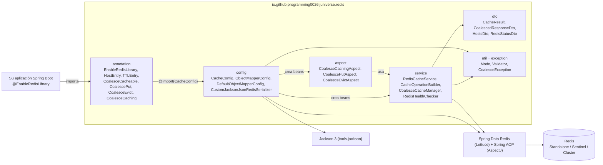
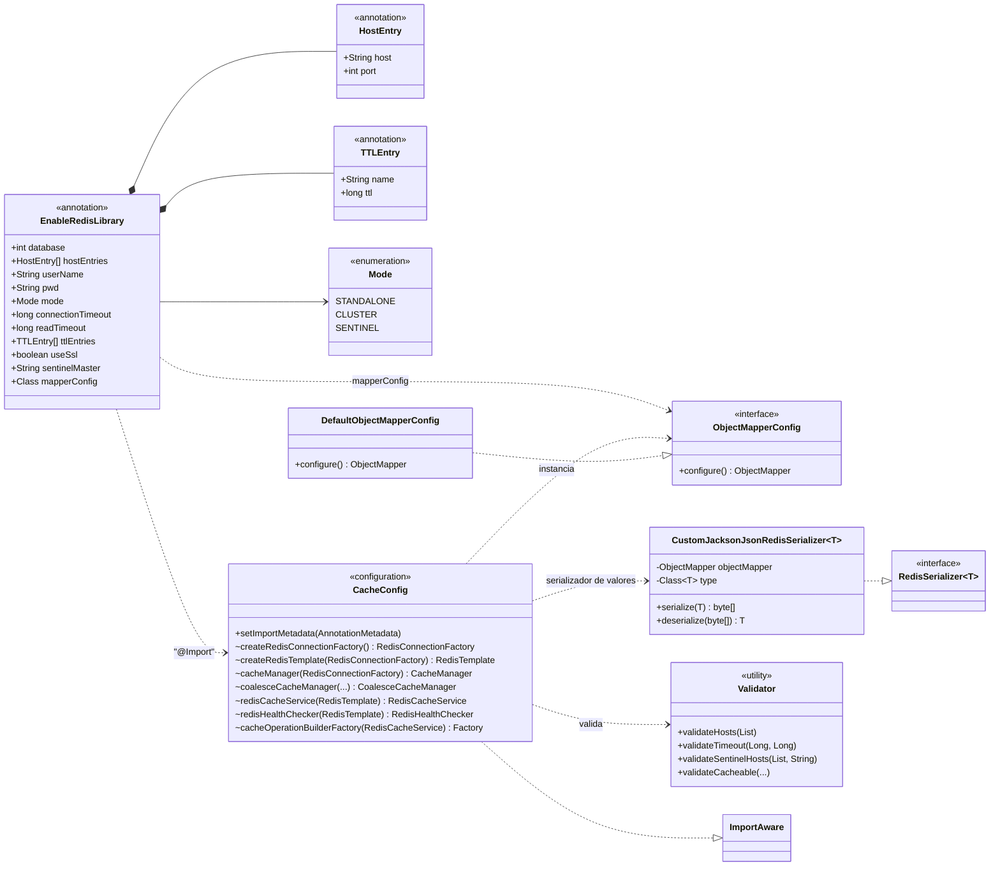
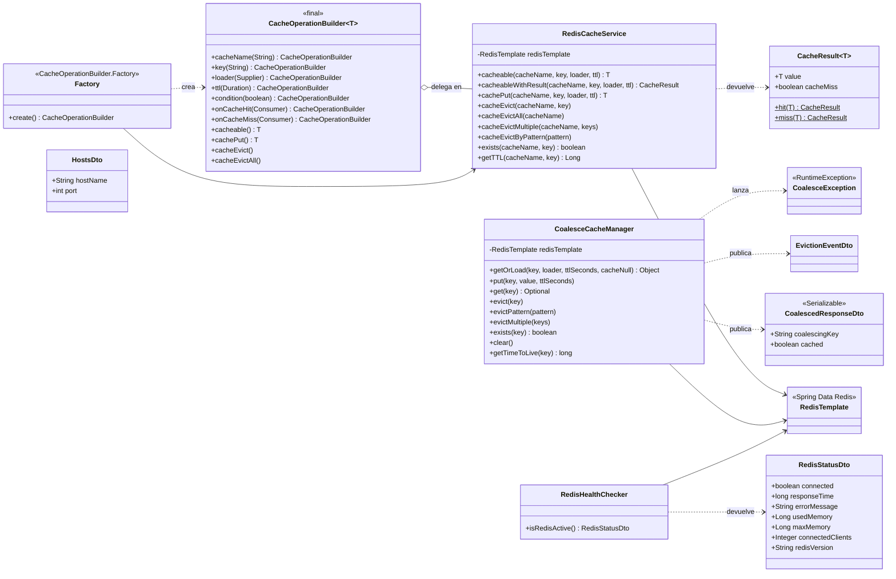
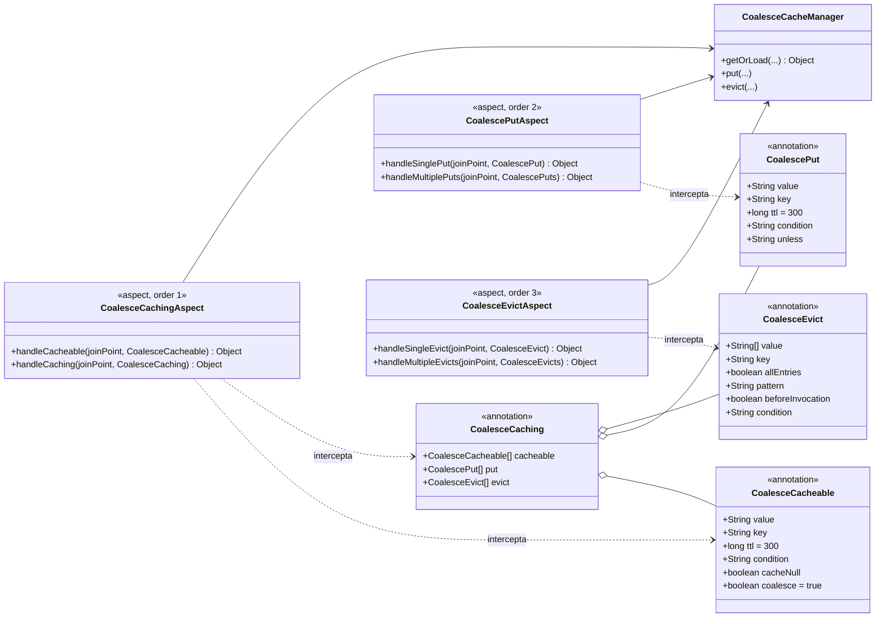
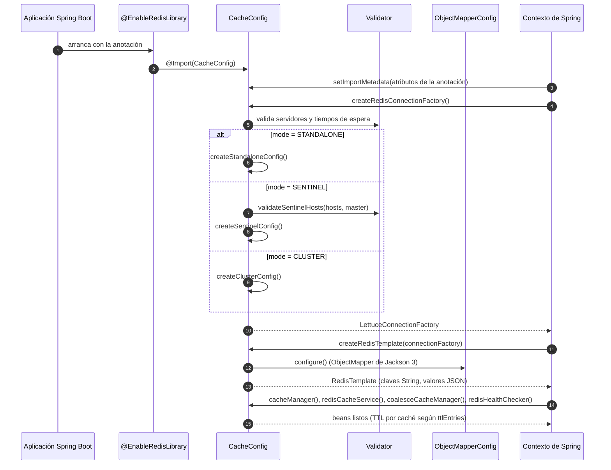
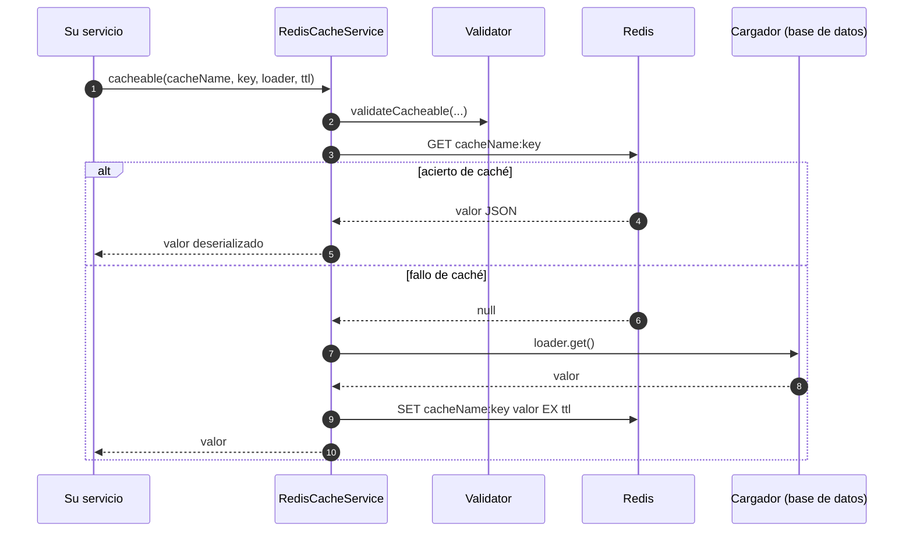
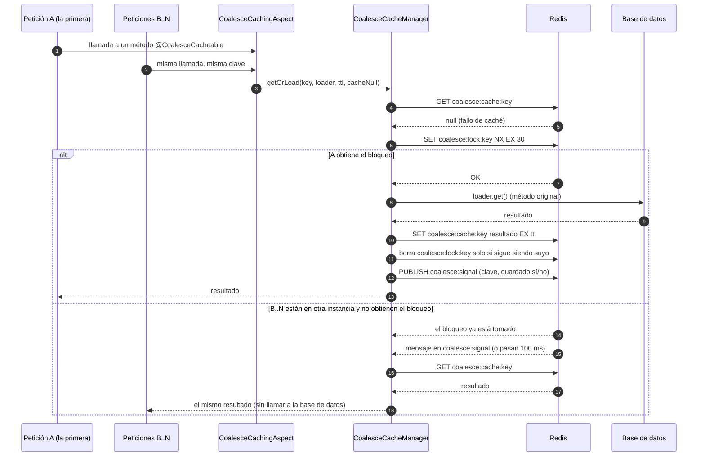
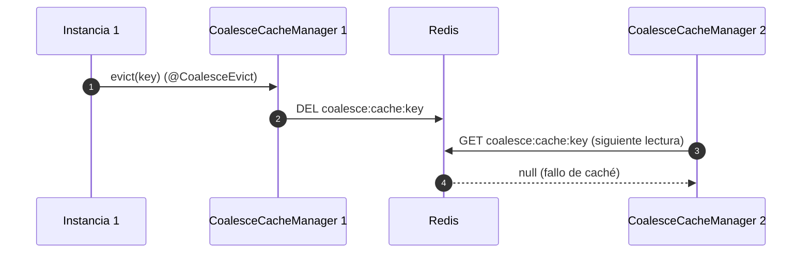
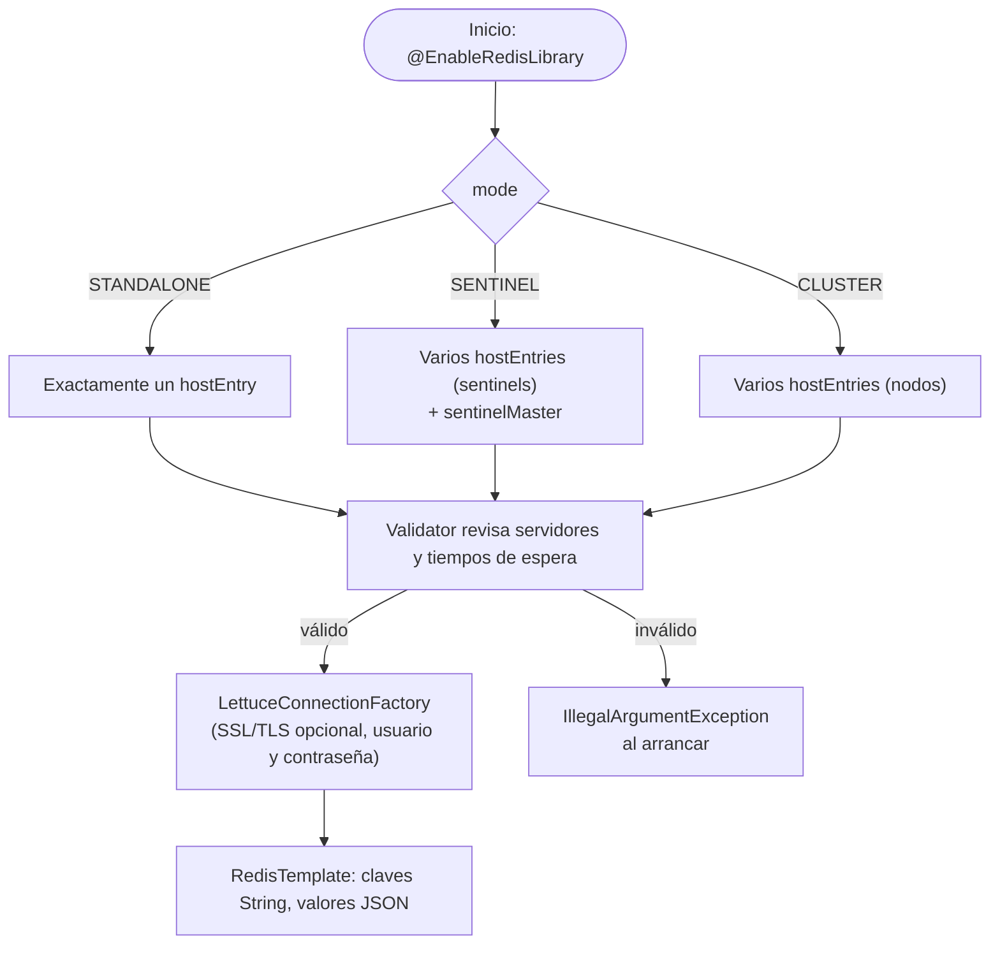

# SBJ-Util-Redis

Librería de utilidades para Spring Boot, potente y flexible, que simplifica la integración con Redis: operaciones de caché, verificación de salud y opciones avanzadas de configuración.

> English version: [README.en.md](README.en.md)

## Tabla de contenido

- [Características](#características)
- [Requisitos](#requisitos)
- [Instalación](#instalación)
- [Inicio rápido](#inicio-rápido)
- [Configuración](#configuración)
- [Uso](#uso)
  - [Operaciones básicas de caché](#operaciones-básicas-de-caché)
  - [Operaciones avanzadas de caché](#operaciones-avanzadas-de-caché)
  - [Verificación de salud](#verificación-de-salud)
  - [Coalescencia de peticiones](#coalescencia-de-peticiones-caché-con-alta-concurrencia)
- [Comparación de enfoques de caché](#comparación-de-enfoques-de-caché)
- [Seguridad](#seguridad)
- [Observabilidad](#observabilidad)
- [Seguridad en hilos](#seguridad-en-hilos)
- [Referencia de la API](#referencia-de-la-api)
- [Ejemplos](#ejemplos)
- [Diagramas UML](#diagramas-uml)
- [Migración de 1.x a 2.0 (Jackson 3)](#migración-de-1x-a-20-jackson-3)
- [Migración de 2.x a 3.0](#migración-de-2x-a-30)
- [Solución de problemas](#solución-de-problemas)
- [Pruebas](#pruebas)
- [Licencia](#licencia)

## Características

- **Integración sencilla**: habilita Redis con una sola anotación
- **Configuración flexible**: admite los modos Standalone, Cluster y Sentinel
- **Alta disponibilidad**: soporte de Redis Sentinel para la conmutación automática por fallo
- **Soporte SSL/TLS**: conexiones seguras con SSL/TLS integrado
- **Operaciones de caché**: operaciones programáticas equivalentes a las anotaciones de Spring Cache
- **Patrón constructor**: API fluida para operaciones de caché complejas
- **Monitoreo de salud**: verificador de Redis con métricas detalladas (memoria, clientes, versión)
- **Serialización personalizada**: `ObjectMapper` de Jackson 3 configurable para la serialización JSON
- **Gestión de TTL**: configuración del TTL por caché
- **Validación robusta**: validación completa de parámetros con mensajes de error descriptivos
- **Manejo de errores**: manejo elegante de errores con mecanismos de respaldo
- **Alta cobertura de pruebas**: más del 85 % de cobertura con pruebas unitarias completas
- **Coalescencia de peticiones**: anotaciones basadas en AOP para escenarios de alta concurrencia con deduplicación automática de peticiones

## Requisitos

- Java 21 o superior
- Spring Boot 4.1.2 o superior
- Redis 4 o superior (los borrados usan `UNLINK`)
- Servidor Redis (Standalone, Sentinel o Cluster)

## Instalación

Esta copia de la librería se publica con las coordenadas `io.github.programming0026:sbj-util-redis-annotation`. Para usar la versión de este repositorio, instálela primero en su repositorio local de Maven:

```bash
cd sbj-util-redis
mvn install
```

Después agregue la dependencia a su `pom.xml`:

```xml
<dependency>
    <groupId>io.github.programming0026</groupId>
    <artifactId>sbj-util-redis-annotation</artifactId>
    <version>3.0.0</version>
</dependency>
```

## Inicio rápido

### 1. Habilitar la librería de Redis

Agregue la anotación `@EnableRedisLibrary` a su aplicación Spring Boot:

```java
import io.github.programming0026.juniverse.redis.annotation.EnableRedisLibrary;
import io.github.programming0026.juniverse.redis.enums.Mode;
import org.springframework.boot.SpringApplication;
import org.springframework.boot.autoconfigure.SpringBootApplication;

@SpringBootApplication
@EnableRedisLibrary(
		hostEntries = {
				@HostEntry(host = "localhost", port = 6379)
		},
		mode = Mode.STANDALONE,
		connectionTimeout = 5000,
		readTimeout = 1000
)
public class Application {
	public static void main(String[] args) {
		SpringApplication.run(Application.class, args);
	}
}
```

### 2. Inyectar y usar

```java
import io.github.programming0026.juniverse.redis.service.RedisCacheService;
import org.springframework.beans.factory.annotation.Autowired;
import org.springframework.stereotype.Service;

@Service
public class UserService {

	@Autowired
	private RedisCacheService cacheService;

	public User getUser(String userId) {
		return cacheService.cacheable(
				"users",
				userId,
				() -> fetchUserFromDatabase(userId),
				Duration.ofMinutes(30)
		);
	}
}
```

## Configuración

### Parámetros de la anotación

La anotación `@EnableRedisLibrary` admite los siguientes parámetros:

| Parámetro | Tipo | Valor por defecto | Descripción |
|-----------|------|---------|-------------|
| `hostEntries` | HostEntry[] | `{}` | Servidores Redis con `@HostEntry(host, port)`. `host` admite placeholders y también el puerto: `@HostEntry(host = "${redis.host}:${redis.port}")` |
| `userName` | String | `""` | Usuario de los nodos de datos (opcional). En modo `SENTINEL` es el del maestro y las réplicas |
| `pwd` | String | `""` | Contraseña de los nodos de datos (opcional). En modo `SENTINEL` es la del maestro y las réplicas |
| `sentinelUserName` | String | `""` | Usuario de los sentinels (opcional, solo modo `SENTINEL`) |
| `sentinelPwd` | String | `""` | Contraseña de los sentinels (opcional, solo modo `SENTINEL`) |
| `mode` | Mode | `STANDALONE` | Modo de conexión: `STANDALONE`, `CLUSTER` o `SENTINEL` |
| `sentinelMaster` | String | `""` | Nombre del maestro de Sentinel (obligatorio con el modo `SENTINEL`) |
| `useSsl` | boolean | `false` | Habilita SSL/TLS para conexiones seguras |
| `failOpen` | boolean | `true` | Si Redis falla, las tres formas de caché (`@Coalesce*`, `RedisCacheService` y `@Cacheable`) ejecutan el método como si no hubiera caché, y la aplicación arranca aunque Redis no esté disponible. Con `false`, el fallo se propaga |
| `failurePause` | long | `5000` | Milisegundos que se deja de usar Redis tras un fallo de conexión. Al acabar, una sola petición vuelve a probarlo. `0` lo desactiva |
| `coalesceLockTimeout` | long | `30000` | Duración del bloqueo de una carga con coalescencia. Quien carga lo renueva mientras trabaja; es lo que se tarda en detectar que la instancia que cargaba murió |
| `coalesceWaitTimeout` | long | `30000` | Milisegundos que una petición espera como máximo el resultado que carga otra antes de fallar con `CoalesceException`. Debe superar la duración máxima de los métodos `@CoalesceCacheable` |
| `connectionTimeout` | long | `5000` | Tiempo máximo para establecer la conexión, en milisegundos (debe ser > 0) |
| `readTimeout` | long | `1000` | Tiempo máximo de espera de la respuesta de cada orden, en milisegundos (debe ser > 0). Es lo que tarda en detectarse que Redis no contesta (ver «Qué pasa si Redis falla») |
| `mapperConfig` | Class | `DefaultObjectMapperConfig.class` | Clase que construye el `ObjectMapper`. Debe tener constructor público sin argumentos; si no se puede instanciar, la aplicación no arranca |
| `ttlEntries` | TTLEntry[] | `{}` | TTL por nombre de caché, con `@TTLEntry(name, ttl, unit)`; la unidad por defecto son minutos |
| `keyPrefix` | String | `""` | Prefijo de todas las claves, bloqueos y canales de la aplicación. Vacío: se usa `spring.application.name`; si tampoco está, no hay prefijo |
| `readFrom` | String | `""` | De qué nodos se lee cuando hay réplicas (`replicaPreferred`, `replica`, `any`, `nearest`...). Vacío: siempre del maestro |
| `trustedPackages` | String[] | `{}` | Paquetes adicionales cuyas clases se pueden reconstruir a partir del nombre de clase guardado en Redis (ver «Serialización») |

### Ejemplo de configuración Standalone

```java
@EnableRedisLibrary(
    hostEntries = {
        @HostEntry(host = "localhost", port = 6379)
    },
    mode = Mode.STANDALONE,
    userName = "myuser",
    pwd = "mypassword"
)
```

### Standalone con SSL/TLS

```java
@EnableRedisLibrary(
    hostEntries = {
        @HostEntry(host = "redis.example.com", port = 6380)
    },
    mode = Mode.STANDALONE,
    userName = "myuser",
    pwd = "mypassword",
    useSsl = true  // Habilita SSL/TLS
)
```

### Ejemplo de configuración Cluster

```java
@EnableRedisLibrary(
    hostEntries = {
        @HostEntry(host = "redis-node1", port = 6379),
        @HostEntry(host = "redis-node2", port = 6379),
        @HostEntry(host = "redis-node3", port = 6379)
    },
    mode = Mode.CLUSTER,
    userName = "myuser",
    pwd = "mypassword"
)
```

### Ejemplo de configuración Sentinel

```java
@EnableRedisLibrary(
    hostEntries = {
        @HostEntry(host = "sentinel1", port = 26379),
        @HostEntry(host = "sentinel2", port = 26379),
        @HostEntry(host = "sentinel3", port = 26379)
    },
    mode = Mode.SENTINEL,
    sentinelMaster = "mymaster",  // Obligatorio: nombre de la instancia maestra
    userName = "myuser",           // Credenciales del maestro y las réplicas
    pwd = "${redis.password}",
    sentinelPwd = "${redis.sentinel.password:}"  // Solo si los sentinels piden contraseña
)
```

**Notas:**
- Redis Sentinel ofrece alta disponibilidad mediante la conmutación automática por fallo
- Los nodos Sentinel vigilan las instancias maestra y réplica
- El parámetro `sentinelMaster` es **obligatorio** con el modo SENTINEL
- `userName` y `pwd` autentican contra el maestro y las réplicas; `sentinelUserName` y `sentinelPwd`, contra los sentinels. Hasta la versión 2.0.1 `userName` y `pwd` se enviaban solo a los sentinels: si los suyos piden contraseña, pásela ahora en `sentinelPwd`
- En los modos `SENTINEL` y `CLUSTER` basta un `hostEntry` (por ejemplo, el punto de entrada único de un servicio gestionado); con varios, la conexión inicial tiene alternativas si uno no responde
- Nombres comunes del maestro: «mymaster», «redis-master» (se configuran en sentinel.conf)

### Cómo elegir el modo

| Modo | Caso de uso | Ventajas | Desventajas |
|------|----------|------|------|
| **STANDALONE** | Desarrollo, pruebas, aplicaciones pequeñas | Configuración sencilla, poca sobrecarga | Sin alta disponibilidad, punto único de fallo |
| **CLUSTER** | Aplicaciones grandes, grandes volúmenes de datos | Escalado horizontal, particionado de datos | Configuración compleja, sobrecarga |
| **SENTINEL** | Aplicaciones de producción que necesitan alta disponibilidad | Conmutación automática, monitoreo | Requiere nodos Sentinel |

**Recomendaciones:**
- **Desarrollo y pruebas**: use STANDALONE
- **Producción (pequeña o mediana)**: use SENTINEL para alta disponibilidad
- **Producción (gran escala)**: use CLUSTER para escalar horizontalmente
- **Producción (crítica)**: considere CLUSTER + SENTINEL para escalar y tener alta disponibilidad

### TTL personalizado

```java
@EnableRedisLibrary(
    hostEntries = {
        @HostEntry(host = "localhost", port = 6379)
    },
    ttlEntries = {
        @TTLEntry(name = "users", ttl = 30),      // 30 minutos
        @TTLEntry(name = "products", ttl = 60),   // 1 hora
        @TTLEntry(name = "sessions", ttl = 120)    // 2 horas
    }
)
```

Un `@TTLEntry` es el TTL por defecto de esa caché en las tres formas de usarla:

| Forma de uso | Cuándo se aplica el `@TTLEntry` | Si la caché no tiene `@TTLEntry` |
|---|---|---|
| `@Cacheable` de Spring | Siempre | Sin caducidad |
| `@CoalesceCacheable`, `@CoalescePut` | Cuando la anotación no indica `ttl` | 300 segundos |
| `RedisCacheService`, `CacheOperationBuilder` | Cuando la llamada no indica TTL | 10 minutos |

La unidad se indica con `unit`; sin ella son minutos: `@TTLEntry(name = "tokens", ttl = 90, unit = TimeUnit.SECONDS)`. El atributo `ttl` de las anotaciones `@Coalesce*` va siempre en segundos.

### Comportamiento del cliente de Redis

La librería configura Lettuce así, sin atributos que ajustar:

- **Keep-alive de TCP** con sondeos tras 30 s de inactividad, cada 10 s, 3 intentos: una conexión que un cortafuegos o un balanceador cortó en silencio se detecta en algo más de un minuto y Lettuce reconecta. Donde el sistema no admite estos tiempos se usa el keep-alive básico.
- **Modo CLUSTER**: refresco de la topología cada 60 segundos y ante errores de redirección, para seguir a los nodos tras una conmutación por fallo o un movimiento de slots.
- **Con `failOpen = true`**: mientras no hay conexión, las órdenes fallan enseguida en lugar de esperar `readTimeout`.

**Qué pasa si Redis falla (`failOpen = true`, valor por defecto)**

| Situación | Comportamiento |
|---|---|
| Redis caído o rechaza la conexión | Las peticiones se sirven sin caché, sin esperar |
| Redis no contesta (corte de red, cortafuegos que descarta paquetes) | Las peticiones que llegan durante el primer `readTimeout` esperan ese tiempo, porque la avería todavía no se ha detectado. La primera que vence abre una pausa de `failurePause`. Durante la pausa, ninguna operación de ninguna de las tres formas de caché espera a Redis. Al acabar, una sola petición vuelve a probar: si contesta, la caché se reanuda para todas |
| Redis no está disponible al arrancar | La aplicación arranca igualmente; la suscripción a los avisos se reintenta cada 5 s |
| Redis vuelve | El cliente se reconecta solo y la caché se reanuda, sin reiniciar la aplicación |
| Sentinel promueve otra réplica, o cae un maestro del clúster | Las peticiones siguen respondiendo durante la conmutación y la caché se reanuda contra el nuevo maestro |

Mientras Redis no está disponible, las invalidaciones no se aplican: al recuperarse puede haber datos antiguos hasta que caduquen. Use siempre un TTL.

Leer de réplicas (`readFrom`) reparte la carga, pero una réplica puede ir unos milisegundos por detrás: una lectura justo después de guardar o invalidar puede ver el estado anterior.

### Sustituir los beans de la librería

Todos los beans de la librería se retiran si la aplicación define el suyo:

| Bean de la librería | Se retira si la aplicación define |
|---|---|
| `redisConnectionFactory` | Cualquier `RedisConnectionFactory` |
| `redisTemplate` | Un bean llamado `redisTemplate` |
| `cacheManager` | Cualquier `CacheManager` |
| `redisMessageListenerContainer` | Cualquier `RedisMessageListenerContainer` |
| `CoalesceCacheManager`, `RedisCacheService`, `RedisHealthChecker`, los tres aspectos, `CacheOperationBuilder.Factory` | Un bean del mismo tipo |

Si define su propia `RedisConnectionFactory`, los atributos de conexión de `@EnableRedisLibrary` (`hostEntries`, `mode`, tiempos, SSL) no se usan. Es la forma de configurar lo que la anotación no permite, por ejemplo un almacén de confianza TLS propio:

```java
@Bean
RedisConnectionFactory redisConnectionFactory(@Value("${redis.host}") String host) {
    LettuceClientConfiguration client = LettuceClientConfiguration.builder()
            .useSsl().and()
            .clientOptions(ClientOptions.builder()
                    .sslOptions(SslOptions.builder().truststore(new File("/etc/redis/truststore.p12"), "clave").build())
                    .build())
            .build();
    return new LettuceConnectionFactory(new RedisStandaloneConfiguration(host, 6380), client);
}
```

Para tomar el puerto de una propiedad no hace falta: basta con `@HostEntry(host = "${redis.host}:${redis.port}")`.

La plantilla y la fábrica de conexiones usan los nombres de Spring Boot (`redisTemplate`, `redisConnectionFactory`), así que su autoconfiguración de Redis no crea otras. Hasta la versión 2.0.1 se llamaban `createRedisTemplate` y `createRedisConnectionFactory`.

La anotación puede estar en la clase de configuración, en una superclase suya o dentro de una anotación propia de la aplicación.

El administrador de caché de la librería escribe en Redis de forma inmediata. Spring Data Redis 4 lo hace de forma asíncrona por defecto, y entonces una lectura justo después de un `@Cacheable` o un `@CacheEvict` puede no ver el cambio.

### Configuración personalizada del ObjectMapper

Cree una clase de configuración propia:

```java
import io.github.programming0026.juniverse.redis.config.ObjectMapperConfig;
import tools.jackson.databind.ObjectMapper;
import tools.jackson.databind.json.JsonMapper;
import tools.jackson.databind.cfg.DateTimeFeature;

public class CustomObjectMapperConfig implements ObjectMapperConfig {

	@Override
	public ObjectMapper configure() {
		// Los mappers de Jackson 3 son inmutables: todo se configura en el constructor.
		// java.time y Optional se admiten de fábrica (no hay módulos que registrar).
		return JsonMapper.builder()
				.disable(DateTimeFeature.WRITE_DATES_AS_TIMESTAMPS)
				// Agregue su configuración personalizada
				.build();
	}
}
```

> El mapper debe escribir y leer la información de tipo (`@class`) que `RedisTemplate`, `RedisCacheService` y `@Cacheable` necesitan para reconstruir sus objetos; parta de `DefaultObjectMapperConfig` si tiene dudas. Las anotaciones `@Coalesce*` usan una copia de ese mismo mapper sin información de tipo, porque ya conocen el tipo de retorno del método. Con un `mapperConfig` propio, `trustedPackages` no se aplica: la validación de clases es la de su mapper.

Después, haga referencia a ella en la anotación:

```java
@EnableRedisLibrary(
    hostEntries = {
        @HostEntry(host = "localhost", port = 6379)
    },
    mapperConfig = CustomObjectMapperConfig.class
)
```

## Uso

### Operaciones básicas de caché

#### RedisCacheService

`RedisCacheService` ofrece el equivalente programático de las anotaciones de Spring Cache:

##### Cacheable (equivale a @Cacheable)

```java
@Autowired
private RedisCacheService cacheService;

// Con TTL personalizado
public Product getProduct(String productId) {
    return cacheService.cacheable(
        "products",
        productId,
        () -> productRepository.findById(productId),
        Duration.ofHours(1)
    );
}

// Con el TTL predeterminado (10 minutos)
public Product getProduct(String productId) {
    return cacheService.cacheable(
        "products",
        productId,
        () -> productRepository.findById(productId)
    );
}
```

##### Cache Put (equivale a @CachePut)

```java
public Product updateProduct(String productId, Product product) {
    return cacheService.cachePut(
        "products",
        productId,
        () -> productRepository.save(product),
        Duration.ofHours(1)
    );
}
```

##### Cache Evict (equivale a @CacheEvict)

```java
// Invalidar una sola entrada
public void deleteProduct(String productId) {
    productRepository.deleteById(productId);
    cacheService.cacheEvict("products", productId);
}

// Invalidar todas las entradas de una caché
public void clearProductCache() {
    cacheService.cacheEvictAll("products");
}

// Invalidar varias claves concretas
public void deleteProducts(String... productIds) {
    cacheService.cacheEvictMultiple("products", productIds);
}

// Invalidar por patrón
public void evictUserSessions() {
    cacheService.cacheEvictByPattern("sessions:user:*");
}
```

##### Métodos de utilidad

```java
// Comprobar si existe una clave
boolean exists = cacheService.exists("products", "product-123");

// Obtener el TTL restante (en segundos)
Long ttl = cacheService.getTTL("products", "product-123");
```

### Operaciones avanzadas de caché

#### CacheOperationBuilder

Para escenarios más complejos, use la API fluida del constructor:

```java
@Autowired
private CacheOperationBuilder<User> cacheBuilder;

public User getUser(String userId, boolean forceRefresh) {
    return cacheBuilder
        .cacheName("users")
        .key(userId)
        .loader(() -> userRepository.findById(userId))
        .ttl(Duration.ofMinutes(30))
        .condition(!forceRefresh)  // Omite la caché si forceRefresh es true
        .onCacheHit(user -> log.info("Cache hit for user: {}", userId))
        .onCacheMiss(user -> log.info("Cache miss for user: {}", userId))
        .cacheable();
}
```

Métodos del constructor:

- `cacheName(String)`: establece el nombre de la caché
- `key(String)`: establece la clave de la caché
- `loader(Supplier<T>)`: establece la función que carga los datos
- `ttl(Duration)`: establece el tiempo de vida
- `condition(boolean)`: caché condicional
- `onCacheHit(Consumer<T>)`: retrollamada ante un acierto de caché
- `onCacheMiss(Consumer<T>)`: retrollamada ante un fallo de caché
- `cacheable()`: ejecuta la operación como cacheable
- `cachePut()`: ejecuta la operación como guardado en caché
- `cacheEvict()`: ejecuta la operación como invalidación
- `cacheEvictAll()`: ejecuta la invalidación de todo (elimina todas las entradas de ese nombre de caché)

### Verificación de salud

Monitoree la salud de la conexión con Redis con métricas detalladas:

```java
@Autowired
private RedisHealthChecker healthChecker;

@GetMapping("/health/redis")
public RedisStatusDto checkRedisHealth() {
    return healthChecker.isRedisActive();
}
```

Estructura de la respuesta:

```json
{
  "connected": true,
  "responseTime": 15,
  "errorMessage": "Redis is up and running and responding correctly",
  "usedMemory": 1048576,
  "maxMemory": 2097152,
  "connectedClients": 5,
  "redisVersion": "7.0.0"
}
```

El verificador de salud ofrece métricas completas:
- **connected**: estado de la conexión (true/false)
- **responseTime**: tiempo de respuesta en milisegundos
- **errorMessage**: mensaje de estado o de error
- **usedMemory**: uso actual de memoria en bytes
- **maxMemory**: límite de memoria configurado en Redis (`maxmemory`), en bytes; 0 si no hay límite
- **connectedClients**: cantidad de clientes conectados
- **redisVersion**: versión del servidor Redis

### Coalescencia de peticiones (caché con alta concurrencia)

En escenarios de alta concurrencia, donde varios hilos pueden pedir los mismos datos a la vez, use las anotaciones de coalescencia:

#### @CoalesceCacheable

```java
@Service
public class UserService {

    @CoalesceCacheable(
        value = "users",           // Nombre o prefijo de la caché
        key = "#userId",           // Expresión SpEL para la clave dinámica
        ttl = 300,                 // TTL en segundos (5 minutos)
        condition = "#userId != null",  // Condición SpEL para guardar en caché
        cacheNull = false,         // Si se guardan los resultados nulos
        coalesce = true            // Activa la coalescencia de peticiones
    )
    public User getUserById(String userId) {
        return userRepository.findById(userId);
    }
}
```

#### @CoalescePut

```java
@CoalescePut(value = "users", key = "#user.id", ttl = 300)
public User updateUser(User user) {
    return userRepository.save(user);
}
```

#### @CoalesceEvict

```java
@CoalesceEvict(value = "users", key = "#userId")
public void deleteUser(String userId) {
    userRepository.deleteById(userId);
}

// Invalidar todas las entradas de la caché
@CoalesceEvict(value = "users", allEntries = true)
public void clearAllUsers() {
    // Esto invalidará todas las entradas de la caché "users" (claves "users:...").
    // Otras cachés cuyo nombre empieza igual, como "usersByEmail", no se tocan.
}
```

Si usa `:` dentro de los nombres de caché (`order`, `order:status`, `order:customer`), `allEntries` sobre `order` borra también las otras dos, porque sus claves empiezan por `order:`. Para poder vaciarlas por separado, use nombres sin `:`.

#### @CoalesceCaching (varias operaciones)

```java
@CoalesceCaching(
    cacheable = @CoalesceCacheable(value = "users", key = "#userId"),
    evict = @CoalesceEvict(value = "userSessions", key = "#userId")
)
public User refreshUser(String userId) {
    return userRepository.findById(userId);
}
```

**Características principales:**
- **Coalescencia de peticiones**: varias peticiones concurrentes por la misma clave se unifican y el método subyacente se ejecuta una sola vez
- **Soporte de SpEL**: generación dinámica de claves con Spring Expression Language. Los argumentos están disponibles por nombre (`#id`) y por posición (`#a0`, `#p0`); el nombre requiere compilar con `-parameters`, la posición funciona siempre. También `#target`, `#method` y, tras ejecutar el método, `#result`
- **Varias cachés en una invalidación**: `@CoalesceEvict(value = {"users", "usersByEmail"}, key = "#id")` borra la clave en todas
- **Invalidación distribuida**: los valores viven solo en Redis, así que una invalidación vale para todas las instancias
- **Espacio de nombres propio**: usa el prefijo `coalesce:cache:` para evitar conflictos con la caché estándar
- **Tipos exactos**: el valor se reconstruye con el tipo de retorno del método, incluidos records, `Long`, fechas, enums y listas inmutables
- **Nulos en caché**: con `cacheNull = true` un resultado nulo queda guardado y no vuelve a ejecutar el método

**Claves cuando la anotación no las indica:**

- Sin `value`, el nombre de la caché es la clase, el método y los tipos de sus parámetros: `com.acme.UserService.find(Long)`. Dos sobrecargas no comparten entradas.
- Sin `key`, la clave se forma con el contenido de los argumentos, no con su `hashCode()`. Un solo argumento numérico, booleano, enum o UUID da su texto (`users:42`); en los demás casos es la lista de argumentos en JSON (`users:["ana",2]`), o su SHA-256 si pasa de 200 caracteres.
- Si un argumento no se puede convertir a JSON, la llamada falla con un mensaje que pide indicar `key`.

Un `@CoalescePut` cuyo método devuelve `null` borra la entrada en lugar de guardar un nulo.

**Cuándo usar las anotaciones de coalescencia:**
- Métodos con operaciones costosas (consultas a la base de datos, llamadas a APIs externas)
- Escenarios de alta concurrencia donde varios hilos pueden pedir los mismos datos a la vez
- Necesidad de generar claves dinámicas con SpEL
- Aplicaciones distribuidas que requieren sincronizar la invalidación de la caché entre instancias

## Comparación de enfoques de caché

La librería ofrece **tres enfoques de caché distintos**; elija según su caso de uso:

| Enfoque | Caso de uso | Características | Seguridad en hilos |
|----------|----------|----------|---------------|
| **RedisCacheService** | Caché programática con control total | Llamadas directas a la API, TTL propio, patrones de invalidación, retrollamadas mediante el constructor | Singleton seguro para hilos |
| **Spring @Cacheable** | Caché declarativa estándar de Spring | Abstracción estándar de Spring Cache, TTL mediante `@TTLEntry`, funciona con cualquier proveedor de caché | Seguro para hilos |
| **@CoalesceCacheable** | Alta concurrencia con coalescencia de peticiones | Claves con SpEL, coalescencia de peticiones, invalidación distribuida por pub/sub, caché condicional | Seguro para hilos |

**Matriz de decisión:**
- **¿Necesita control programático o retrollamadas?** Use `RedisCacheService` o `CacheOperationBuilder`
- **¿Caché estándar de Spring con poca configuración?** Use `@Cacheable` con `@TTLEntry`
- **¿Alta concurrencia + operaciones costosas + necesidad de SpEL?** Use `@CoalesceCacheable`
- **¿Invalidación distribuida entre instancias?** Use `@CoalesceEvict` (publica en pub/sub de Redis)
- **¿Caché condicional dinámica en tiempo de ejecución?** Use `CacheOperationBuilder.condition()` o `@CoalesceCacheable(condition=...)`

**Espacios de nombres de las claves** (`{prefijo}` es `keyPrefix` o `spring.application.name`; sin ninguno de los dos, no hay prefijo ni su `:`):
- `RedisCacheService`: `{prefijo}:{cacheName}:{key}`
- Spring `@Cacheable`: `{prefijo}:{cacheName}::{key}`
- `@CoalesceCacheable`: `{prefijo}:coalesce:cache:{value}:{key}`

Las tres formas usan espacios de claves distintos a propósito: guardan los valores en formatos distintos y no deben leerse entre sí. Dos aplicaciones que comparten Redis deben tener prefijos distintos; todas las instancias de una misma aplicación, el mismo. `cacheEvictByPattern` y los borrados por patrón actúan solo dentro del prefijo propio.

## Seguridad

### Cifrado SSL/TLS

Habilite conexiones seguras con Redis mediante SSL/TLS:

```java
@EnableRedisLibrary(
    hostEntries = {
        @HostEntry(host = "secure-redis.example.com", port = 6380)
    },
    useSsl = true,
    userName = "${redis.username}",  // Use variables de entorno
    pwd = "${redis.password}"
)
```

**Buenas prácticas:**
- Use siempre SSL/TLS en producción
- Guarde las credenciales en variables de entorno o en almacenes seguros
- Nunca escriba contraseñas directamente en el código fuente
- Use credenciales de autenticación robustas
- Configure tiempos de espera adecuados para evitar bloqueos
- Dé a cada aplicación su propio usuario de Redis (ACL) y su propio `keyPrefix`

**Qué valida `useSsl`.** El certificado del servidor se comprueba contra el almacén de confianza de la JVM (`javax.net.ssl.trustStore`). Para usar otro almacén, un certificado de cliente o desactivar la comprobación del nombre de host, defina su propia `RedisConnectionFactory` (ver «Sustituir los beans de la librería»).

**Qué puede instanciar lo que hay en Redis.** Quien pueda escribir en su Redis no debe poder elegir qué clases construye su aplicación. Las anotaciones `@Coalesce*` no guardan nombres de clase; el resto solo admite los paquetes de confianza (ver «Serialización»).

### Validación de parámetros

La librería valida de forma completa todas las entradas:

**Parámetros de conexión:**
- Los nombres de host no pueden estar vacíos
- Los puertos deben estar entre 1 y 65535
- El tiempo de espera de conexión debe ser > 0
- El tiempo de espera de lectura debe ser > 0

**Parámetros de caché:**
- Los nombres de caché no pueden contener los caracteres `:` ni `*`
- Las claves no pueden contener el carácter `*`
- El TTL debe ser positivo (> 0)
- Todos los parámetros obligatorios se validan contra valores nulos

**Ejemplos de errores de validación:**
```java
// Inválido: lanza IllegalArgumentException
cacheService.cacheable("test:cache", "key", loader, ttl);
// Error: cacheName cannot contain ':' or '*' characters

// Inválido: lanza IllegalArgumentException
cacheService.cacheable("cache", "key*", loader, ttl);
// Error: key cannot contain '*' character

// Inválido: lanza IllegalArgumentException
cacheService.cacheable("cache", "key", loader, Duration.ZERO);
// Error: ttl must be positive

// Válido
cacheService.cacheable("cache", "key", loader, Duration.ofMinutes(10));
```

### Manejo de errores

La librería maneja los errores con elegancia:

- **Respaldo de la caché**: ante errores de Redis, `cacheable()` y los métodos `@Coalesce*` devuelven el resultado del método de negocio (`failOpen = true`)
- **El método de negocio se ejecuta una sola vez**: si lanza una excepción, llega tal cual a quien llama
- **Errores que no bloquean**: las operaciones de invalidación no lanzan excepciones si fallan. La entrada sigue en Redis hasta que caduque, así que use siempre un TTL
- **`@Cacheable`, `@CachePut` y `@CacheEvict` de Spring** tienen el mismo respaldo: un fallo de Redis se trata como caché vacía. Con `failOpen = false` se propaga
- **Registro detallado**: todos los errores se registran con información de contexto
- **Verificaciones de salud**: use `RedisHealthChecker` para monitorear la conectividad

## Observabilidad

### Métricas

Si la aplicación tiene un `MeterRegistry` de Micrometer (por ejemplo, con Spring Boot Actuator), la librería publica estos contadores de las anotaciones `@Coalesce*`, sin configuración:

| Métrica | Etiqueta | Qué cuenta |
|---|---|---|
| `sbj.redis.cache.requests` | `result`: `hit`, `miss`, `coalesced` | Peticiones servidas de la caché, que no encontraron valor, o que recibieron el valor que cargó otra petición |
| `sbj.redis.cache.loads` | | Ejecuciones del método de negocio |
| `sbj.redis.cache.wait.timeouts` | | Peticiones que agotaron `coalesceWaitTimeout` |
| `sbj.redis.cache.errors` | `operation`: `read`, `write`, `lock`... | Operaciones contra Redis que fallaron |

Cómo leerlas:

- **Tasa de aciertos**: `hit / (hit + miss)`.
- **Ahorro de la coalescencia**: `coalesced` son llamadas al método de negocio que no se hicieron.
- **`errors` creciendo** con `failOpen = true` significa que la aplicación sigue respondiendo, pero sin caché: es la señal para alertar.

Micrometer es una dependencia opcional. Para enviar los contadores a otro sistema, defina un bean de tipo `CacheMetrics`. `RedisCacheService` y el `@Cacheable` de Spring no publican estas métricas.

### Logs

| Nivel | Qué se registra |
|---|---|
| `WARN` | Fallos de Redis en las anotaciones (como mucho uno cada 10 segundos; el resto va a `DEBUG`), entradas ilegibles que se descartan, modo CLUSTER o SENTINEL con un solo host |
| `ERROR` | Fallos de Redis en `RedisCacheService` y en el verificador de salud |
| `DEBUG` | Cada acierto, fallo, guardado e invalidación, con su clave |

Las claves pueden contener datos de quien llama (identificadores, correos). Téngalo en cuenta antes de activar `DEBUG` en producción.

## Seguridad en hilos

### Diseño totalmente seguro para hilos

Todos los componentes están diseñados para un **acceso concurrente seguro** en entornos multihilo:

| Componente | Seguridad en hilos | Alcance | Notas |
|-----------|-------------|-------|-------|
| `RedisCacheService` | Segura | Singleton | Estado inmutable, segura para uso concurrente |
| `RedisHealthChecker` | Segura | Singleton | Estado inmutable, segura para uso concurrente |
| `CacheOperationBuilder.Factory` | Segura | Singleton | La fábrica crea constructores nuevos de forma segura |
| `CacheOperationBuilder` | No segura | Por operación | Use factory.create() cada vez |
| `RedisTemplate` | Segura | Singleton | Administrado por Spring, con conexiones en grupo |

### CacheOperationBuilder: patrón fábrica

**Importante:** el propio `CacheOperationBuilder` NO es seguro para hilos y no debe compartirse entre hilos. Cree siempre una instancia nueva por operación con la fábrica.

**Uso correcto:**
```java
@Service
public class UserService {
    @Autowired
    private CacheOperationBuilder.Factory builderFactory;

    public User getUser(String userId) {
        // Cree un constructor NUEVO por cada operación
        return builderFactory.create()
            .cacheName("users")
            .key(userId)
            .loader(() -> userRepository.findById(userId))
            .ttl(Duration.ofMinutes(30))
            .cacheable();
    }
}
```

**Uso incorrecto:**
```java
@Service
public class UserService {
    @Autowired
    private CacheOperationBuilder.Factory builderFactory;

    // NO HAGA ESTO: reutilizar constructores provoca condiciones de carrera
    private CacheOperationBuilder<User> reusedBuilder;

    @PostConstruct
    public void init() {
        this.reusedBuilder = builderFactory.create();
    }

    public User getUser(String userId) {
        // INSEGURO: varios hilos compartirán el mismo constructor
        return reusedBuilder
            .cacheName("users")
            .key(userId)
            .loader(() -> userRepository.findById(userId))
            .cacheable();
    }
}
```

**Puntos clave:**
- La fábrica es segura para hilos y se puede inyectar como singleton
- Llame a `factory.create()` en cada operación de caché
- Cada instancia del constructor es aislada e independiente
- Nunca guarde ni reutilice instancias del constructor entre peticiones

### Por qué este diseño es seguro para hilos

1. **Patrón fábrica**: crea instancias nuevas del constructor cuando se necesitan
2. **Servicios inmutables**: todos los servicios singleton usan campos `final`
3. **Inyección por constructor**: garantiza una publicación segura (modelo de memoria de Java)
4. **Grupo de conexiones**: RedisTemplate administra conexiones seguras para hilos
5. **Sin estado compartido**: cada constructor opera de forma independiente

## Referencia de la API

### RedisCacheService

| Método | Parámetros | Tipo de retorno | Descripción |
|--------|-----------|-------------|-------------|
| `cacheable` | `cacheName, key, loader, ttl` | `T` | Obtiene de la caché o ejecuta el cargador |
| `cacheable` | `cacheName, key, loader` | `T` | Obtiene de la caché con el TTL predeterminado |
| `cachePut` | `cacheName, key, loader, ttl` | `T` | Actualiza una entrada de la caché |
| `cachePut` | `cacheName, key, loader` | `T` | Actualiza la caché con el TTL predeterminado |
| `cacheEvict` | `cacheName, key` | `void` | Elimina una entrada de la caché |
| `cacheEvictAll` | `cacheName` | `void` | Elimina todas las entradas de la caché |
| `cacheEvictMultiple` | `cacheName, keys...` | `void` | Elimina varias entradas |
| `cacheEvictByPattern` | `pattern` | `void` | Elimina las entradas que coinciden con el patrón |
| `exists` | `cacheName, key` | `boolean` | Comprueba si existe la clave |
| `getTTL` | `cacheName, key` | `Long` | Obtiene el TTL restante en segundos |

### RedisHealthChecker

| Método | Parámetros | Tipo de retorno | Descripción |
|--------|-----------|-------------|-------------|
| `isRedisActive` | - | `RedisStatusDto` | Comprueba el estado de la conexión con Redis |

### RedisStatusDto

| Campo | Tipo | Descripción |
|-------|------|-------------|
| `connected` | boolean | Estado de la conexión |
| `responseTime` | long | Tiempo de respuesta en milisegundos |
| `errorMessage` | String | Mensaje de estado o de error |
| `usedMemory` | long | Uso actual de memoria en bytes |
| `maxMemory` | long | Límite de memoria configurado en Redis (`maxmemory`), en bytes; 0 si no hay límite |
| `connectedClients` | int | Cantidad de clientes conectados |
| `redisVersion` | String | Versión del servidor Redis |

## Ejemplos

### Ejemplo 1: caché de productos de una tienda en línea

```java
@Service
public class ProductService {
    
    @Autowired
    private RedisCacheService cacheService;
    
    @Autowired
    private ProductRepository productRepository;
    
    public Product getProduct(String productId) {
        return cacheService.cacheable(
            "products",
            productId,
            () -> productRepository.findById(productId)
                .orElseThrow(() -> new ProductNotFoundException(productId)),
            Duration.ofHours(2)
        );
    }
    
    public Product updateProduct(String productId, Product product) {
        Product updated = productRepository.save(product);
        return cacheService.cachePut(
            "products",
            productId,
            () -> updated,
            Duration.ofHours(2)
        );
    }
    
    public void deleteProduct(String productId) {
        productRepository.deleteById(productId);
        cacheService.cacheEvict("products", productId);
    }
    
    public void refreshAllProducts() {
        cacheService.cacheEvictAll("products");
    }
}
```

### Ejemplo 2: administración de sesiones de usuario

```java
@Service
public class SessionService {
    
    @Autowired
    private CacheOperationBuilder<UserSession> sessionBuilder;
    
    public UserSession getSession(String sessionId) {
        return sessionBuilder
            .cacheName("sessions")
            .key(sessionId)
            .loader(() -> createNewSession(sessionId))
            .ttl(Duration.ofMinutes(30))
            .onCacheHit(session -> updateLastAccess(session))
            .cacheable();
    }
    
    public void invalidateSession(String sessionId) {
        sessionBuilder
            .cacheName("sessions")
            .key(sessionId)
            .cacheEvict();
    }
}
```

### Ejemplo 3: caché condicional

```java
@Service
public class ReportService {
    
    @Autowired
    private CacheOperationBuilder<Report> reportBuilder;
    
    public Report getReport(String reportId, boolean realtime) {
        return reportBuilder
            .cacheName("reports")
            .key(reportId)
            .loader(() -> generateReport(reportId))
            .ttl(Duration.ofMinutes(15))
            .condition(!realtime)  // Solo se guarda en caché si no es en tiempo real
            .onCacheMiss(report -> log.info("Generated new report: {}", reportId))
            .cacheable();
    }
}
```

### Ejemplo 4: endpoint de verificación de salud

```java
@RestController
@RequestMapping("/api/health")
public class HealthController {
    
    @Autowired
    private RedisHealthChecker healthChecker;
    
    @GetMapping("/redis")
    public ResponseEntity<RedisStatusDto> checkRedis() {
        RedisStatusDto status = healthChecker.isRedisActive();
        
        if (status.isConnected()) {
            return ResponseEntity.ok(status);
        } else {
            return ResponseEntity.status(HttpStatus.SERVICE_UNAVAILABLE)
                .body(status);
        }
    }
}
```

## Arquitectura

### Componentes principales

- **@EnableRedisLibrary**: anotación principal que habilita la librería
- **CacheConfig**: clase de autoconfiguración de Redis
- **RedisCacheService**: servicio central de las operaciones de caché
- **CacheOperationBuilder**: API fluida para operaciones avanzadas
- **RedisHealthChecker**: servicio de monitoreo de salud
- **ObjectMapperConfig**: interfaz para la serialización JSON personalizada
- **CoalesceCacheManager**: administrador de caché dedicado a la coalescencia de peticiones, con soporte de pub/sub
- **@CoalesceCacheable/@CoalescePut/@CoalesceEvict**: anotaciones AOP para caché con alta concurrencia

### Modos de conexión

- **STANDALONE**: una sola instancia de Redis (para desarrollo e instalaciones pequeñas)
- **CLUSTER**: Redis Cluster con varios nodos (para escalado horizontal y particionado)
- **SENTINEL**: Redis Sentinel con conmutación automática por fallo (para alta disponibilidad)

### Serialización

La librería usa **Jackson 3** (`tools.jackson`, la versión que trae Spring Boot 4) para la serialización JSON, mediante `CustomJacksonJsonRedisSerializer`, con esta configuración por defecto (`DefaultObjectMapperConfig`):

- Soporte de fecha y hora de Java 8 y de `Optional` (integrado en Jackson 3, sin módulos que registrar)
- Fechas escritas como texto ISO-8601, no como marcas de tiempo
- Visibilidad basada en campos
- Ignora las propiedades desconocidas
- Maneja con elegancia los beans vacíos

**Dos formatos según quién guarda el valor:**

| | Anotaciones `@Coalesce*` | `RedisTemplate`, `RedisCacheService`, `@Cacheable` |
|---|---|---|
| Cómo se sabe el tipo al leer | Por el tipo de retorno del método | Por el nombre de clase guardado junto a cada valor en el JSON |
| Records, `Long`, `BigDecimal`, fechas y enums | Se conservan | Se conservan |
| `List.of(...)`, `stream.toList()`, `Map.of(...)` | Se conservan | Se leen con el mismo contenido, como `ArrayList` / mapa modificable |
| Campos de tipo `Object`, interfaz o clase abstracta | Necesitan `@JsonTypeInfo` en el tipo | Funcionan |
| Qué clases puede instanciar lo que haya en Redis | Solo las del tipo de retorno | Las de los paquetes de confianza |
| Tamaño | Más compacto | Algo mayor, por los nombres de clase |

Con las anotaciones, un método que devuelve `Object` o un genérico sin resolver usa el segundo formato. En el segundo formato, un `Optional` como valor raíz se guarda como su contenido; el `@Cacheable` de Spring ya lo desenvuelve por su cuenta.

**Paquetes de confianza.** En el formato con `@class`, solo se instancian clases de los paquetes base de la aplicación (los de `@SpringBootApplication`; si no los hay, el de la clase que lleva `@EnableRedisLibrary`), los añadidos en `trustedPackages` y los tipos básicos de `java.lang`, `java.util`, `java.time` y `java.math`. Una entrada con una clase de otro paquete no se puede leer: se registra el error y se ejecuta el cargador. Si sus DTO vienen de una librería compartida, añada su paquete:

```java
@EnableRedisLibrary(
    hostEntries = @HostEntry(host = "${redis.host}"),
    trustedPackages = {"com.acme.shared.dto"}
)
```

**Compatibilidad de los valores guardados.** Una entrada que no corresponde al tipo actual del método (por ejemplo, tras cambiar el DTO de forma incompatible) se borra y se vuelve a cargar, sin error para quien llama.

Las anotaciones de Jackson (`@JsonFormat`, `@JsonIgnore`, ...) siguen siendo las de `com.fasterxml.jackson.annotation`: Jackson 3 sigue usando el paquete de anotaciones de la versión 2.x.

## Diagramas UML

Los diagramas están escritos en [Mermaid](https://mermaid.js.org/), que GitHub muestra directamente en el navegador.

### 1. Paquetes y dependencias



### 2. Diagrama de clases: configuración y anotaciones



### 3. Diagrama de clases: servicios y datos



### 4. Diagrama de clases: anotaciones AOP y aspectos



### 5. Secuencia: arranque de la aplicación



### 6. Secuencia: `RedisCacheService.cacheable`



### 7. Secuencia: coalescencia de peticiones (`@CoalesceCacheable`)

Diez peticiones concurrentes por la misma clave producen **una sola** llamada a la base de datos.

- **Dentro de una instancia**, la primera petición de una clave se encarga de ella y las demás esperan su resultado en memoria. Si el método lanza una excepción, todas reciben esa misma excepción.
- **Entre instancias**, la petición encargada de cada instancia compite por un bloqueo en Redis. La que lo consigue carga el valor, lo guarda y avisa por pub/sub; las demás esperan el aviso y, por si se pierde, vuelven a mirar la caché y el bloqueo cada 100 ms.

Casos que conviene conocer:

| Situación | Qué ocurre |
|---|---|
| El método lanza una excepción | Quien lo llamó recibe esa excepción, sin envoltorios. Las instancias que esperaban ejecutan su propia llamada |
| El método devuelve `null` | No hay valor que repartir: cada instancia que esperaba ejecuta su propia llamada |
| El método tarda más que `coalesceLockTimeout` | Quien carga renueva el bloqueo cada tercio de su duración, así que el método no se ejecuta a la vez en otra instancia. Si esa instancia muere, el bloqueo caduca y otra petición carga el valor |
| El bloqueo ajeno sigue vigente al agotarse `coalesceWaitTimeout` | La petición falla con `CoalesceException` |
| Redis no responde (`failOpen = true`) | El método se ejecuta sin caché y el fallo se registra. Tras un fallo de conexión la librería deja de usar Redis durante `failurePause` (5 s), para que las peticiones no paguen el tiempo de espera una por una |

Mientras Redis no responde, las invalidaciones (`@CoalesceEvict`) no se aplican. Al recuperarse puede haber datos antiguos hasta que caduquen, así que conviene usar siempre un TTL.



En el diagrama, B..N son peticiones de otra instancia. Las que llegan a la misma instancia que A ni siquiera consultan Redis: esperan en memoria el resultado de A.

### 8. Secuencia: invalidación entre instancias

Los valores viven solo en Redis, no en la memoria de cada instancia. Por eso basta con borrar la clave: la siguiente lectura de cualquier instancia ya no la encuentra.



### 9. Elección del modo de conexión




## Migración de 1.x a 2.0 (Jackson 3)

La versión 2.0.0 pasa la librería de Jackson 2 a **Jackson 3**, el valor por defecto en Spring Boot 4. Es una versión con cambios incompatibles:

| 1.x (Jackson 2) | 2.0 (Jackson 3) |
|---|---|
| `com.fasterxml.jackson.databind.ObjectMapper` | `tools.jackson.databind.ObjectMapper` (se construye con `JsonMapper.builder()`; es inmutable) |
| `ObjectMapperConfig.configure()` devolvía un `ObjectMapper` de Jackson 2 | devuelve un `ObjectMapper` de Jackson 3 |
| `JavaTimeModule` y `Jdk8Module` (`jackson-datatype-jsr310` / `-jdk8`) | integrados en Jackson 3: elimine esas dos dependencias |
| `SerializationFeature.WRITE_DATES_AS_TIMESTAMPS` | `DateTimeFeature.WRITE_DATES_AS_TIMESTAMPS` |
| `DeserializationFeature.READ_ENUMS_USING_TO_STRING`, `SerializationFeature.WRITE_ENUMS_USING_TO_STRING` | `EnumFeature.READ_ENUMS_USING_TO_STRING`, `EnumFeature.WRITE_ENUMS_USING_TO_STRING` |
| `CustomJackson2JsonRedisSerializer` | `CustomJacksonJsonRedisSerializer` |
| `JsonProcessingException` / `IOException` (comprobadas) | `tools.jackson.core.JacksonException` (no comprobada) |
| `spring-boot-starter-aop` (artefacto de Spring Boot 3) | `spring-boot-starter-aspectj` |

El JSON guardado en Redis conserva la misma forma (`@class` más los campos). Los valores en caché son temporales por naturaleza, así que, si tiene dudas al actualizar, vacíe una vez las cachés de la librería.

**2.0.1.** Sin cambios en el código ni en la API: la librería deja de ser contenido premium, se publica gratis en GitHub como código abierto bajo la [Licencia MIT](../LICENSE).

## Migración de 2.x a 3.0

La 3.0 corrige fallos que afectaban a datos y disponibilidad, y para ello cambia el formato de lo que se guarda en Redis y varios comportamientos. Revise esta lista antes de actualizar.

**Antes de desplegar**

1. **La caché arranca vacía.** Las claves cambian (nuevo formato por defecto y prefijo de aplicación), así que la primera petición de cada clave ejecuta el método. Prevea esa carga inicial.
2. **Borre las entradas antiguas sin caducidad.** Las que tenían TTL caducan solas. Las guardadas con `ttl = 0` quedan huérfanas: `coalesce:cache:*`, `coalesce:lock:*` y las claves `{cacheName}:*` de `RedisCacheService`.
3. **No mantenga mezcladas instancias 2.x y 3.0** más tiempo del necesario: no comparten entradas ni avisos de coalescencia.

**Configuración que puede necesitar cambios**

| Si su aplicación... | Haga esto |
|---|---|
| Usa Sentinel con contraseña en los sentinels | Pásela en `sentinelPwd`; `pwd` es ahora la del maestro y las réplicas |
| Guarda con `RedisCacheService`, `RedisTemplate` o `@Cacheable` clases de un paquete que no es el de la aplicación | Añada ese paquete a `trustedPackages` |
| Tiene campos de tipo `Object`, interfaz o clase abstracta en lo que devuelven los métodos `@Coalesce*` | Anote el tipo con `@JsonTypeInfo`, o devuelva tipos concretos |
| Inyecta por nombre `createRedisTemplate` o `createRedisConnectionFactory` | Use `redisTemplate` y `redisConnectionFactory` |
| Captura `CoalesceException` para detectar fallos del método en caché | Capture la excepción original del método; `CoalesceException` queda para la espera agotada o interrumpida |
| Dependía de que `allEntries` con `value = "user"` borrase también `users:...` | Declare las dos cachés |
| Dependía de que la librería trajese Spring MVC | Declare `spring-boot-starter-webmvc` en su aplicación |
| Prefiere que un fallo de Redis haga fallar la petición | Ponga `failOpen = false` |
| No quiere prefijo en las claves | No defina `keyPrefix` ni `spring.application.name` |

**Comportamientos que cambian sin tocar nada**

- **Redis caído**: las tres formas de caché sirven las peticiones sin caché en lugar de fallar, y la aplicación arranca aunque Redis no esté disponible. Las invalidaciones que ocurran mientras tanto no se aplican.
- **Formato con nombres de clase** (`RedisTemplate`, `RedisCacheService`, `@Cacheable`): ahora conserva `Long`, records, fechas y enums. Las entradas escritas por la 2.x se siguen leyendo, con las limitaciones de entonces, hasta que caducan.
- **`@Cacheable`**: el administrador de caché es un `FailOpenCacheManager` que envuelve al `RedisCacheManager`. Si necesita la API de este último, use `getDelegate()`.
- **Tiempos de espera**: `readTimeout` (1 s por defecto; antes 3 s) limita cada orden y `connectionTimeout` (5 s) la conexión; antes estaban cruzados. Sin conexión, las órdenes fallan enseguida.
- **Excepciones**: con coalescencia, quien llama recibe la excepción de su método, sin envoltorio.
- **`cacheNull = true`** funciona: el nulo queda guardado.
- **`@CoalescePut` con resultado nulo** borra la entrada.
- **`@CoalesceEvict` con varios `value`** borra la clave en todos.
- **`@TTLEntry`** es también el TTL por defecto de `@Coalesce*` (si la anotación no indica `ttl`) y de `RedisCacheService` (si la llamada no lo indica).
- **`cacheable` / `cachePut` de `RedisCacheService`**: una excepción del cargador ya no lo ejecuta dos veces.
- **`mapperConfig` que no se puede instanciar**: la aplicación no arranca.
- **`maxMemory` del verificador de salud** es el `maxmemory` de Redis (0 si no hay límite), no la memoria del sistema.
- **`@Cacheable` de Spring** escribe en Redis de forma inmediata.
- **Logs**: los mensajes por operación pasan a `debug`.

**API**

- `CoalesceCacheManager` cambia de constructor y gana `lookup`, `put` y `getOrLoad` con tipo. Si solo lo inyecta, no le afecta.
- `CoalescedResponseDto` cambia de campos y `EvictionEventDto` desaparece (eran mensajes internos).
- Atributos nuevos de `@EnableRedisLibrary`: `failOpen`, `failurePause`, `coalesceLockTimeout`, `coalesceWaitTimeout`, `keyPrefix`, `trustedPackages`, `readFrom`, `sentinelUserName`, `sentinelPwd`. `@TTLEntry` gana `unit`.

## Solución de problemas

### Problemas comunes

**Tiempo de espera de conexión agotado**
```
Aumente los valores de connectionTimeout y readTimeout en @EnableRedisLibrary
```

**Errores de serialización**
```
Implemente un ObjectMapperConfig propio (Jackson 3, tools.jackson) para manejar tipos concretos
```

**La caché no funciona**
```
Verifique que Redis esté en ejecución y accesible
Revise el endpoint de salud: /api/health/redis
Revise los logs en busca de errores de conexión
```

## Pruebas

`mvn verify` ejecuta las pruebas unitarias y, si hay Docker disponible, las de integración contra Redis real (sin Docker se omiten). Las de integración cubren:

| Escenario | Prueba |
|---|---|
| Ida y vuelta de tipos en las tres formas de caché | `SerializationRoundTripIT`, `UntypedRoundTripIT` |
| Coalescencia con 20 hilos y 2 instancias, cargas más largas que el bloqueo, instancia muerta | `CoalesceConcurrencyIT` (standalone y clúster) |
| Redis que no contesta, que se cae y vuelve, que no está al arrancar; pausa con peticiones simultáneas | `NetworkFailureIT` |
| Sentinel con contraseñas distintas en datos y sentinels; caída del maestro | `SentinelFailoverIT` |
| Clúster de 3 maestros y 3 réplicas desde un solo nodo semilla; borrado en todos los nodos; caída de un maestro | `ClusterFailoverIT` |
| TLS con certificado de confianza y con certificado rechazado | `TlsIT` |
| Contexto de Spring real: beans, sustitución, métricas | `SpringContextIT` |

Las pruebas de Sentinel y de clúster publican los puertos de Redis en la propia máquina, así que necesitan un Docker local. Los certificados de `src/test/resources/tls` son solo de prueba.

## Licencia

Este proyecto es **código abierto** y se publica bajo la [Licencia MIT](../LICENSE). Puedes usarlo, copiarlo, modificarlo, fusionarlo, publicarlo, distribuirlo, sublicenciarlo e incluso venderlo, siempre que conserves el aviso de copyright y el texto de la licencia. Las condiciones completas están en [LICENSE](../LICENSE).

## Autor

**Java Universe**
- GitHub: [@programming0026](https://github.com/programming0026)

## Contribuciones

¡Las contribuciones, los reportes de errores y las solicitudes de funciones son bienvenidos!

## Estadísticas del proyecto

- **Cobertura de pruebas**: más del 85 %
- **Total de pruebas**: 297 pruebas unitarias
- **Estado de la compilación**: todas las pruebas pasan
- **Seguridad en hilos**: verificada por completo
- **Modos admitidos**: Standalone, Cluster, Sentinel
- **Versión de Java**: 21
- **Spring Boot**: 4.1.2

---

Para más información, reportes de errores o contribuciones, visite el repositorio del proyecto.
